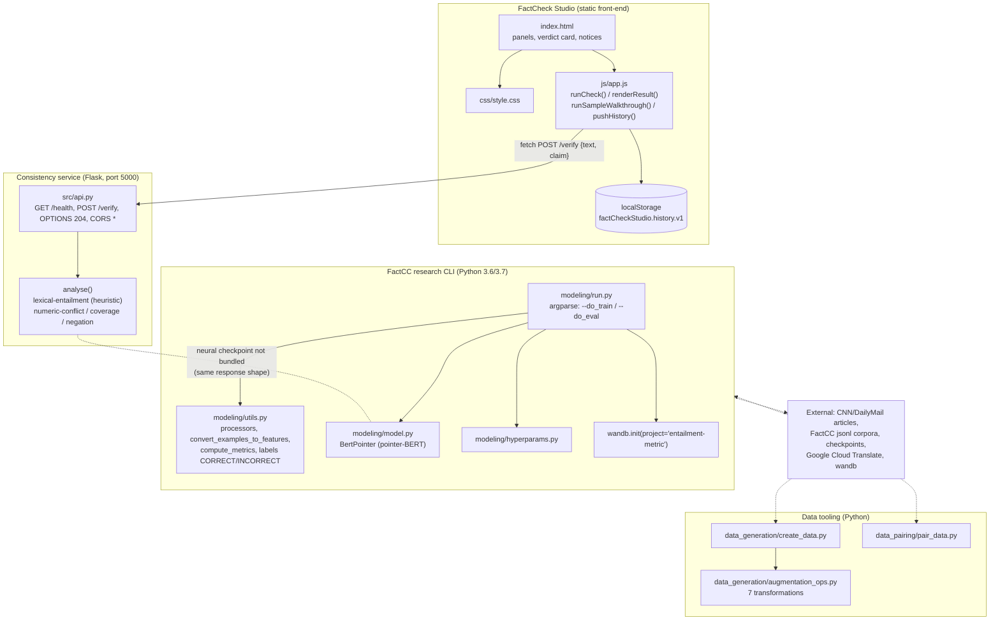

# FactCheck Studio: Factual Consistency and Summarization

## Overview and purpose

abstractive-text-summarizer FactCheck Studio FactCC — Salesforce Research (https://github.com/salesforce/factCC) Abstractive summarisation metrics (ROUGE, etc.) do not measure whether a generated summary is factually consistent with its source document. Provide a weakly-supervised model that (1) labels a summary sentence as factually consistent or not, (2) extracts the supporting span in the source, and (3) extracts the inconsistent span in the summary — plus an honest, static operator console that visualises the workflow without faking model output. NLP researchers re-running the FactCC experiments; engineers wrapping the model in a service; reviewers who need to see the workflow without a

## Real-world context and scope

Modern abstractive summarisers generate fluent text that may contradict its source. Traditional automatic metrics such as ROUGE compare surface overlap with reference summaries and say nothing about factual faithfulness. Manually annotating large corpora for factuality is prohibitively expensive, so datasets with human factuality labels are small and noisy.

The FactCC paper attacks this with **weak supervision**: instead of collecting human labels, it *manufactures* training data by applying rule-based transformations to source sentences (negation, entity swaps, date/number swaps, backtranslation, noise). The model then learns three related tasks jointly, and the auxiliary span-extraction tasks measurably help the main consistency classification.

On top of that research code base, this project adds a **static front-end** whose job is to make the workflow legible and — critically — to never pretend that a verdict exists when it does not.

---

The material describes the repository as supplied. **Implemented behavior** is summarized from the source overview and entry points; **proposed or missing functionality** is listed separately below. Do not infer production readiness from a polished interface or project title.

### Verified implementation notes

- **Consistency service** (`src/api.py`, Flask): `GET /health` and `POST /verify` implement a deterministic **lexical-entailment engine** (`analyse()` — numeric-conflict detection, token coverage, sentence Jaccard overlap, negation flip). Returns the FactCC label space (`CORRECT`/`INCORRECT`) plus supporting/inconsistent spans, and labels itself `model_checkpoint: false`.
- **Verdict card with four states** — empty, loading, backend-unavailable, result — switched by `showVerdictState()` in `js/app.js`.
- **Live check** (`runCheck()`): `fetch(API_BASE + "/verify")` renders the backend's real label, confidence and spans; a network error falls back to the backend-unavailable card with the start command.
- **Claim editor with up to 3 rows** (`MAX_CLAIMS = 3`), each with a text area, a focus selector and per-row span tools.
- **Three span categories**, colour-coded in the legend: *supporting span*, *inconsistent span*, and *user-marked span* (explicitly "your annotation, not a model output").
- **Sample walkthrough** (`DEMO` object + `runSampleWalkthrough()`): a hand-written source/claim pair, an `INCORRECT` label, an illustrative `0.91` confidence arc and offset-resolved span highlights — every render carries a "demo" banner.
- **Local check history**: `localStorage` key `factCheckStudio.history.v1`, capped at 100 entries, exportable as JSON, copyable, clearable.
- **API-contract & CLI reference panel** in the page footer: the real `jsonl` format, the real CLI invocation, and the `POST /verify` contract (now implemented by `src/api.py`).
- **Training / evaluation CLI** with 30+ argparse flags (see the README table), wandb logging, `--fp16`, multi-GPU friendly `local_rank` handling.
- **Seven claim augmentations** in `data_generation/augmentation_ops.py`: `SampleSentences`, `Backtranslation`, `PronounSwap`, `NERSwap` (+ `EntitySwap`, `NumberSwap`, `DateSwap`), `NegateSentences`, `AddNoise`.

### Future / not built

- A **neural** inference wrapper that loads a released FactCC/FactCCX checkpoint (the current service is the heuristic engine; loading the checkpoint needs the pinned 2020 stack).
- Loading a released checkpoint into the browser (WebGPU/WASM port of pointer-BERT) — not attempted.
- Automated evaluation reports inside the UI (metrics from `compute_metrics()` are not surfaced).
- Support for the `factcc_generated` task in the UI's task selector.

---

### Proposed, absent, or uncertain behavior

- A **neural** inference wrapper that loads a released FactCC/FactCCX checkpoint (the current service is the heuristic engine; loading the checkpoint needs the pinned 2020 stack).
- Loading a released checkpoint into the browser (WebGPU/WASM port of pointer-BERT) — not attempted.
- Automated evaluation reports inside the UI (metrics from `compute_metrics()` are not surfaced).
- Support for the `factcc_generated` task in the UI's task selector.

---

## Technology stack

- `pytorch_transformers==1.0.0`
- `scipy==1.3.0`
- `spacy==2.2.3`
- `torch==1.3.1`
- `numpy==1.17.4`
- `tqdm==4.32.1`
- `apex==0.9.10dev`
- `protobuf==3.11.2`
- `scikit_learn==0.22.1`
- `google-cloud-translate==1.6.0`

## System requirements and setup

Use a supported Python environment appropriate to the source dependency pins. Some projects also require data files, trained weights, external APIs, cameras, GPU resources, a database, or an LLM runtime. These are identified in `setup-guide.md`; they are not assumed to be included. Follow the source `WORKFLOW.md` carefully and do not paste real credentials into tracked files.

## Architecture and important components

Real components only — the front-end talks to the bundled service over HTTP; the neural CLI remains separate.

**Key architectural facts**

- The UI reaches a backend over HTTP: `js/app.js` calls `fetch(API_BASE + "/verify")` where `API_BASE = window.FACTCC_API_BASE || "http://127.0.0.1:5000"`. The service sends CORS `Access-Control-Allow-Origin: *`.
- `modeling/run.py` uses flat imports (`from model import BertPointer`, `from utils import ...`), so it must be executed in a way that puts `modeling/` on `sys.path` — running `python modeling/run.py` does this automatically because Python puts the script's directory first on the path.
- `data_generation/create_data.py` likewise does `import augmentation_ops as ops` and is intended to be run as a script from its own directory.

---

## Directory structure

Source paths central to the learning material:

- `PROJECT_OVERVIEW.md`
- `README.md`
- `WORKFLOW.md`
- `data_generation/__init__.py`
- `data_generation/augmentation_ops.py`
- `data_generation/create_data.py`
- `data_pairing/pair_data.py`
- `index.html`
- `js/app.js`
- `modeling/__init__.py`
- `modeling/model.py`
- `modeling/run.py`
- `modeling/utils.py`
- `project-metadata.json`
- `requirements.txt`
- `src/api.py`

## Installation, environment, and database

See [`setup-guide.md`](setup-guide.md) for repository-specific commands, environment variables, optional services, and data/model requirements. Database setup is only applicable when the source workflow documents a database.

## Testing

Use only tests and checks present in the source repository. This learning package has not run the source application or trained a model. Expected test behavior and missing coverage are described in the source workflow and lessons.

## Security, privacy, and responsible use

Treat credentials, uploaded data, biometric data, student/financial records, and generated outputs as sensitive where relevant. Apply data minimization, consent and access controls, retention limits, secure secret handling, documented error handling, and human review. For consequential decisions, model outputs are educational signals only. Project-specific hazards appear in the final project guide and source review report.

## Troubleshooting

Start with missing assets and dependency versions, then validate input shape/schema, check configured API/database/model services, inspect logs, and compare observed behavior with the exact source path described in `architecture.md`. Many repositories contain a static UI or stub that is not wired to the model.

## Expected outcome

Complete the final project to explain and reproduce the repository's actual data-to-output path, demonstrate a tested source-aligned extension, and document its limitations.

## Further learning

See `references.json` for official framework references and the source repository's `PROJECT_OVERVIEW.md`, `WORKFLOW.md`, and README for implementation details.
