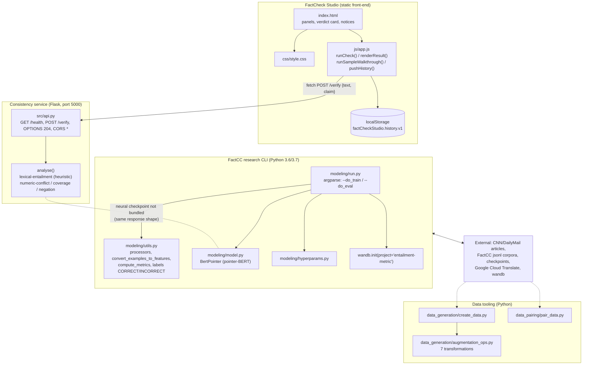
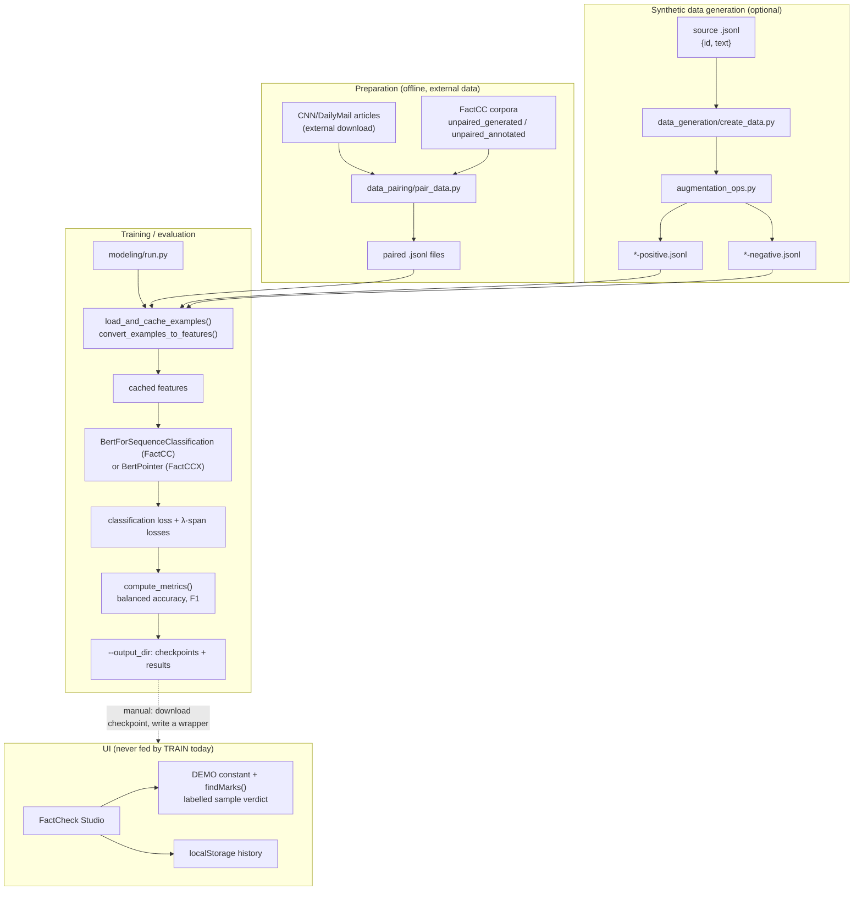

# Architecture — FactCheck Studio: Factual Consistency and Summarization

## Component map

Real components only — the front-end talks to the bundled service over HTTP; the neural CLI remains separate.

**Key architectural facts**

- The UI reaches a backend over HTTP: `js/app.js` calls `fetch(API_BASE + "/verify")` where `API_BASE = window.FACTCC_API_BASE || "http://127.0.0.1:5000"`. The service sends CORS `Access-Control-Allow-Origin: *`.
- `modeling/run.py` uses flat imports (`from model import BertPointer`, `from utils import ...`), so it must be executed in a way that puts `modeling/` on `sys.path` — running `python modeling/run.py` does this automatically because Python puts the script's directory first on the path.
- `data_generation/create_data.py` likewise does `import augmentation_ops as ops` and is intended to be run as a script from its own directory.

---

## Data and control flow

**The dashed edge is the only possible connection between the two halves** — a user would have to write a wrapper service, point it at the checkpoint, and add a `fetch()` call. Nothing in the repository does this.

---

## Algorithm/model details

### The three jointly-trained tasks

FactCC is trained on *synthetically corrupted* claim/source pairs. A transformation is applied to a claim extracted from the source document; whether the transformation preserves factuality defines the label:

| Transformation | Effect on factuality | Label |
|---|---|---|
| `SampleSentences` | claims taken verbatim from the source | positive |
| `Backtranslation` | paraphrase via Google Translate (de → en) — usually preserves facts | positive |
| `PronounSwap`, `EntitySwap`, `NumberSwap`, `DateSwap` | replaces one entity in the claim with a different one found in the source | negative |
| `NegateSentences` | inserts a negation | negative |
| `AddNoise` | injects character-level noise | negative |

### The models

- **FactCC** (`--model_type bert`) is a plain BERT sequence classifier with two labels (`CORRECT`, `INCORRECT`). It is the "does it stay consistent?" head.
- **FactCCX** (`--model_type pbert`) is the **pointer-BERT** variant implemented in `modeling/model.py` as `BertPointer`. Instead of a classification head only, it decodes **span pointers** into the source (supporting span) and into the claim (inconsistent span). The pointer formulation avoids the need for a separate span-extraction architecture and keeps everything end-to-end.

### The objective

The training loss combines the main consistency classification with the auxiliary span losses, weighted by `--loss_lambda` (default `0.1`). The auxiliary tasks regularise the shared BERT encoder: the model must keep the evidence in mind to point at it, which improves the main decision.

### Evaluation

`compute_metrics()` in `modeling/utils.py` returns balanced accuracy and F1 for the annotated task. `processors` maps task names to processors (`factcc_generated` → synthetic training data, `factcc_annotated` → the human-annotated validation/test split), each of which supplies `get_train_examples()`, `get_dev_examples()`, `get_labels()` and its own feature conversion.

### What the UI shows instead

The static desk renders a **hand-authored** verdict. It is not an inference path — the numbers in it (`INCORRECT`, `0.91`) are constants in the `DEMO` object of `js/app.js`. The span highlights are computed by matching literal substrings in the live text (`findMarks()`), not by a model.

---

## Source inventory

### Front-end (added layer)

| File | Key elements | Purpose |
|---|---|---|
| `index.html` | `#btn-run`, `#btn-sample`, `#verdict-backend`, `#verdict-result`, `#api-contract` | Page structure; the backend-unavailable notice; the real-data-format / live-contract reference panel |
| `js/app.js` | `DEMO`, `runCheck()`, `runSampleWalkthrough()`, `renderClaims()`, `addSelectionMark()`, `findMarks()`, `pushHistory()`, `downloadJSON()` | All client behaviour; `HISTORY_KEY = "factCheckStudio.history.v1"`; `MAX_CLAIMS = 3` |
| `css/style.css` | panel / stamp / arc / chip styles | Visual layer only, no logic |

### Research CLI (upstream Salesforce code)

| File | Key elements | Purpose |
|---|---|---|
| `modeling/run.py` | `main()`, `train()`, `evaluate()`, `load_and_cache_examples()`, `MODEL_CLASSES` / `MODEL_TYPES` | The single entry point. `wandb.init(project="entailment-metric")` at import; `processors` and `output_modes` imported from `utils` |
| `modeling/utils.py` | `processors`, `output_modes`, `convert_examples_to_features()`, `compute_metrics()` | Task registry, label space (`CORRECT`/`INCORRECT`), feature conversion, metrics |
| `modeling/model.py` | `BertPointer` | Pointer-BERT span extractor used by FactCCX |
| `modeling/hyperparams.py` | hyper-parameter defaults | Defaults for the BERT encoder |
| `modeling/scripts/factcc-*.sh`, `factccx-*.sh` | `*_PATH` variables to edit | Quickstart train / finetune / eval shell scripts |

### Data tooling (upstream)

| File | Key elements | Purpose |
|---|---|---|
| `data_generation/create_data.py` | `load_source_docs()`, `apply_transformation()`, `save_data()`, `main()` | Drives the augmentation pipeline over a `jsonl` source file |
| `data_generation/augmentation_ops.py` | `SampleSentences`, `NegateSentences`, `Backtranslation`, `PronounSwap`, `NERSwap`, `EntitySwap`, `NumberSwap`, `DateSwap`, `AddNoise` | The transformations themselves; `translate.Client()` for backtranslation; spaCy for NER |
| `data_pairing/pair_data.py` | `parse_story_file()`, `main()` | Re-joins FactCC examples with the CNN/DailyMail article texts |

### Configuration files

| File | Purpose |
|---|---|
| `requirements.txt` | Pinned 2019 stack (does **not** include `wandb`) |
| `LICENSE.txt` | BSD-3-Clause, Salesforce.com, Inc. |
| `project-metadata.json` | Provenance metadata (upstream URL, licence, declared entry point) |
| `.gitignore` | Ignores `__pycache__`, `**/wandb/`, `**/gen_data/` and similar local artefacts |

---

## Implemented versus proposed

Implemented behavior is limited to the source entry points and code paths described above.

- The shipped Flask endpoint is deterministic lexical consistency scoring; it does not load a neural checkpoint. The research model code is a separate, older stack and no trained checkpoint is bundled. WORKFLOW statements that contradict the API/UI implementation need review.
