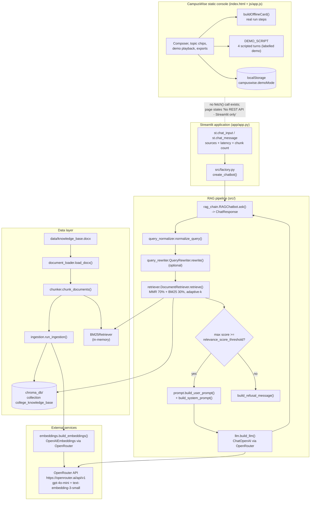

# CampusWise: College FAQ Retrieval-Augmented Generation

## Overview and purpose

college-faq-chatbot-rag CampusWise (static console) / "College FAQ Chatbot" (Streamlit app) College FAQ RAG Chatbot — https://github.com/aishwarya-nagothu/College-FAQ-RAG-Chatbot Prospective students and staff need accurate, sourced answers about the college. A static FAQ page goes stale; a generic LLM answers from its training data and invents details. Answer questions strictly from one authoritative .docx knowledge base, always cite the sections used, and refuse rather than speculate. Applicants, students and staff asking about admissions, faculty, departments, placements and facilities; developers extending the retrieval stack. A grounded natural-language answer plus the list of knowledge

## Real-world context and scope

College information is scattered: admission notices, faculty rosters, placement reports, hostel rules, timetables. New applicants ask the same questions every year, and human staff repeat them. Two naive fixes fail:

1. **A pure FAQ page** answers only the questions someone remembered to write down, and goes stale as soon as a policy changes.
2. **A general-purpose chatbot** answers from pretraining, producing plausible but institutionally wrong statements — wrong faculty counts, wrong packages, invented programmes.

The hard requirement is therefore **grounding**: an answer must be extractable from a single controlled document, must show its evidence, and must fail loudly (refuse) rather than fabricate when the document does not cover the question.

---

The material describes the repository as supplied. **Implemented behavior** is summarized from the source overview and entry points; **proposed or missing functionality** is listed separately below. Do not infer production readiness from a polished interface or project title.

### Verified implementation notes

- **Document-aware `.docx` loading** — `load_docx()` in `src/document_loader.py` walks paragraphs and tables in order, detects section headings from the style name *or* a `^\d+\.\s+.+` pattern, and converts tables to Markdown so they remain retrievable.
- **Metadata-rich chunking** — `chunk_documents()` in `src/chunker.py` uses `RecursiveCharacterTextSplitter` (500 chars / 100 overlap), prepends the section heading to every chunk and attaches `section`, `heading`, `chunk_id`, `filename`.
- **Hybrid retrieval with diagnostics** — `DocumentRetriever.retrieve()` prints a structured *RETRIEVAL DIAGNOSTICS* block (original query, rewritten query, chunk count, latency, per-chunk score/section/heading) for every call.
- **Relevance-gated answers** — `RAGChatbot.ask()` returns a `ChatResponse` dataclass with `answer`, `sources`, `refused`, `retrieval`, `normalized_query`, `rewritten_query`.
- **Post-hoc LLM refusal detection** — `RAGChatbot._is_refusal()` scans for eight refusal markers (`"couldn't find"`, `"not in the knowledge base"`, `"insufficient context"`, …) and converts the answer into the canonical refusal.
- **Persistent vector store** — `src/vector_store.py` provides `build_vector_store()`, `ingest_documents(reset=…)`, `load_vector_store()`, `collection_is_empty()`; the collection is `college_knowledge_base` inside `chroma_db/`.
- **Automatic bootstrap** — `create_chatbot()` in `src/factory.py` ingests automatically when the collection is empty and degrades gracefully (hybrid → semantic only) if the BM25 index cannot be built.
- **LLM + embedding factories that fail fast** — `build_llm()` and `build_embeddings()` raise `ValueError` with a copy-pasteable fix when the key is missing; the app additionally rejects the placeholder value.
- **RAGAS evaluation** — `src/evaluation/ragas_eval.py` scores faithfulness, answer relevancy, context precision and context recall over 8 ground-truth pairs and saves CSV + JSON + a Plotly dashboard.
- **Retrieval smoke test** — `scripts/evaluate_retrieval.py` runs 7 different phrasings of the establishment-year question with rewriting disabled and checks for keyword hits in the retrieved chunks.
- **CampusWise console** — topic chips, composer, demo playback with per-turn demo badges and demo retrieval panels, JSON/Markdown export, transcript persistence in `localStorage` (`campuswise.demoMode`).

### Future / not built

- A

[Excerpt shortened; consult the cited source guide for full detail.]

### Proposed, absent, or uncertain behavior

- A REST/FastAPI wrapper so other clients can query the assistant.
- Multi-document corpora with routing, or re-ranking by a cross-encoder.
- Conversation memory / follow-up resolution.
- Caching of embeddings and LLM answers per question.
- Automated evaluation on every change (CI hook).

---

## Technology stack

- `python-dotenv>=1.0.0`
- `python-docx>=1.1.0`
- `langchain>=0.3.0`
- `langchain-core>=0.3.0`
- `langchain-community>=0.3.0`
- `langchain-openai>=0.2.0`
- `langchain-chroma>=0.1.4`
- `langchain-text-splitters>=0.3.0`
- `chromadb>=0.5.0`
- `openai>=1.40.0`
- `rank_bm25>=0.2.2`
- `fastembed>=0.9.0`
- `streamlit>=1.38.0`
- `ragas>=0.2.0`

## System requirements and setup

Use a supported Python environment appropriate to the source dependency pins. Some projects also require data files, trained weights, external APIs, cameras, GPU resources, a database, or an LLM runtime. These are identified in `setup-guide.md`; they are not assumed to be included. Follow the source `WORKFLOW.md` carefully and do not paste real credentials into tracked files.

## Architecture and important components

Real components only. The Streamlit app and the static console are **separate surfaces** — the console never calls the pipeline.

**Architectural notes**

- The Streamlit app inserts the project root into `sys.path` at import time, so `from config.settings import …` and `from src.factory import …` resolve regardless of the working directory.
- `create_chatbot()` builds the BM25 index from freshly loaded chunks on every start-up (`all_

[Excerpt shortened; consult the cited source guide for full detail.]

## Directory structure

Source paths central to the learning material:

- `.streamlit/config.toml`
- `PROJECT_OVERVIEW.md`
- `README.md`
- `WORKFLOW.md`
- `app/__init__.py`
- `app/app.py`
- `config/__init__.py`
- `config/settings.py`
- `index.html`
- `js/app.js`
- `project-metadata.json`
- `requirements.txt`
- `run.py`
- `scripts/evaluate.py`
- `scripts/evaluate_retrieval.py`
- `scripts/ingest.py`
- `src/__init__.py`
- `src/chunker.py`
- `src/document_loader.py`
- `src/embeddings.py`
- `src/evaluation/__init__.py`
- `src/evaluation/ragas_eval.py`
- `src/factory.py`
- `src/ingestion.py`
- `src/llm.py`
- `src/prompt.py`
- `src/query_normalizer.py`
- `src/query_rewriter.py`
- `src/rag_chain.py`
- `src/retriever.py`
- `src/vector_store.py`

## Installation, environment, and database

See [`setup-guide.md`](setup-guide.md) for repository-specific commands, environment variables, optional services, and data/model requirements. Database setup is only applicable when the source workflow documents a database.

## Testing

Use only tests and checks present in the source repository. This learning package has not run the source application or trained a model. Expected test behavior and missing coverage are described in the source workflow and lessons.

## Security, privacy, and responsible use

Treat credentials, uploaded data, biometric data, student/financial records, and generated outputs as sensitive where relevant. Apply data minimization, consent and access controls, retention limits, secure secret handling, documented error handling, and human review. For consequential decisions, model outputs are educational signals only. Project-specific hazards appear in the final project guide and source review report.

## Troubleshooting

Start with missing assets and dependency versions, then validate input shape/schema, check configured API/database/model services, inspect logs, and compare observed behavior with the exact source path described in `architecture.md`. Many repositories contain a static UI or stub that is not wired to the model.

## Expected outcome

Complete the final project to explain and reproduce the repository's actual data-to-output path, demonstrate a tested source-aligned extension, and document its limitations.

## Further learning

See `references.json` for official framework references and the source repository's `PROJECT_OVERVIEW.md`, `WORKFLOW.md`, and README for implementation details.
