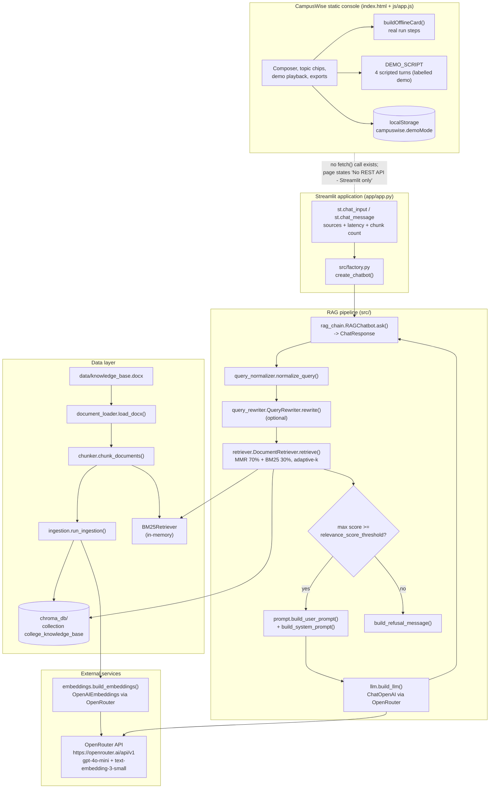
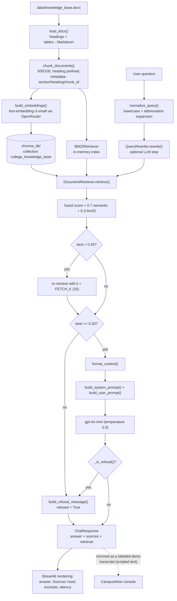

# Architecture — CampusWise: College FAQ Retrieval-Augmented Generation

## Component map

Real components only. The Streamlit app and the static console are **separate surfaces** — the console never calls the pipeline.



**Architectural notes**

- The Streamlit app inserts the project root into `sys.path` at import time, so `from config.settings import …` and `from src.factory import …` resolve regardless of the working directory.
- `create_chatbot()` builds the BM25 index from freshly loaded chunks on every start-up (`all_chunks` → `BM25Retriever.from_documents`). If that fails, it logs a warning and continues with semantic-only retrieval.
- MMR uses `max_marginal_relevance_search(query, k, fetch_k, lambda_mult)`; the numeric scores are recovered post-hoc via `similarity_search_with_relevance_scores()` and matched on the first 80 characters of the page content.

---

## Data and control flow



---

## Algorithm/model details

This project is **not** a trained-model project — it is a retrieval-augmented generation system. The "algorithms" are:

### 1. MMR (Maximal Marginal Relevance) semantic search

`self._vector_store.max_marginal_relevance_search(query, k=k, fetch_k=fetch_k, lambda_mult=lambda_mult)` selects chunks that are relevant *and* mutually diverse. With `lambda_mult = 0.5` the trade-off is balanced: `0` favours diversity, `1` favours relevance. `fetch_k = 20` candidates are pulled from ChromaDB before the diversity pass.

### 2. BM25 keyword retrieval with rank-derived scores

`BM25Retriever.from_documents(all_chunks, k=top_k)` is built over the in-memory chunk list. Because BM25 returns no numeric scores through this interface, the code converts **rank** into a synthetic score:

```
score = max(0.5, 0.75 - rank * (0.25 / n))
```

so the best keyword hit scores `0.75` and the last one `0.50`.

### 3. Weighted hybrid fusion

In `_hybrid_retrieve()` the two lists are merged on the first 120 characters of the page content:

```
final = 0.7 * semantic_score  +  0.3 * bm25_rank_score
```

Duplicates are combined rather than repeated, and the merged list is truncated to `k` and sorted descending.

### 4. Adaptive-k

If `max(scores) < adaptive_k_threshold` (0.45) and fewer than `fetch_k` chunks were returned, the search is repeated with `k = fetch_k`. This trades latency for recall on vague queries.

### 5. Relevance gate

`is_relevant = bool(scores) and max(scores) >= relevance_score_threshold` (0.20). Below that, the pipeline returns the refusal **without calling the LLM** — a cost and a hallucination-safety measure.

### 6. Grounded prompting

`build_system_prompt()` instructs the model to answer only from the provided excerpts, to use partial matches rather than refusing unnecessarily, to never use its own knowledge, and to quote the exact refusal sentence when nothing is found. `build_user_prompt()` injects the numbered context blocks and the original question.

### 7. LLM query rewriting (optional)

`QueryRewriter.rewrite()` uses a second, cheap LLM call with a search-optimizer system prompt to convert the normalised question into a retrieval-friendly form. The evaluation script `scripts/evaluate_retrieval.py` disables it (`settings.model_copy(update={'enable_query_rewriting': False})`) to measure raw retrieval quality.

### 8. Evaluation metrics (RAGAS)

`run_ragas_evaluation()` collects answers + contexts for the 8 ground-truth pairs and scores them with **faithfulness** (is the answer grounded in the retrieved context?), **answer relevancy** (does it address the question?), **context precision** (are the retrieved chunks relevant?) and **context recall** (were all the needed chunks retrieved?).

---

## Source inventory

### Entry points

| File | Key elements | Purpose |
|---|---|---|
| `app/app.py` | `load_chatbot()` (`@st.cache_resource`), `_render_sources_used()`, `_render_sources()`, `_render_answer_stats()`, `st.chat_input` block | The real chat UI; renders sources, scores, latency and chunk count |
| `run.py` | `main()` → `subprocess.run([sys.executable, "-m", "streamlit", "run", "app/app.py"])` | Convenience launcher |
| `scripts/ingest.py` | `main()` with `--reset` | CLI ingestion |
| `scripts/evaluate.py` | `main()` with `--output-dir` | CLI RAGAS evaluation |
| `scripts/evaluate_retrieval.py` | `TEST_QUERIES` (7 items), `_chunk_hits()`, `main()` | Retrieval smoke test with rewriting disabled |

### Configuration

| File | Key elements | Purpose |
|---|---|---|
| `config/settings.py` | `Settings(BaseSettings)`, `get_settings()`, `openrouter_headers` property | Every tunable, read from `.env` with BOM-safe encoding |
| `.env.example` | all supported variables | Template — copy to `.env` |
| `.streamlit/config.toml` | `fileWatcherType = "none"`, `gatherUsageStats = false` | Streamlit runtime config |

### Pipeline (`src/`)

| File | Key elements | Purpose |
|---|---|---|
| `src/factory.py` | `create_chatbot()` | Bootstrap: embeddings → vector store → conditional ingestion → BM25 chunks → retriever → optional rewriter → `RAGChatbot` |
| `src/rag_chain.py` | `RAGChatbot.ask()`, `RAGChatbot._is_refusal()`, `RAGChatbot._build_sources()`, `ChatResponse` | The orchestration layer; the single entry point for a question |
| `src/retriever.py` | `DocumentRetriever.retrieve()`, `_hybrid_retrieve()`, `_semantic_retrieve()`, `_bm25_retrieve()`, `format_context()`, `RetrievalResult`, `_log_retrieval()` | Hybrid retrieval, adaptive-k, diagnostics |
| `src/query_normalizer.py` | `ABBREVIATIONS` table, `normalize_query()`, `_expand_abbreviations()` | Lowercasing, punctuation stripping, abbreviation expansion |
| `src/query_rewriter.py` | `QueryRewriter.rewrite()`, `_SYSTEM_PROMPT` | Optional LLM query rewriting |
| `src/document_loader.py` | `load_docx()`, `_is_section_heading()`, `_table_to_markdown()`, `_iter_block_items()`, `SECTION_PATTERN` | `.docx` → LangChain Documents with `section` metadata |
| `src/chunker.py` | `chunk_documents()` | Recursive character splitting + metadata enrichment |
| `src/embeddings.py` | `build_embeddings()` | `OpenAIEmbeddings` on the OpenRouter base URL |
| `src/llm.py` | `build_llm()` | `ChatOpenAI`, `temperature=0.0`, `max_tokens=1024` |
| `src/prompt.py` | `build_system_prompt()`, `build_user_prompt()`, `build_refusal_message()` | Grounding instructions and the canonical refusal |
| `src/vector_store.py` | `build_vector_store()`, `ingest_documents()`, `load_vector_store()`, `collection_is_empty()` | ChromaDB helpers |
| `src/ingestion.py` | `run_ingestion()` | load → chunk → embed → store orchestration |
| `src/evaluation/ragas_eval.py` | `EVAL_QUESTIONS` (8 pairs), `_collect_responses()`, `run_ragas_evaluation()`, `save_evaluation_results()`, `build_dashboard()` | RAGAS metrics + artifacts |

### Static console

| File | Key elements | Purpose |
|---|---|---|
| `index.html` | tabs, chips, `#demo-toggle`, `#api-contract`-style reference panels, the "No REST API - Streamlit only" section | Page structure and honest disclosures |
| `js/app.js` | `DEMO_SCRIPT`, `buildOfflineCard()`, `buildScorePanel()`, `buildAssistantBubble()`, `startDemo()`, `setDemoMode()`, `exportJSON()`, `exportMarkdown()`, `LS_DEMO` | All client behaviour — **no `fetch()`** |
| `css/style.css` | layout, cards, badges, demo banner | Presentation only |

### Data

| File | Purpose |
|---|---|
| `data/knowledge_base.docx` | The institutional knowledge base (replace it with your own document) |

---

## Implemented versus proposed

Implemented behavior is limited to the source entry points and code paths described above.

- A local vector database and external LLM configuration are required; retrieved snippets can still be incomplete or wrong. The static console is not the Streamlit chat backend.
