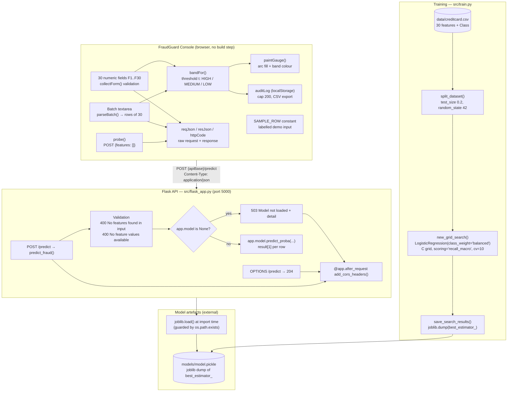

# FraudGuard: Credit Card Fraud Detection

## Overview and purpose

credit-card-fraud-detection FraudGuard Console fraud-detection — Cloud Academy (https://github.com/cloudacademy/fraud-detection) Card transactions are overwhelmingly legitimate (~0.17 % fraud), so an untrained or mis-tuned classifier either misses fraud or buries the team in false positives. The decision threshold is a business decision, not a modelling artefact. Serve a calibrated fraud probability per transaction over a small, well-specified HTTP API, and give an operator a console that scores single transactions and batches, bands the risk, and keeps an audit trail. Fraud analysts / SOC operators using the console; backend developers integrating /predict into a payment flow. POST /predict

## Real-world context and scope

Two hard facts shape this design.

**Imbalance.** In the classic credit-card transaction dataset, 284 807 transactions contain 492 frauds — 0.17 %. Accuracy is therefore meaningless: a model that always answers "legitimate" scores 99.83 %.

**Asymmetric cost.** Missing a fraud is far more expensive than investigating a false positive, so the model should be optimised for **recall**, and the *decision* of what score to act on should be separated from the model.

The upstream project already frames the task this way ("SMOTE vs class weights, precision-recall tradeoff and cost-aware thresholding"), and the shipped implementation follows the **class-weight** branch: `LogisticRegression(class_weight="balanced")` inside a `GridSearchCV` scored by **macro recall**, with the operational threshold living in the front-end.

---

The material describes the repository as supplied. **Implemented behavior** is summarized from the source overview and entry points; **proposed or missing functionality** is listed separately below. Do not infer production readiness from a polished interface or project title.

### Verified implementation notes

- **Single and batch scoring in one route** — `predict_fraud()` inspects `features[0]`: a list means a batch of rows, a number means one row.
- **Strict, documented validation** — two distinct 400 messages, so a client can tell "you forgot the key" from "you sent an empty list".
- **A structured 503 with remediation text** — `{"error": "Model not loaded", "detail": "models/model.pickle is missing. Train it first: place data/creditcard.csv then run python src/train.py"}`.
- **CORS for all responses** plus an `OPTIONS /predict` → 204 preflight, so a browser served from another origin can call the API.
- **Joblib with a legacy fallback** — `import joblib` first, `from sklearn.externals import joblib` second, so the file works on both 2017 and current scikit-learn.
- **Grid-search training** — `Pipeline([("clf", LogisticRegression(class_weight="balanced"))])` over `C ∈ {1e-4, 1e-2, 1, 1e2, 1e4}`, `scoring="recall_macro"`, `cv=10`, `n_jobs=-1`; the winner is pickled to `models/model.pickle`.
- **Deterministic split** — `test_size=0.2, random_state=42`.
- **Console reachability probe** — the API has no health route, so the console posts `{"features": []}` and treats *any* HTTP answer as "reachable" (only a network failure means offline).
- **Risk banding driven by a user threshold** — `bandFor()`: `score >= t` → HIGH, `score >= t/2` → MEDIUM, else LOW; the threshold is persisted in `localStorage` and the gauge fill colour follows the band.
- **Batch scoring with a sortable result table and CSV export** (`fraudguard-batch-YYYYMMDD-HHMMSS.csv`).
- **Audit log** — every single or batch attempt is recorded (time, mode, score, band, status, detail), capped at 200 entries, exportable as CSV, clearable behind a confirmation dialog.
- **Request/response inspector** — the console shows the exact JSON it sent, the raw body it received, the HTTP status and the latency, with a Copy button.
- **Endpoint contract tests** — `tests/test_flask.py` covers the empty body, the null-features body, the single-point and the multi-point cases.

### Future / not built

- Persisting the training metrics (macro recall, confusion matrix) to a file or a metrics endpoint.
- A `/health` or `/model-info` route (the console deliberately works around its absence).
- Model hot-reload after retraining.
- Authentication, rate limiting, structured server-side request logging.
- A cost-sensitive decisi

[Excerpt shortened; consult the cited source guide for full detail.]

### Proposed, absent, or uncertain behavior

- Persisting the training metrics (macro recall, confusion matrix) to a file or a metrics endpoint.
- A `/health` or `/model-info` route (the console deliberately works around its absence).
- Model hot-reload after retraining.
- Authentication, rate limiting, structured server-side request logging.
- A cost-sensitive decision layer server-side (the threshold currently lives only in the browser).
- Calibration reporting (reliability curve) for the returned probabilities.
- Support for more than the fixed 30-column feature vector (e.g. PCA-reduced inputs).

---

## Technology stack

- `python-dateutil==2.6.1`
- `numpy==1.13.1`
- `pandas==0.20.3`
- `scikit-learn==0.18.2`
- `scipy==0.19.1`
- `Flask==0.12.2`

## System requirements and setup

Use a supported Python environment appropriate to the source dependency pins. Some projects also require data files, trained weights, external APIs, cameras, GPU resources, a database, or an LLM runtime. These are identified in `setup-guide.md`; they are not assumed to be included. Follow the source `WORKFLOW.md` carefully and do not paste real credentials into tracked files.

## Architecture and important components

Real components only. Note that the **model file and the dataset are external** to the repository.

**Architectural notes**

- `src/flask_app.py` imports `from settings import MODEL_FILENAME` — a flat import, so the process must have `src/` on `sys.path`. Both documented launch commands satisfy that automatically.
- `src/settings.py` resolves `DATASET_FILENAME` and `MODEL_FILENAME` from `__file__`, so both are absolute and independent of the working directo

[Excerpt shortened; consult the cited source guide for full detail.]

## Directory structure

Source paths central to the learning material:

- `PROJECT_OVERVIEW.md`
- `README.md`
- `WORKFLOW.md`
- `index.html`
- `js/app.js`
- `project-metadata.json`
- `requirements.txt`
- `src/__init__.py`
- `src/flask_app.py`
- `src/settings.py`
- `src/train.py`
- `tests/test_flask.py`

## Installation, environment, and database

See [`setup-guide.md`](setup-guide.md) for repository-specific commands, environment variables, optional services, and data/model requirements. Database setup is only applicable when the source workflow documents a database.

## Testing

Use only tests and checks present in the source repository. This learning package has not run the source application or trained a model. Expected test behavior and missing coverage are described in the source workflow and lessons.

## Security, privacy, and responsible use

Treat credentials, uploaded data, biometric data, student/financial records, and generated outputs as sensitive where relevant. Apply data minimization, consent and access controls, retention limits, secure secret handling, documented error handling, and human review. For consequential decisions, model outputs are educational signals only. Project-specific hazards appear in the final project guide and source review report.

## Troubleshooting

Start with missing assets and dependency versions, then validate input shape/schema, check configured API/database/model services, inspect logs, and compare observed behavior with the exact source path described in `architecture.md`. Many repositories contain a static UI or stub that is not wired to the model.

## Expected outcome

Complete the final project to explain and reproduce the repository's actual data-to-output path, demonstrate a tested source-aligned extension, and document its limitations.

## Further learning

See `references.json` for official framework references and the source repository's `PROJECT_OVERVIEW.md`, `WORKFLOW.md`, and README for implementation details.
