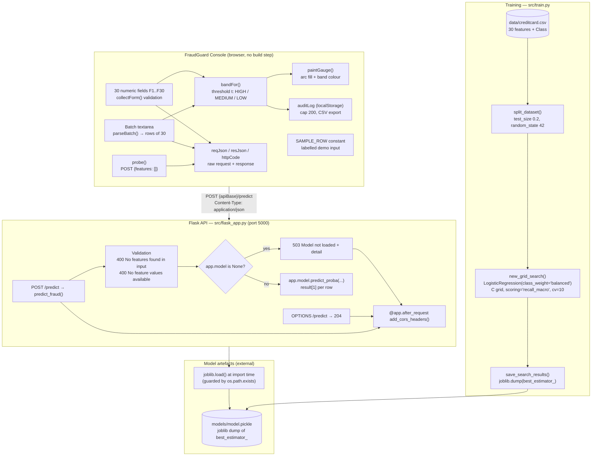
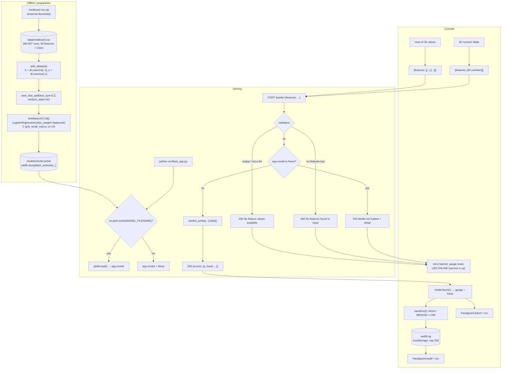

# Architecture — FraudGuard: Credit Card Fraud Detection

## Component map

Real components only. Note that the **model file and the dataset are external** to the repository.



**Architectural notes**

- `src/flask_app.py` imports `from settings import MODEL_FILENAME` — a flat import, so the process must have `src/` on `sys.path`. Both documented launch commands satisfy that automatically.
- `src/settings.py` resolves `DATASET_FILENAME` and `MODEL_FILENAME` from `__file__`, so both are absolute and independent of the working directory.
- The API is **stateless**; the only state is `app.model` in memory and the browser's `localStorage`.
- The console's default `apiBase` (`http://127.0.0.1:5000`) matches the API's `app.run(host="127.0.0.1", port=5000)`.

---

## Data and control flow



---

## Algorithm/model details

### The classifier

```python
Pipeline([("clf", LogisticRegression(class_weight="balanced"))])
```

Logistic regression is a linear model: it learns a weight vector `w` and a bias `b` such that `sigmoid(w·x + b)` approximates `P(fraud | x)`. On the 30 standardised transaction features this yields a well-behaved, monotonically increasing risk score, and its coefficients remain interpretable ("which features push a transaction towards fraud?").

`class_weight="balanced"` compensates for the 492/284 807 imbalance by giving each class an inverse-frequency weight during fitting. It is the **class-weight** branch of the upstream project's stated "SMOTE vs class weights" comparison; no resampling is performed.

### The model selection

```python
GridSearchCV(
    estimator=pipeline,
    param_grid={"clf__C": (1e-4, 1e-2, 1e0, 1e2, 1e4)},
    scoring="recall_macro",
    cv=10,
    n_jobs=-1,
)
```

- **Only `C` is tuned** — the regularisation strength. `C → ∞` means almost no regularisation; small `C` means strong L2 shrinkage. Five orders of magnitude are explored.
- **`recall_macro`** is the average of the per-class recalls. For a 0.17 %-positive problem, plain accuracy would be useless; macro recall weights the fraud class equally with the legitimate class, so the search cannot win by predicting "legitimate" everywhere.
- **10-fold cross-validation** inside `GridSearchCV` on the 80 % training split, then the best estimator is evaluated on the held-out 20 % test split (`random_state=42` keeps it reproducible).

### The response semantics

`predict_proba(X)` returns one row of probabilities per sample; the code keeps `result[1]` — the probability of class 1, i.e. fraud. For a single transaction the payload is wrapped in a one-element list so that both shapes go through the same `predict_proba` call.

**The probability is not the decision.** The service returns the raw probability; the console applies the operator's threshold:

```
score >= t      → HIGH
score >= t / 2  → MEDIUM
otherwise       → LOW
```

This is the "cost-aware thresholding" idea, implemented where the business context lives (the analyst's screen) rather than baked into the model.

### Why the macro-recall optimisation matters operationally

A recall-oriented model is intentionally biased towards raising alerts. The precision/recall trade-off is therefore a *threshold* decision, and the console exposes exactly that knob (`fraudguard.threshold`, default 0.50) with the band boundaries recomputed on every change (`updateThresholdUI()` → `refreshStoredBands()`), so past scores are re-banded live.

---

## Source inventory

### API

| File | Key elements | Purpose |
|---|---|---|
| `src/flask_app.py` | `app = Flask("Fraud Detection")`, `add_cors_headers()`, `predict_preflight()`, `predict_fraud()`, `app.model`, `__main__` runner | The whole HTTP surface: one scoring route, one preflight, CORS on every response |
| `src/flask_app.py.bak` | original 2017 file: `from sklearn.externals import joblib`, eager `joblib.load`, no CORS, no OPTIONS, no `__main__` | Preserved upstream original |
| `src/settings.py` | `PARENT_DIR_PATH`, `DATASET_FILENAME`, `MODEL_FILENAME` | Absolute dataset and model paths, resolved from `__file__` |
| `src/train.py` | `main()`, `split_dataset()`, `new_grid_search()`, `run_grid_search()`, `save_search_results()`, `logger` | Training pipeline; logs metrics at DEBUG level |
| `src/train.py.bak` | backup copy (currently byte-identical to `train.py`) | Preserved backup |
| `tests/test_flask.py` | `EndpointTest.test_empty_body`, `test_no_features`, `test_single_data_point`, `test_multiple_data_points` | Contract tests; 2 pass, 2 need a trained model |
| `requirements-modern.txt` | `flask>=2.3`, `scikit-learn>=1.3`, `pandas>=2.0`, `joblib>=1.3` | Installable dependency set for Python 3.10+ |
| `requirements.txt` | 2017 pins (`Flask==0.12.2`, `scikit-learn==0.18.2`, `numpy==1.13.1`, `pandas==0.20.3`, `scipy==0.19.1`) | Original, kept untouched |
| `requirements-dev.txt` | `nose==1.3.7` + `-r requirements.txt` | Original test tooling (nose is unusable on Python 3.12) |
| `data/.gitignore`, `models/.gitignore` | `*` + `!.gitignore` | Why the dataset and the model are not in the repository |

### Console

| File | Key elements | Purpose |
|---|---|---|
| `index.html` | `#apiBase`, `#probeBtn`, `#threshold`, `#txForm` (fields `f1`…`f30`), `#pasteRow`, `#sampleBtn`, `#scoreBtn`, `#gaugeFill`, `#bandChip`, `#reqJson` / `#resJson` / `#httpCode`, `#batchInput` / `#batchBody`, `#auditBody`, `#exportCsv`, `#exportLog`, `#setupPanel` | Page structure, the 30-field form, the setup panel, the JSON inspector, the batch and audit tabs |
| `js/app.js` | `FEATURES = 30`, `SAMPLE_ROW`, `LS_API` / `LS_TH` / `LS_LOG`, `LOG_CAP = 200`, `REQ_TIMEOUT = 20000`, `PROBE_TIMEOUT = 8000`, `probe()`, `collectForm()`, `submitSingle()`, `parseBatch()`, `scoreBatch()`, `bandFor()`, `updateThresholdUI()`, `addLog()`, `exportBatchCsv()`, `exportAuditCsv()` | All client behaviour: validation, requests, rendering, persistence, exports |
| `css/style.css` | LED states, gauge, band chips, data tables | Presentation only |

---

## Implemented versus proposed

Implemented behavior is limited to the source entry points and code paths described above.

- A real score depends on a separately supplied model/data artifact; class imbalance means accuracy alone is misleading. Validate privacy and threshold choices before real decisions.
