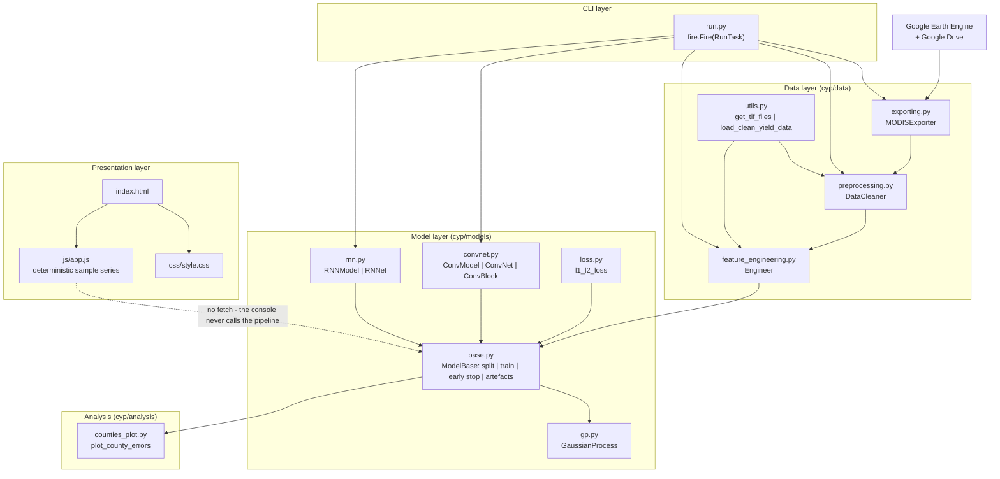

# YieldSight: County-Level Crop Yield Prediction

## Overview and purpose

crop-yield-prediction <https://github.com/gabrieltseng/pycrop-yield-prediction> — a PyTorch port of JiaxuanYou/cropyieldprediction Deep Gaussian Process for Crop Yield Prediction Based on Remote Sensing Data — AAAI 2017 — <https://cs.stanford.edu/~ermon/papers/cropyieldAAAI17.pdf> Python Fire CLI (run.py) + a static HTML/CSS/JavaScript console (index.html) Predict county-level US soybean yield (bushels per acre) from MODIS satellite imagery for 2009–2015 1-D CNN over 9-band histograms or an LSTM over the same histograms, optionally topped with a deep Gaussian process run.py — Python Fire commands export, process, engineer, traincnn, trainrnn index.html + css/style.css + js/app.js — static, n

## Real-world context and scope

Agricultural planners and insurers need **yield estimates before the harvest**, at county resolution, for tens of thousands of counties — without sending anyone out to collect ground samples. Manual sampling is accurate but slow, expensive and geographically sparse.

Satellite remote sensing offers coverage of every field, but raw imagery is far too large and noisy to model directly: a decade of 8-day composites for the United States is hundreds of gigabytes, and each pixel's reflectance is dominated by weather, soil and sensor noise rather than by the crop's final productivity.

The specific problem this code solves is therefore a **scale-and-signal** problem:

1. **Scale** — reduce ~110 GB of MODIS composites to a tensor a GPU can train on.
2. **Signal** — compress each county-year into a representation that still predicts yield.
3. **Uncertainty** — yield estimates are used for insurance and policy decisions, so a point prediction is not enough; the system must also express confidence.

---

The material describes the repository as supplied. **Implemented behavior** is summarized from the source overview and entry points; **proposed or missing functionality** is listed separately below. Do not infer production readiness from a polished interface or project title.

### Verified implementation notes

Read PROJECT_OVERVIEW.md in the source repository for the implementation inventory.

### Proposed, absent, or uncertain behavior

- The workflow needs Earth Engine exports and large raster data not included in the package. Optional error-map dependencies are missing from the declared environment; results require spatially honest evaluation.

## Technology stack

- `See source project dependency manifest and setup guide`

## System requirements and setup

Use a supported Python environment appropriate to the source dependency pins. Some projects also require data files, trained weights, external APIs, cameras, GPU resources, a database, or an LLM runtime. These are identified in `setup-guide.md`; they are not assumed to be included. Follow the source `WORKFLOW.md` carefully and do not paste real credentials into tracked files.

## Architecture and important components

### Layers

| Layer | Module | Responsibility |
|---|---|---|
| CLI | `run.py` | Fire dispatch to the five tasks; owns all path and hyper-parameter defaults |
| Data acquisition | `cyp/data/exporting.py` | Earth Engine collections → Drive export tasks |
| Data preparation | `cyp/data/preprocessing.py`, `cyp/data/utils.py` | `.tif` → masked, temperature-merged per-year `.npy`; file discovery and yield loading |
| Feature extraction | `cyp/data/feature_engineering.py` | `.npy` → 9-band histograms → `.npz` |
| Model | `cyp/models/convnet.py`, `cyp/models/rnn.py` | The two deep architectures |
| Shared training logic | `cyp/models/base.py` | `ModelBase`: split, train loop, early stopping, GP hook-up, artefact writing |
| Uncertainty | `cyp/models/gp.py` | `GaussianProcess.run()` — the deep GP |
| Objective | `cyp/models/loss.py` | `l1_l2_loss()` |
| Analysis | `cyp/analysis/counties_plot.py` | County error maps from a checkpoint |
| Presentation | `index.html`, `css/style.css`, `js/app.js` | YieldSight console (static) |

### Control flow of a training run

`RunTask.train_cnn()` → `ConvModel(...)` (inherits `ModelBase`) → `ModelBase.run(path_to_histogram, times, pred_years, num_runs, ...)`:

1. Load `histogra

[Excerpt shortened; consult the cited source guide for full detail.]

## Directory structure

Source paths central to the learning material:

- `PROJECT_OVERVIEW.md`
- `README.md`
- `WORKFLOW.md`
- `cyp/__init__.py`
- `cyp/analysis/__init__.py`
- `cyp/analysis/counties_plot.py`
- `environment.yml`
- `index.html`
- `js/app.js`
- `project-metadata.json`
- `run.py`

## Installation, environment, and database

See [`setup-guide.md`](setup-guide.md) for repository-specific commands, environment variables, optional services, and data/model requirements. Database setup is only applicable when the source workflow documents a database.

## Testing

Use only tests and checks present in the source repository. This learning package has not run the source application or trained a model. Expected test behavior and missing coverage are described in the source workflow and lessons.

## Security, privacy, and responsible use

Treat credentials, uploaded data, biometric data, student/financial records, and generated outputs as sensitive where relevant. Apply data minimization, consent and access controls, retention limits, secure secret handling, documented error handling, and human review. For consequential decisions, model outputs are educational signals only. Project-specific hazards appear in the final project guide and source review report.

## Troubleshooting

Start with missing assets and dependency versions, then validate input shape/schema, check configured API/database/model services, inspect logs, and compare observed behavior with the exact source path described in `architecture.md`. Many repositories contain a static UI or stub that is not wired to the model.

## Expected outcome

Complete the final project to explain and reproduce the repository's actual data-to-output path, demonstrate a tested source-aligned extension, and document its limitations.

## Further learning

See `references.json` for official framework references and the source repository's `PROJECT_OVERVIEW.md`, `WORKFLOW.md`, and README for implementation details.
