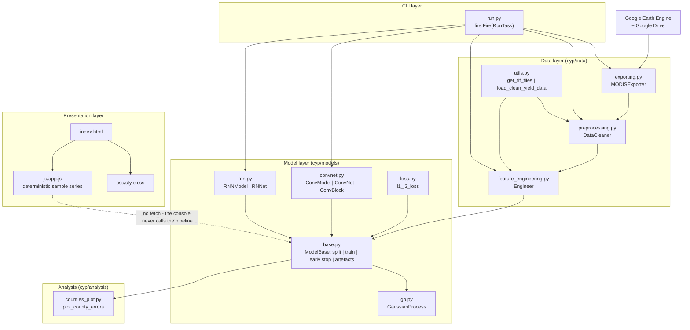
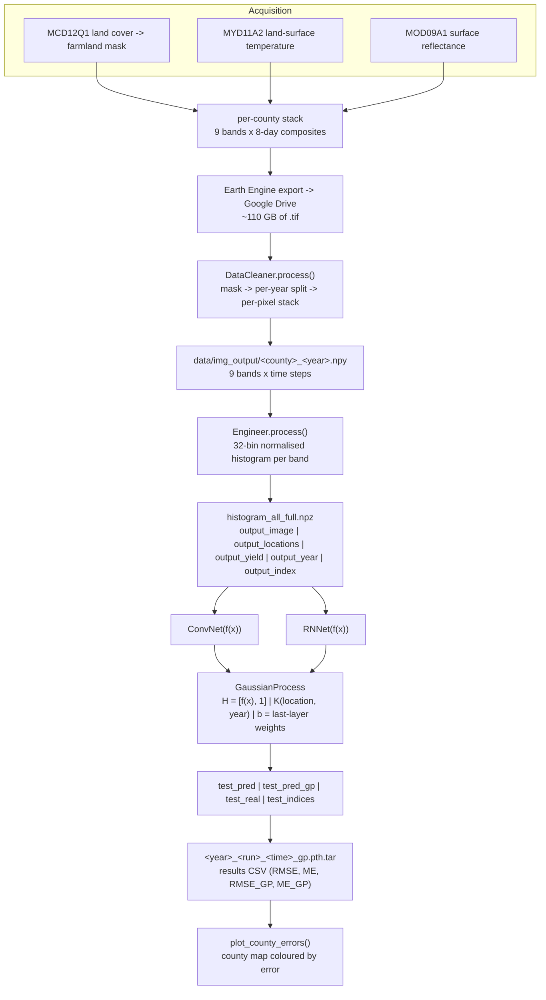
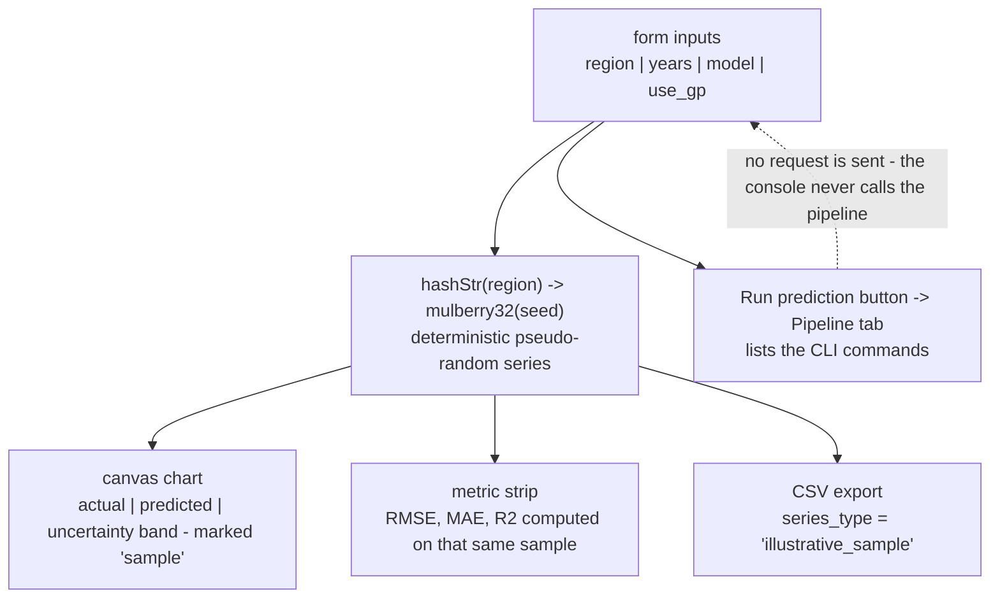

# Architecture — YieldSight: County-Level Crop Yield Prediction

## Component map

### Layers

| Layer | Module | Responsibility |
|---|---|---|
| CLI | `run.py` | Fire dispatch to the five tasks; owns all path and hyper-parameter defaults |
| Data acquisition | `cyp/data/exporting.py` | Earth Engine collections → Drive export tasks |
| Data preparation | `cyp/data/preprocessing.py`, `cyp/data/utils.py` | `.tif` → masked, temperature-merged per-year `.npy`; file discovery and yield loading |
| Feature extraction | `cyp/data/feature_engineering.py` | `.npy` → 9-band histograms → `.npz` |
| Model | `cyp/models/convnet.py`, `cyp/models/rnn.py` | The two deep architectures |
| Shared training logic | `cyp/models/base.py` | `ModelBase`: split, train loop, early stopping, GP hook-up, artefact writing |
| Uncertainty | `cyp/models/gp.py` | `GaussianProcess.run()` — the deep GP |
| Objective | `cyp/models/loss.py` | `l1_l2_loss()` |
| Analysis | `cyp/analysis/counties_plot.py` | County error maps from a checkpoint |
| Presentation | `index.html`, `css/style.css`, `js/app.js` | YieldSight console (static) |

### Control flow of a training run

`RunTask.train_cnn()` → `ConvModel(...)` (inherits `ModelBase`) → `ModelBase.run(path_to_histogram, times, pred_years, num_runs, ...)`:

1. Load `histogram_all_full.npz` → `output_image`, `output_locations`, `output_yield`, `output_year`, `output_index`.
2. For each target year in `pred_years` and each run in `num_runs`:
   a. Split: samples with `year < target` are training, the target year is the test set, 10 % of the training set is held out for validation.
   b. Time-index selection: `times="all"` → `[32]` (the full season); `times="realtime"` → `range(10, 31, 4)` (forecasting with only early-season data).
   c. `_train()` — SGD with the decayed learning rate, `l1_l2_loss`, early stopping on validation loss, best-state restore.
   d. `_predict()` on the test year → `test_pred`, `test_real`, `test_indices`, `train_feat`/`test_feat`, `train_loc`/`test_loc`, `train_years`/`test_years`.
   e. If `use_gp`: `GaussianProcess.run(...)` using the network's last dense layer's weights and bias as the GP's `b` vector → `test_pred_gp`.
   f. `torch.save(model_information, data/models/cnn/<year>_<run>_<time>_gp.pth.tar)` and append the row to the results CSV.

### Why the GP is "deep"

The network is not merely a feature extractor whose output is thrown away. `ModelBase` reads the **last dense layer's weight matrix and bias** out of the `state_dict` and passes them to the GP as `b`, the prior mean's weight vector. The GP therefore inherits the network's learned representation as its prior, and the network's outputs are *posterior-corrected* rather than merely replaced. The network is still trained end-to-end with MSE; the GP then refines the prediction using the spatial and temporal correlation structure of the training set.

---

## Data and control flow

### The real (pipeline) flow

### The console's flow (deliberately different)

There is **no arrow from the console to the pipeline**. The console's "Run prediction" button validates the region field and then switches to the Pipeline tab, which lists the CLI commands instead of running them.

---

## Algorithm/model details

### The nine MODIS bands

The exporter builds each county-year's stack from three MODIS products (`data/README.md`):

| Product | Role | Contribution |
|---|---|---|
| **MOD09A1** surface reflectance | red, NIR, blue reflectance at 1 km, 8-day | 7 of the 9 bands |
| **MYD11A2** land-surface temperature | day/night temperature at 1 km, 8-day | 2 of the 9 bands |
| **MCD12Q1** land cover | the IGBP classification | not a band — used as the **farmland mask** |

After the reflectance bands are shifted into the 0–10 000 space that the temperature bands occupy, the network's `in_channels` is **9** (7 reflectance + 2 temperature).

### From pixels to a histogram

`Engineer.process()` keeps the growing-season window (days 49–305), then for each county-year computes, for each of the 9 bands, a **32-bin histogram** of the pixel values, with `max_bin_val=4999` and the counts normalised to sum to 1. Channels-first output: `[batch, bands, times, bins]`. This is what makes the CNN's 1-D convolution over the **time** axis meaningful and the LSTM's input size `9 * 32 = 288`.

### The CNN

`ConvNet` treats the histogram as a small image: 9 channels, one "row" per band, `time` steps along the season, 32 bins along the width. Convolutions run over the **time** axis with `kernel_size=3` and `same` padding, alternating stride 1 and 2 (7 blocks, 512 channels at the end), with dropout 0.5. The flattened vector feeds a dense stack of 2048 → 1 units. The **second-to-last** dense layer's activations are the feature vector `f(x)` that the GP consumes.

### The LSTM

`RNNet` treats the histogram as a sequence: each time step contributes a 288-dimensional vector (`channels * bins`) and the 32 time steps are fed to a **single-layer LSTM** with hidden size 128 and dropout 0.75, followed by dense 256 → 1. It is the "sequence-first" alternative to the CNN, and in the paper it is the stronger of the two before the GP is added.

### The deep Gaussian process

`GaussianProcess.run()` implements a GP on top of the network:

- **Kernel** — a product of two squared-exponential kernels: one over county **locations** (`r_loc=0.5`) and one over **years** (`r_year=1.5`), scaled by `sigma²` and added to a noise term `sigma_e² I` on the training block only.
- **Mean function** — a Bayesian linear model over the network's basis functions `H = [f(x), 1]`, with a diagonal prior precision `B = sigma_b I`; the network's own last-layer weight and bias form the prior mean's vector `b`.
- **Normalisation** — locations and years are min–max normalised over the combined train+test set before the kernel is evaluated.
- **Posterior** — `beta = (B⁻¹ + HᵀK⁻¹H)⁻¹ (HᵀK⁻¹Y + B⁻¹b)` (Rasmussen 2006, eq. 2.41); the prediction is `H*·beta + K*·K⁻¹(Y − H·beta)`.

The result is a prediction that borrows strength across space and time — a county with an unusual year is pulled towards its neighbours' behaviour — and a posterior that yields a meaningful uncertainty band.

### Training details

| Aspect | Setting |
|---|---|
| Loss | `F.mse_loss` + `l1_weight * F.l1_loss` (both logged) |
| Optimiser | SGD (momentum 0.9) with weight decay, learning rate 1e-3 divided by 10 after 2 000 and 4 000 steps |
| Split | Training years vs. the target year; 10 % of the training set as validation |
| Early stopping | Patience 10 validation checks; best `state_dict` restored before testing |
| Repetitions | `num_runs=2` per target year |
| Metrics | RMSE and mean error (ME) per year, run and time index; the GP columns are added when `use_gp=True` |

### Published results (upstream README, not reproduced here)

| Model | 2009 | 2010 | 2011 | 2012 | 2013 | 2014 | 2015 |
|---|---|---|---|---|---|---|---|
| LSTM | 3.88 | 3.75 | 4.14 | 4.33 | 3.98 | 4.09 | 3.61 |
| LSTM + GP | 3.68 | 3.54 | 3.85 | 4.13 | 3.68 | 3.81 | 3.35 |
| CNN | 4.36 | 4.19 | 4.16 | 4.22 | 3.87 | 4.31 | 3.75 |
| CNN + GP | 4.21 | 3.98 | 4.04 | 4.04 | 3.73 | 4.02 | 3.53 |

*(RMSE in bushels per acre, as reported by the upstream authors.)*

---

## Source inventory

### Root

| File | Lines / role | Key symbols |
|---|---|---|
| `run.py` | The only executable entry point | `RunTask.export()`, `RunTask.process()`, `RunTask.engineer()`, `RunTask.train_cnn()`, `RunTask.train_rnn()`; `if __name__ == "__main__": fire.Fire(RunTask)` |
| `environment.yml` | Conda environment `crop_yield_prediction` | `pytorch=1.0.0`, `gdal`, `earthengine-api`, `fire`, `numpy`, `pandas`, `scipy`, `matplotlib`, `tqdm` |
| `index.html` | YieldSight console markup | header chips, control panel, canvas chart, metric strip, Pipeline tab, Method tab, results table |
| `js/app.js` | All front-end behaviour | `hashStr()`, `mulberry32()`, `computeSeries()`, `computeMetrics()`, `computePlot()`, `drawChart()`, `exportCSV()`, `switchTab()`, `updateCommands()`, copy-to-clipboard |
| `css/style.css` | Presentation only | layout, cards, chart container, tab styling |
| `LICENSE` | MIT, Copyright © 2019 Gabriel Tseng | — |
| `README.md` | Upstream README: paper, results table, setup | — |

### `cyp/`

| File | Role | Key symbols |
|---|---|---|
| `cyp/__init__.py` | Package exports and state list | `MODISExporter`, `DataCleaner`, `Engineer`, `ConvModel`, `RNNModel`, `MAJOR_STATES` (11 states) |
| `cyp/data/exporting.py` | Earth Engine export | `MODISExporter.export_all()`, `MODISExporter.export_county()`, `check_if_done` |
| `cyp/data/preprocessing.py` | `.tif` → per-year `.npy` | `DataCleaner.process()`, `multiprocessing.Pool`/`ProcessPoolExecutor` workers |
| `cyp/data/feature_engineering.py` | `.npy` → histograms | `Engineer.process()`, `output_image`/`output_locations`/`output_yield`/`output_year`/`output_index` |
| `cyp/data/utils.py` | Shared helpers | `get_tif_files()`, `load_clean_yield_data()` |
| `cyp/models/base.py` | The engine room | `ModelBase.__init__`, `ModelBase.run()`, `ModelBase._train()`, `ModelBase._predict()`, `ModelBase.analyze_results()` |
| `cyp/models/convnet.py` | CNN architecture | `ConvModel`, `ConvNet`, `ConvBlock`, `Conv2dSamePadding` |
| `cyp/models/rnn.py` | LSTM architecture | `RNNModel`, `RNNet` |
| `cyp/models/gp.py` | Deep GP | `GaussianProcess.__init__()`, `GaussianProcess.run()`, `GaussianProcess._normalize()` |
| `cyp/models/loss.py` | Objective | `l1_l2_loss()` |
| `cyp/analysis/counties_plot.py` | Error maps | `plot_county_errors()` (parses `data/counties.svg` with BeautifulSoup) |

### `data/`

| File | Status | Purpose |
|---|---|---|
| `data/yield_data.csv` | **Present** (4 274 567 B) | USDA soybean yield per county-year, in bushels per acre |
| `data/county_data.csv` | **Present** (3 178 767 B) | County lat/long and area from the US 2010 Census fusion table |
| `data/counties.svg` | **Present** (1 995 563 B) | Base map for the error plots |
| `data/README.md` | **Present** | Provenance of all three, plus the MODIS product descriptions |
| `data/crop_yield-data_{image,mask,temperature}/` | **Missing** | Earth Engine exports (≈ 110 GB) |
| `data/img_output/` | **Missing** | Processed `.npy` arrays (≈ 97 GB) and `histogram_all_full.npz` |
| `data/models/` | **Missing** | Checkpoints and results CSVs from a training run |

---

## Implemented versus proposed

Implemented behavior is limited to the source entry points and code paths described above.

- The workflow needs Earth Engine exports and large raster data not included in the package. Optional error-map dependencies are missing from the declared environment; results require spatially honest evaluation.
