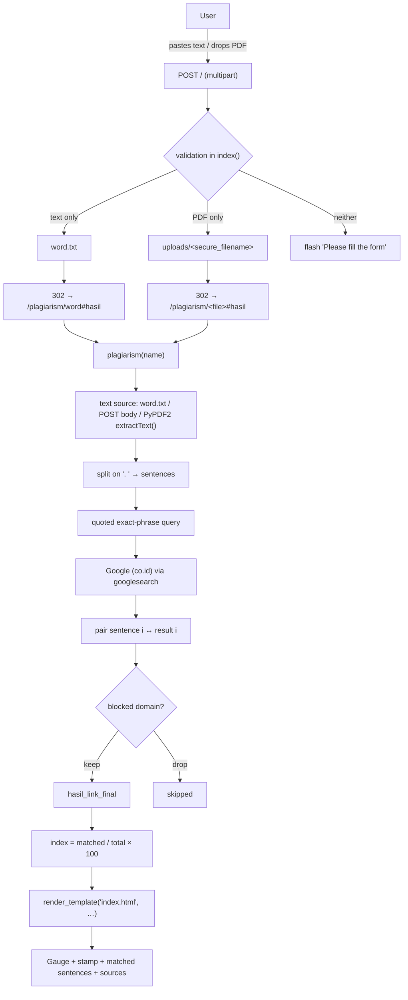
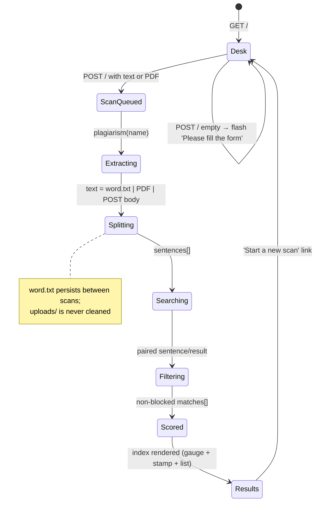

# Architecture — Similarity Radar: Document Similarity Checking

## Component map

Four real components, one of which is an external service:

```
┌───────────────────────────────────────────────────────────────────────────┐
│  Browser                                                                  │
│  templates/index.html (Jinja)  +  static/js/app.js  +  static/css/style.css │
│  ├─ input desk: text tab / PDF tab, counters, dropzone                    │
│  ├─ scanning overlay                                                    │
│  └─ results: gauge, stamp, matched sentences, sources, explainer          │
└───────────────▲───────────────────────────────────────┬───────────────────┘
                │ 302 → /plagiarism/<name>#hasil          │ form POST
                │ (multipart/form-data: text, file)      │ GET /  → 200 HTML
┌───────────────┴───────────────────────────────────────▼───────────────────┐
│  Flask app (app.py)  — binds 0.0.0.0:5000, debug off                      │
│  ├─ index()          : POST validation, word.txt / uploads/ persistence   │
│  ├─ plagiarism(name) : PyPDF2 extraction, sentence split, scoring        │
│  ├─ render_template  : one HTML template for desk and results             │
│  └─ flash()          : session cookie messages (SECRET_KEY = 'super …')    │
└───────────────▲───────────────────────────────────────┬───────────────────┘
                │ search(query, tld='co.id', num=10, stop=10, pause=2)      │
                │ (2 calls per sentence, ~4 s each)                           │
┌───────────────┴───────────────────────────────────────▼───────────────────┐
│  Google search results page  ── external service, no API key              │
│  scraped by the `googlesearch` package (google==3.0.0) + BeautifulSoup    │
│  cookie jar: $HOME/.google-cookie → $USERHOME/.google-cookie → ./.google-cookie │
└───────────────────────────────────────────────────────────────────────────┘

Files touched on disk:  word.txt (last pasted text)   uploads/<file>.pdf (last uploads)
```

There is **no database** and **no background worker** — a scan is a blocking HTTP request
whose duration is dominated by the Google round-trips.

```mermaid
flowchart TD
    subgraph Browser["Browser (no framework)"]
        A1[Index page: input desk] --> A2{Tab: text or PDF?}
        A2 -->|text| A3[textarea + live counters]
        A2 -->|PDF| A4[dropzone: extension + 16 MB check]
        A3 --> A5[POST / multipart/form-data]
        A4 --> A5
        A5 --> A6[Scanning overlay shown]
    end

    subgraph Flask["Flask app.py on 0.0.0.0:5000"]
        B1[POST /] --> B2{text filled AND no file?}
        B2 -->|yes| B3[write word.txt]
        B2 -->|no: file present| B4{allowed_file == .pdf?}
        B4 -->|yes| B5[save uploads/secure_filename]
        B4 -->|no| B6[re-render desk, no message]
        B2 -->|neither| B7[flash 'Please fill the form' + redirect]
        B3 --> B8[302 -> /plagiarism/word#hasil]
        B5 --> B9[302 -> /plagiarism/#hasil]
    end

    subgraph Scoring["plagiarism(name)"]
        C1{input source} -->|word| C2[read word.txt or POST text]
        C1 -->|filename| C3[PyPDF2: extractText per page]
        C2 --> C4["split on '. '"]
        C3 --> C4
        C4 --> C5["query = '\"' + sentence + '\"'"]
        C5 --> C6["search(tld=co.id, num=10, stop=10, pause=2)"]
        C6 --> C7["pair sentence i with result i"]
        C7 --> C8{URL contains blocked domain?}
        C8 -->|no| C9[keep match]
        C8 -->|yes| C10[drop match]
        C9 --> C11["index = matched / total * 100"]
        C10 --> C11
    end

    subgraph Results["Results page"]
        D1[Gauge + status stamp] --> D2[Matched sentences with source links]
        D2 --> D3[Method explainer]
    end

    A6 --> B1
    B8 --> C1
    B9 --> C1
    C11 --> D1
```

---

## Data and control flow

### 9.1 Request → response



### 9.2 What crosses the process boundary

| Boundary | Payload | Format |
|---|---|---|
| Browser → Flask | text + optional PDF | `multipart/form-data` |
| Flask → filesystem | `word.txt`, `uploads/<file>` | plain text / binary PDF |
| Flask → Google | quoted sentence | query string `q="…"` on `www.google.co.id/search` |
| Google → Flask | results HTML | parsed by BeautifulSoup into `(title, url)` |
| Flask → Browser | rendered HTML | one Jinja template, `302` for the initial POST, `200` for the results page |

### 9.3 Where the state lives



---

## Algorithm/model details

> **There is no machine learning in this project.** No model is trained, no weights are
> loaded, no corpus is embedded. `project-metadata.json` lists "TF-IDF" and an "N-gram /
> fingerprint similarity across a local corpus" goal, but **no TF-IDF code and no local
> corpus exist in the repository**. What follows is the actual algorithm.

### 7.1 Stage 1 — Sentence segmentation

```python
inputan += inputan_mentah.replace("\n", " ").split(". ")
```

Newlines become spaces, then the text is split on the literal `". "`. This is a *delimiter
rule*, not a parser: `"Dr. Smith went home. He slept."` → `["Dr. Smith went home", "He slept"]`
(the abbreviation is treated as a sentence break), and a trailing `". "` produces an empty
final segment that still counts toward the denominator.

### 7.2 Stage 2 — Exact-phrase query construction

```python
query = '"' + inputan[i].strip().replace(".", "").replace('"', "'") + '"'
```

The sentence is wrapped in double quotes (Google's exact-phrase operator). Interior
periods are removed so the phrase does not break on abbreviations, and interior double
quotes are downgraded to apostrophes so the outer pair remains balanced. The result is a
literal quoted string — the search is for **those words in that order**.

### 7.3 Stage 3 — Live search

```python
search(query, tld=domain, num=10, stop=10, pause=2)   # domain = "co.id"
```

The `googlesearch` package builds a Google results URL
(`https://www.google.co.id/search?…&num=10&start=0…`), sends it with a browser user-agent
string, parses the HTML with BeautifulSoup and yields `(title, url)` pairs. `pause=2`
sleeps two seconds between queries. The `co.id` TLD is a region choice, not a
correctness one — it is what the upstream author used for Indonesian users.

### 7.4 Stage 4 — The pairing rule (important)

```python
for j in range(len(list(search(...)))):
    if i != j:
        continue
    hasil_plagiarism.append(inputan[i])
    hasil_link.append(list(search(...))[j])
```

The `continue` short-circuits every result index except the one equal to the sentence
index. Consequences, stated plainly:

- Sentence 0 is checked against **result 0**, sentence 1 against **result 1**, and so on.
- With `num=10`, **only the first 10 sentences of a document can ever produce a match**;
  sentence 11 has no result index 11 to pair with.
- A sentence is counted as "matched" when *a* result exists at that index and its domain is
  not blocked — the sentence is not actually compared against that page's text.
- `search()` is invoked **twice per sentence** (once for the length, once for the element),
  so each sentence costs two HTTP round trips plus two 2-second pauses ≈ 4 s.

### 7.5 Stage 5 — Blocked-domain filter

```python
for k in range(len(link_blocked)):
    if link_blocked[k] in hasil_link[j]:
        break
else:
    hasil_plagiarism_final.append(hasil_plagiarism[i])
    hasil_link_final.append(hasil_link[j])
    break
```

The `for … else:` idiom appends the pair only when the inner loop completes **without**
a `break`, i.e. when none of the 11 blocked domains (`linkedin.com`, `youtube.com`,
`instagram.com`, `facebook.com`, `twitter.com`, `reddit.com`, `tokopedia.com`,
`bukalapak.com`, `shopee.com`, `blibli.com`, `id.linkedin.com`) appears as a substring of
the URL. The `break` after the `else` exits the outer `while True`.

### 7.6 Stage 6 — Scoring

```python
count      = len(inputan)                # total sentences
count_hasil = len(hasil_link_final)      # matches that survived the filter
hasil_persen += (count_hasil / count) * 100
```

The similarity index is a **share of sentences that had a hit**, in percent. It is *not*
a percentage of copied characters, *not* a per-sentence similarity and *not* comparable
with Turnitin's number. The UI labels it accordingly: *"similarity index · matched ÷ total
sentences"* (`templates/index.html:166`).

### 7.7 Complexity and cost

For a document with `S` sentences and `R = 10` results per query:

- **Network:** `2 · S` searches, each with a 2-second pause ⇒ roughly `4 · S` seconds.
  A 100-sentence document takes ≈ 6–7 minutes and will very likely hit Google rate limits.
- **Memory:** `O(S + R)` strings — trivially small.
- **CPU:** the parsing cost of BeautifulSoup over 10 result pages per query.

### 7.8 What is explicitly *not* computed

- No TF-IDF vectors, no cosine similarity, no n-gram fingerprints, no embeddings.
- No comparison between the input and the fetched pages' *content* — only the URL of a
  search result is used.
- No semantic matching: a paraphrase is invisible to this method.
- No stored corpus, no historical index, no incremental update.

---

## Source inventory

| Path | Role | Key symbols / details |
|---|---|---|
| `app.py` | **The entire backend** | `path = os.getcwd()` (7), `UPLOAD_FOLDER` (8), `ALLOWED_EXTENSIONS = {'pdf'}` (9), `app.config['UPLOAD_FOLDER']` (12), `add_url_rule("/uploads/<name>", endpoint="download_file", build_only=True)` (13-15), `MAX_CONTENT_LENGTH` (16), `SECRET_KEY` (17), `allowed_file(filename)` (19-21), `index()` (24-50), `plagiarism(name)` (53-229), `link_blocked` (66-67), `render_template(...)` (228-229), `app.run(host="0.0.0.0", debug=False)` (231-232) |
| `templates/index.html` | Redesigned server-rendered UI | Masthead with radar SVG (15-29), *"Method, honestly"* note (34), flash block (38-46), tabs + form (55-103), progress overlay (105-113), stamp + stats (137-148), SVG gauge (150-167), threshold note (168), matched sentences (170-198), sources (200-216), explainer (238-247), colophon with route documentation (251-254) |
| `templates/index.html.bak` | Original upstream template | Preserved for reference; the redesign never overwrote it |
| `static/js/app.js` | Progressive enhancement | `$()` helper (4-6), `MAX_BYTES = 16*1000*1000` (31), `prefersReduced()` (37), `showToast` (41), `showError` (55), `updateCounters` (72), `resetFileUI` (89), `setTab` (101), `describeSize` (198), `acceptFile` (205), dropzone handlers (251-285), `prepareScan` (287), `showProgress`/`hideProgress` (316-326), submit handler (328-335), `Ctrl`+`Enter` (339-346), `clearBtn` (348-375), `statusFor(pct)` (382-390), `animateNumber` (392-408), `initGauge` (410-438), matches collapse (442-451), sentence clamp (453-467), `copyToClipboard` (469-498), copy buttons (500-525) |
| `static/css/style.css` | Styling | Radar/gauge/stamp visual language, reduced-motion handling |
| `requirements.txt` | Pinned deps | `Flask==2.2.2`, `Werkzeug==2.2.2`, `Jinja2==3.1.2`, `google==3.0.0`, `PyPDF2==2.11.1`, `beautifulsoup4==4.11.1`, `gunicorn==20.1.0`, `pytest==7.0.1` + transitive pins |
| `test_app.py` | Smoke test | `test_app()` → `client.get('/')` asserts 200 |
| `word.txt` | Scratch file for the last pasted text | 44 bytes — the verified test input `"The quick brown fox jumps over the lazy dog."` |
| `uploads/` | Upload target | Created from `os.getcwd()`; PDF files are written here and never deleted |
| `.google-cookie` | `LWPCookieJar` used by `googlesearch` | 950 bytes; resolved by the library as `$HOME/.google-cookie`, `$USERHOME/.google-cookie`, else `./.google-cookie` |
| `Dockerfile` | Container build | `FROM python:3.8.2`, `WORKDIR /code`, `pip install -r requirements.txt`, `CMD ["python3","-m","flask","run","--host=0.0.0.0"]` |
| `Procfile` | Heroku-style start | `web: gunicorn app:app --log-file=-` |
| `LICENSE.md` | License | MIT, © 2022 Regi Apriandi |
| `project-metadata.json` | Folder metadata | `id: document-plagiarism-checker`, `entry: app.py`, `license: MIT`, `stack: "Python; TF-IDF; Flask"` (**TF-IDF claim is not implemented**), `repository: …/regiapriandi012/plagiarism-check` |
| `.github/workflows/main.yml` | CI | Ubuntu runner → `pip install -r requirements.txt` → `pip install pytest && python -m pytest` |
| `.github/workflows/python-app.yml`, `codeql.yml`, `dependency-review.yml`, `docker-image.yml`, `docker-publish.yml` | CI / security / release | pytest matrix, CodeQL scanning, dependency review, image build & publish |

---

## Implemented versus proposed

Implemented behavior is limited to the source entry points and code paths described above.

- The repository uses live web search and source-pair scoring, not the advertised TF-IDF/local corpus model. Similarity is not proof of plagiarism; provider availability and document privacy require review.
