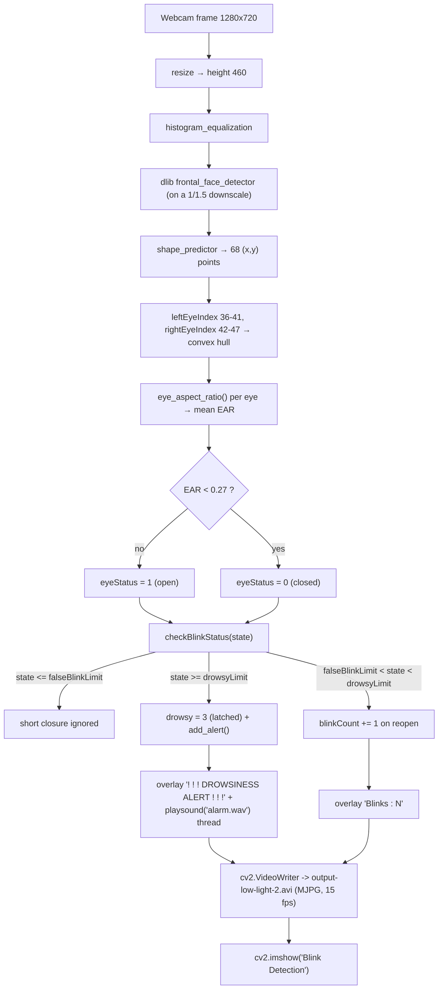
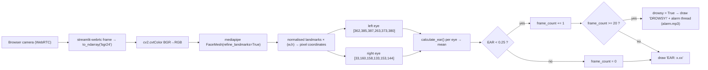

```mermaid
flowchart TD
    subgraph Desktop["Desktop path (dlib)"]
        A1["cv2.VideoCapture(0)"] --> A2["read frame"]
        A2 --> A3["resize to height 460"]
        A3 --> A4["histogram_equalization"]
        A4 --> A5["getLandmarks(): downscale 1/1.5 -> dlib frontal_face_detector -> shape_predictor 68 pts"]
        A5 --> A6{face found?}
        A6 -->|no| A7["overlay 'Unable to detect face' + continue"]
        A6 -->|yes| A8["checkEyeStatus(): hull of eye points -> EAR per eye -> mean"]
        A8 --> A9["eyeStatus = 1 if EAR >= 0.27 else 0"]
        A9 --> A10["checkBlinkStatus(): state counter -> blink / drowsy / alert"]
        A10 --> A11["draw landmark dots + overlay"]
        A11 --> A12{drowsy?}
        A12 -->|yes| A13["alarm thread: playsound('alarm.wav') + DROWSINESS ALERT"]
        A12 -->|no| A14["overlay 'Blinks : N'"]
        A13 --> A15["vid_writer.write(frame) -> output-low-light-2.avi"]
        A14 --> A15
        A7 --> A2
    end

    subgraph Web["Web path (MediaPipe)"]
        B1["streamlit-webrtc: browser camera frames"] --> B2["DrowsinessDetector.transform()"]
        B2 --> B3["cv2.cvtColor BGR->RGB"]
        B3 --> B4["FaceMesh(refine_landmarks=True) -> 468 landmarks"]
        B4 --> B5["calculate_ear(left_eye[362,385,387,263,373,380], right_eye[33,160,158,133,153,144])"]
        B5 --> B6{EAR < 0.25 ?}
        B6 -->|yes| B7["frame_count += 1"]
        B6 -->|no| B8["frame_count = 0"]
        B7 --> B9{frame_count >= 20 ?}
        B9 -->|yes| B10["drowsy = True, draw 'DROWSY!', alarm thread (alarm.mp3)"]
        B9 -->|no| B11["draw 'EAR: x.xx'"]
        B8 --> B11
    end

    subgraph Hud["Cockpit HUD (browser only)"]
        C1["js/app.js: requestAnimationFrame loop, 20 samples/s"] --> C2["stepSignal(): baseline + AR(1) noise + blink/mild/deep envelopes"]
        C2 --> C3["evaluateState(): NORMAL / WARNING (0.15s) / DROWSY (1.5s) / ALERT (<0.25 for 1.0s)"]
        C3 --> C4["setNeedle() + drawChart() + updateMetrics()"]
        C4 --> C5["Web Audio siren while armed"]
    end
```

# Architecture — Cockpit: Driver Drowsiness Detection

## Component map

Three independent programs plus one static page. They share the *idea*, not a runtime:

```
┌────────────────────────┐   ┌─────────────────────────┐   ┌────────────────────────┐
│  blinkDetect.py        │   │  streamlit_app/         │   │  index.html + js/app.js│
│  dlib 68 landmarks     │   │  streamlit_app.py       │   │  Cockpit HUD           │
│  cv2.VideoCapture(0)   │   │  MediaPipe FaceMesh     │   │  simulated EAR signal  │
│  → OpenCV window       │   │  streamlit-webrtc       │   │  gauge + strip chart   │
│  → alarm.wav           │   │  → port 8501            │   │  → static file server  │
│  needs models/…68…dat │   │  → alarm.mp3            │   │    (no camera access)  │
└───────────┬────────────┘   └────────────┬────────────┘   └────────────┬───────────┘
            │                             │                             │
            │  cv2 + dlib                 │  mediapipe + av            │  browser JS only
            ▼                             ▼                             ▼
      ┌───────────┐                ┌───────────┐                 (no network I/O)
      │  Webcam 0 │                │  Browser  │
      └───────────┘                │  WebRTC   │
                                   └───────────┘

Shared assets:  models/haarcascade_frontalface_default.xml (present)
                models/shape_predictor_68_face_landmarks.dat (MISSING — download required)
                alarm.wav (root)  ·  streamlit_app/alarm.mp3
```



---

## Data and control flow

### 9.1 Desktop detection



### 9.2 Web detection



### 9.3 Where the data lives

| Data | Lifetime | Location |
|---|---|---|
| Video frames | per frame | memory; the last 460-px-high frame is also written to `output-low-light-2.avi` |
| EAR samples | per session | `session_ear_values` list in RAM (`blinkDetect.py:48`), printed in the summary and returned by `get_session_ear_values()` |
| Blink/alert counters | per session | globals `blinkCount`, `session_alerts` |
| Recorded video | per run | `output-low-light-2.avi` (overwritten each run) |
| Cockpit samples | per session | `S.samples` — a 480-entry ring buffer in the browser tab (lost on reload) |
| Cockpit preferences | persistent | `localStorage["cockpit.clock24"]` |
| Session history | **not stored** | `Sesssion_analysis.py` is an empty stub |

---

## Algorithm/model details

> **No model is trained and no weights are loaded.** The "model" that ships is dlib's
> pre-trained 68-point shape predictor (`shape_predictor_68_face_landmarks.dat`), a
> regression-SVM model that is downloaded by the user. The drowsiness decision itself is
> pure geometry plus a hand-tuned state machine.

### 7.1 Eye Aspect Ratio (dlib version)

```python
def eye_aspect_ratio(eye):
    A = dist.euclidean(eye[1], eye[5])   # vertical distance, pair 1
    B = dist.euclidean(eye[2], eye[4])   # vertical distance, pair 2
    C = dist.euclidean(eye[0], eye[3])   # horizontal distance (eye width)
    ear = (A + B) / (2.0 * C)
    return ear
```

Properties that make this the standard metric (Soukupová & Čech, 2016):

- **Scale invariant** — `C` normalises for face size and distance.
- **Aspect-based** — only the *ratio* of vertical to horizontal extent matters.
- **Monotone in eye openness** — the value falls smoothly as the lids close, which is
  what allows a single threshold to separate open from closed.
- **Cheap** — three Euclidean distances per eye, i.e. six per frame.

`eye` here is the convex hull of the six dlib eye points: `leftEyeIndex = [36..41]`,
`rightEyeIndex = [42..47]`. The per-eye values are averaged:
`ear = (leftEAR + rightEAR) / 2.0` (`blinkDetect.py:145-148`).

### 7.2 The MediaPipe version is *not* the same pairing

```python
def calculate_ear(landmarks, eye_indices):
    p1, p2 = landmarks[eye_indices[1]], landmarks[eye_indices[5]]
    p3, p4 = landmarks[eye_indices[2]], landmarks[eye_indices[4]]
    p5, p6 = landmarks[eye_indices[0]], landmarks[eye_indices[3]]
    vertical1 = euclidean(p2, p4)   # (1, 4)
    vertical2 = euclidean(p3, p5)   # (2, 0)
    horizontal = euclidean(p1, p6)   # (1, 0)
    return (vertical1 + vertical2) / (2.0 * horizontal)
```

The MediaPipe implementation pairs **(1,4)** and **(2,0)** vertically and uses **(1,0)**
horizontally, whereas the dlib implementation uses **(1,5)**, **(2,4)** and **(0,3)**. The
two landmark sets are also different (68 points vs. 468), so their EAR distributions are
not identical — which is why the web app uses a different threshold (`0.25` instead of
`0.27`). Anyone re-tuning one path should not assume the constants transfer.

### 7.3 The blink/drowsiness state machine (dlib)

```
state  ──eyes closed──▶ state+1
         eyes open  ──▶ state = 0   (and blinkCount += 1 once the closure was a real blink)

if state ≤ falseBlinkLimit              → short closure, ignore
elif falseBlinkLimit ≤ state < drowsyLimit → a genuine blink
else (state ≥ drowsyLimit)              → drowsy: drowsy = 3, add_alert() every frame
```

`falseBlinkLimit = 0.15 / spf` frames, `drowsyLimit = 1.5 / spf` frames.

Two behavioural consequences worth knowing:

- **`drowsy` is a latch.** Once it is set to `3` it is never cleared by the state machine
  — only the `r` key (`blinkDetect.py:361`) sets `drowsy = 0`. So the alert overlay and
  the alarm remain active after the driver opens their eyes again, until `r` is pressed.
- **The two ranges overlap by one frame** (`state <= falseBlinkLimit` versus
  `state >= falseBlinkLimit`), and the first branch wins — harmless, but it means the
  false-blink window is `falseBlinkLimit + 1` frames wide.

### 7.4 The MediaPipe state machine

Simpler and frame-based rather than time-based: `EAR < 0.25` for 20 consecutive frames
⇒ `drowsy = True`. At the ~30 fps a browser stream typically delivers, 20 frames ≈ 0.67 s
of closure — noticeably shorter than the 1.5 s the desktop path waits for. The two
detectors therefore differ in sensitivity as well as in implementation.

### 7.5 Why the thresholds look the way they do

- `0.27` sits in the gap between a fully open eye (≈0.30–0.35) and a blink (≈0.10–0.15).
- `0.15 s` is a typical human blink duration, so anything shorter is noise.
- `1.5 s` of continuous closure is well past a blink and into "eyes shut" territory.
- The Cockpit simulation mirrors this: a *mild* closure bottoms out at 0.252–0.264
  (between the 0.25 alert line and the 0.27 redline → the "warning/drowsy" band) while a
  *deep* closure drops to 0.06 (below 0.25 → the ALERT band with the siren).

### 7.6 Complexity

Per frame: one dlib face detection on a 1/1.5-scaled image, one 68-point shape
prediction, 6 Euclidean distances, and a handful of `cv2` drawing calls. The measured
`spf` printed at calibration (typically 10–40 ms on a modern laptop) is what makes the
durations frame-rate independent. The MediaPipe path is heavier: a 468-point face mesh
per frame, which is why it runs client-side through WebRTC.

---

## Source inventory

| Path | Role | Key symbols / details |
|---|---|---|
| `main.py` | **Metadata entry point** — Tkinter launcher | `run_face_detection(btn_face)` (10-35), `run_blink_detection(btn_blink)` (38-53), `toggle_theme(root, frame, toggle_btn)` (55-71), `on_quit(root)` (73-76), `main()` (78-118) — 500×500 window, `clam` theme, dark mode, launches scripts with `subprocess.Popen(["python", script])` |
| `ui.py` | Older Tkinter launcher | `run_script(script_name)` (13-16) via `sys.executable`, `face()` (18), `blink()` (21), `lane()` (24) — 300×550 window |
| `blinkDetect.py` | **Core detector** | `FACE_DOWNSAMPLE_RATIO = 1.5` (20), `RESIZE_HEIGHT = 460` (21), `thresh = 0.27` (23), `modelPath` (28), `sound_path = "alarm.wav"` (29), `detector`/`predictor` (31-32), `leftEyeIndex`/`rightEyeIndex` (34-35), `blinkTime = 0.15` / `drowsyTime = 1.5` (40-41), `TempSessionTracker` (54-89), `gamma_correction()` (98), `histogram_equalization()` (101), `soundAlert()` (105-117), `eye_aspect_ratio(eye)` (119-125), `checkEyeStatus(landmarks)` (128-157), `checkBlinkStatus(eyeStatus)` (159-190), `getLandmarks(im)` (192-209), `get_current_ear()` (212), `get_current_blink_count()` (216), `get_session_data()` (220), `get_session_ear_values()` (231), `start_new_session()` (235), `end_current_session()` (242), calibration loop (262-300), main loop (307-371) |
| `face-try.py` | Haar-cascade face detector | `cascade_path` (16-17), `face_cascade.empty()` check (23-25), `detectMultiScale(gray, 1.1, 4)` (46), `q` quits (56) |
| `lanedetection.py` | Lane-marking detector | `region_of_interest(img, vertices)` (10), `drow_the_lines(img, lines)` (17) — Hough lines blended with `cv2.addWeighted` |
| `Sesssion_analysis.py` | Session-history stub | `ttk.Notebook` with `live_track` and `session_his` frames — **no logic, no storage** |
| `streamlit_app/streamlit_app.py` | MediaPipe web detector | `EAR_THRESHOLD = 0.25` (12), `CONSEC_FRAMES = 20` (13), `play_alarm()` (16-21), `euclidean()` (25), `calculate_ear()` (28-39), `DrowsinessDetector` (41-85) with `transform(frame)`, `pwa_html` (96-156), `webrtc_streamer(...)` (186-191), `alarm.wav` embed (193-199) |
| `streamlit_app/streamlit_app_pwa.py` | PWA variant | `serve_pwa_files()` (26+), inline base64 manifest (31-33), same EAR logic, `st.info("This app supports offline use when installed!")` (276) |
| `streamlit_app/.streamlit/config.toml` | Streamlit config | `enableStaticServing = true`, `enableCORS = false`, red theme `#ff6b6b` |
| `streamlit_app/manifest.json`, `sw.js`, `offline.html`, `icons/` | PWA assets | Service worker caches `/`, `/manifest.json` and other assets; icons 72→512 px |
| `streamlit_app/generate_icons.py`, `test_pwa_setup.py` | Icon generation / asset validation | Pillow-based generator; validator for manifest, icons and service worker |
| `index.html` | **Cockpit HUD** | Top bar (LED, session timer, clock) (18-59), simulation chip (61-67), left rail metrics (71-112), SVG gauge with redline (114-138), strip chart + threshold legend (140-159), EAR formula + eye diagram (165-194), backend thresholds (196-206), copyable run commands + honesty list (208-228), footer (233-235) |
| `js/app.js` | Cockpit logic | `MAX_EAR/THRESH/THRESH_ALERT/BLINK_WINDOW/DROWSY_TIME/ALERT_TIME/SAMPLE_MS/MAX_SAMPLES` (42-49), `PROFILES` (51-55), `ensureAudio()/beep()/startAlarmLoop()` (121-167), `gaugePoint()/buildTicks()/setNeedle()` (176-236), `STATE_COPY`/`STATE_LABEL` (238-252), `setState()` (254-280), `setupChart()/yFor()/traceColor()/drawChart()` (288-391), `snapshot()` (393-423), `updateMetrics()` (427-431), `stepSignal()` (468-522), `evaluateState()` (524-560), `sample()` (562-591), `loop()` (593-602), `startSession()/stopSession()` (606-649), `Space` handler (688-701), copy buttons (791-807) |
| `css/style.css` | Cockpit styling | Dark HUD theme, reduced-motion support |
| `models/haarcascade_frontalface_default.xml` | Haar cascade | **Present** — used by `face-try.py` |
| `models/shape_predictor_68_face_landmarks.dat` | dlib 68-point model | **MISSING** — must be downloaded from dlib.net into `models/` |
| `models/ML_Models/` | Placeholder for CNN / transformer models | Two **empty** directories |
| `alarm.wav` | D

[Excerpt shortened; consult the cited source guide for full detail.]

## Implemented versus proposed

Implemented behavior is limited to the source entry points and code paths described above.

- No project-specific drowsiness model is trained; desktop geometry/state logic and the MediaPipe variant differ. A missing landmark asset or camera failure prevents operation. It is a learning prototype, not a safety-certified driver aid.
