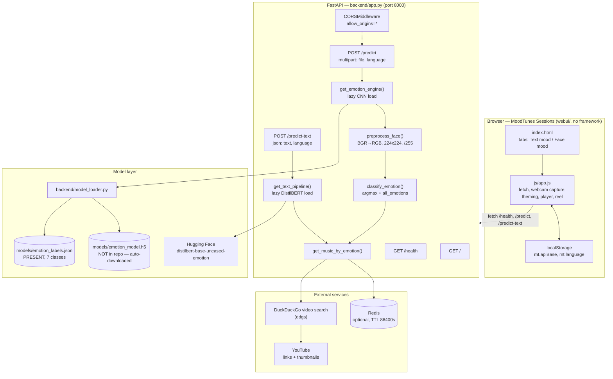

# MoodTunes: Emotion Detection and Music Recommendation

## Overview and purpose

MoodTunes — AI-Powered Emotion Detection & Music Recommender N:\Foundev-Projects\Domain\Artificial Intelligence & Machine Learning\emotion-detection-from-text-and-face People often know how they feel but not what to listen to, and mood-driven music services normally demand a playlist, a history or a text prompt before they respond. Read the user's mood from two passive inputs — a face photo/webcam frame or a short piece of text — classify it into one of seven emotions, and return a short, mood-matched YouTube track list immediately. End users who want instant, mood-aware music suggestions; developers who want a reference hybrid face + text inference API. A JSON payload (emotion, confidence,

## Real-world context and scope

Music discovery is usually driven by metadata the user must supply: a song title, an artist, a
genre, or a manually written prompt. Those inputs are slow to produce, and they describe
*what* to play rather than *how* the user currently feels. Three concrete gaps follow:

1. **No low-effort mood capture.** Typing a description of your mood is friction — especially
   on mobile, and especially when the description of a feeling is exactly what you are
   struggling to name.
2. **No unified signal source.** Face-based mood readers and text-based mood readers
   usually ship as separate products. A user with a camera, a keyboard, or neither should
   get the same output shape from both.
3. **No immediate bridge to a playlist.** Even a good emotion label is not a listening
   experience; the user still has to translate "disgust" into a search query.

MoodTunes attacks all three: one API, two interchangeable input modalities, seven shared
emotion classes, and a track list attached to every response.

**Constraints that shape the design** (all observable in the code):

- The deep-learning stack (TensorFlow + PyTorch + a CNN + DistilBERT) is heavy, so nothing
  may be loaded at import time — both models are loaded lazily on first use
  (`get_emotion_engine()`, `get_text_pipeline()`).
- The face model weights are not redistributable inside this repository, so the loader
  fetches them on demand (`download_model()`), and the `.h5` file must be repaired for
  Keras 3 before it can be loa

[Excerpt shortened; consult the cited source guide for full detail.]

The material describes the repository as supplied. **Implemented behavior** is summarized from the source overview and entry points; **proposed or missing functionality** is listed separately below. Do not infer production readiness from a polished interface or project title.

### Verified implementation notes

Read PROJECT_OVERVIEW.md in the source repository for the implementation inventory.

### Proposed, absent, or uncertain behavior

- The expected face weights are absent and training provenance is unavailable. Facial/text emotion labels are uncertain and sensitive; no mood inference should be treated as fact.

## Technology stack

- `fastapi==0.104.1`
- `uvicorn[standard]==0.24.0`
- `python-multipart`
- `tensorflow-cpu>=2.15.0`
- `tf-keras`
- `opencv-python>=4.10.0.84`
- `numpy>=2.0.0`
- `pandas>=2.1.3`
- `scikit-learn>=1.3.2`
- `matplotlib>=3.8.2`
- `seaborn>=0.13.0`
- `deepface>=0.0.93`
- `Pillow>=10.1.0`
- `requests>=2.31.0`

## System requirements and setup

Use a supported Python environment appropriate to the source dependency pins. Some projects also require data files, trained weights, external APIs, cameras, GPU resources, a database, or an LLM runtime. These are identified in `setup-guide.md`; they are not assumed to be included. Follow the source `WORKFLOW.md` carefully and do not paste real credentials into tracked files.

## Architecture and important components

**Component notes**

- `backend/app.py` — the whole HTTP surface: three routes, two lazy model loaders, the
  preprocessing and classification helpers, the Redis client and the music search.
- `backend/model_loader.py` — file-system concerns only: where the weights live, how to
  fetch them, how to repair them for Keras 3, how to load them, how to read the label map.
- `webui/` — the shipped front end. It is a plain HTML page with an ES5-style script; no
  bundler, no framework, no runtime dependency. All API access is `fetch`.
- `models/emotion_labels.json` — the only model artefact in the repository; it defines the
  class order the CNN's output vector uses.
- `redis` — a cache, not a store of record. Every cache entry can be recomputed.

---

## Directory structure

Source paths central to the learning material:

- `PROJECT_OVERVIEW.md`
- `README.md`
- `WORKFLOW.md`
- `backend/__init__.py`
- `backend/app.py`
- `backend/model_loader.py`
- `docker-compose.yml`
- `frontend/README.md`
- `frontend/app/docs/page.tsx`
- `frontend/app/layout.tsx`
- `frontend/app/loading.tsx`
- `frontend/app/page.tsx`
- `frontend/app/system/page.tsx`
- `frontend/app/text-music/page.tsx`
- `frontend/app/types.ts`
- `frontend/components/Footer.tsx`
- `frontend/components/HydrationLoader.tsx`
- `frontend/components/PageTour.tsx`
- `frontend/components/resizable-navbar-demo.tsx`
- `frontend/components/theme-provider.tsx`
- `frontend/components/theme-toggle.tsx`
- `frontend/components/ui/button.tsx`
- `frontend/components/ui/orbital-loader.tsx`
- `frontend/components/ui/resizable-navbar.tsx`
- `frontend/components.json`
- `frontend/lib/utils.ts`
- `frontend/next.config.ts`
- `frontend/package-lock.json`
- `frontend/package.json`
- `frontend/public/manifest.json`
- `frontend/tsconfig.json`
- `project-metadata.json`
- `requirements.txt`
- `training/emotion-detection-and-music-recommendation-system.ipynb`
- `webui/index.html`
- `webui/js/app.js`

## Installation, environment, and database

See [`setup-guide.md`](setup-guide.md) for repository-specific commands, environment variables, optional services, and data/model requirements. Database setup is only applicable when the source workflow documents a database.

## Testing

Use only tests and checks present in the source repository. This learning package has not run the source application or trained a model. Expected test behavior and missing coverage are described in the source workflow and lessons.

## Security, privacy, and responsible use

Treat credentials, uploaded data, biometric data, student/financial records, and generated outputs as sensitive where relevant. Apply data minimization, consent and access controls, retention limits, secure secret handling, documented error handling, and human review. For consequential decisions, model outputs are educational signals only. Project-specific hazards appear in the final project guide and source review report.

## Troubleshooting

Start with missing assets and dependency versions, then validate input shape/schema, check configured API/database/model services, inspect logs, and compare observed behavior with the exact source path described in `architecture.md`. Many repositories contain a static UI or stub that is not wired to the model.

## Expected outcome

Complete the final project to explain and reproduce the repository's actual data-to-output path, demonstrate a tested source-aligned extension, and document its limitations.

## Further learning

See `references.json` for official framework references and the source repository's `PROJECT_OVERVIEW.md`, `WORKFLOW.md`, and README for implementation details.
