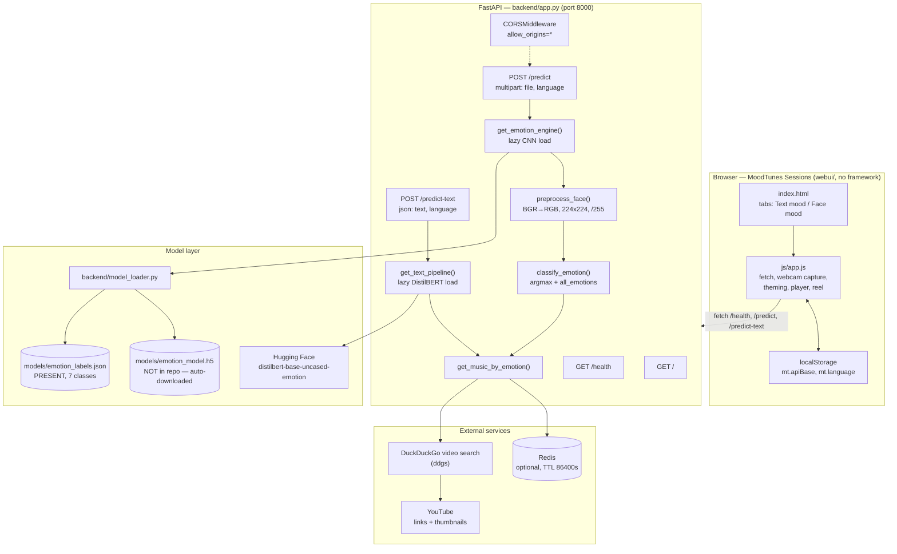
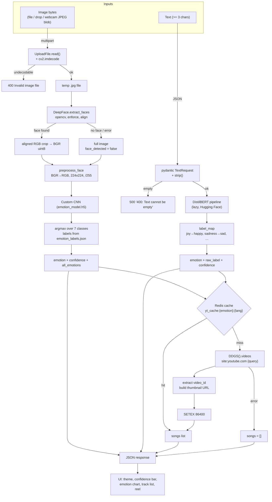

# Architecture — MoodTunes: Emotion Detection and Music Recommendation

## Component map

**Component notes**

- `backend/app.py` — the whole HTTP surface: three routes, two lazy model loaders, the
  preprocessing and classification helpers, the Redis client and the music search.
- `backend/model_loader.py` — file-system concerns only: where the weights live, how to
  fetch them, how to repair them for Keras 3, how to load them, how to read the label map.
- `webui/` — the shipped front end. It is a plain HTML page with an ES5-style script; no
  bundler, no framework, no runtime dependency. All API access is `fetch`.
- `models/emotion_labels.json` — the only model artefact in the repository; it defines the
  class order the CNN's output vector uses.
- `redis` — a cache, not a store of record. Every cache entry can be recomputed.

---

## Data and control flow

**Data shapes on the wire**

| Boundary | Shape |
|---|---|
| Browser → `/predict` | `multipart/form-data`: `file` (binary), `language` (text, default `"Any"`) |
| Browser → `/predict-text` | `application/json`: `{"text": "…", "language": "Any"}` |
| `/predict` → browser | `{"emotion": str, "confidence": float, "face_detected": bool, "all_emotions": {label: float}, "songs": [track]}` |
| `/predict-text` → browser | `{"emotion": str, "raw_label": str, "confidence": float, "text_analyzed": str, "songs": [track]}` |
| `track` | `{"title": str, "video_id": str, "thumbnail": str, "channel": str, "duration": str}` |
| Redis value | JSON array of `track`, TTL 86 400 s, key `yt_cache:{emotion}:{language}` |

---

## Algorithm/model details

### The face classifier (custom CNN)

- **Architecture:** the repository does not contain the training code for the shipped
  weights, and `models/emotion_model.h5` is not in the repository. What the code *does*
  tell us is precise: the input is a single RGB tensor of shape `(1, 224, 224, 3)`
  (`preprocess_face()`), the output is a 7-element vector (`backend/app.py:129` iterates
  over 7 classes and `emotion_labels.json` contains exactly 7 entries), and the class
  order is fixed by `emotion_labels.json`:
  `angry=0, disgust=1, fear=2, happy=3, neutral=4, sad=5, surprise=6`.
- **Preprocessing contract:** BGR→RGB (`cv2.COLOR_BGR2RGB`) → `cv2.resize(rgb, (224,224))`
  → `astype("float32") / 255.0` → `reshape(1, 224, 224, 3)`. No mean/std normalisation is
  applied, so the model expects plain `[0,1]` scaling.
- **Decision rule:** a plain arg-max over the softmax output. `predicted_idx = int(
  np.argmax(predictions))`; the label comes from `idx_to_label` (falling back to
  `"neutral"` for an out-of-range index) and the confidence is that entry rounded to 4
  decimals. There is no threshold, no calibration and no rejection of low-confidence
  predictions — a 0.31 "happy" is returned as "happy".
- **Label↔index mapping is the load-bearing detail:** `load_emotion_labels()` inverts the
  JSON (`{int(v): k for k, v in label_to_idx.items()}`), so the JSON *is* the model
  contract. Renumbering it silently breaks the classifier.
- **No training or evaluation evidence in the repository:** there is no training script
  for the CNN in the runtime path, no metrics file, and no dataset. The docs and
  `training/*.ipynb` reference FER2013, and `docs/architecture.md` describes the CNN as
  FER2013-trained, but none of that can be verified from the code. Any accuracy claim
  would be fabricated.
- **Keras 3 repair:** `patch_h5_file_permanently()` opens the `.h5` with `h5py`, reads
  the `model_config` attribute, and rewrites `"batch_shape": [null, 224, 224, 3]` into
  `"shape": [224, 224, 3]` with a regex plus a JSON round-trip, writing the attribute
  back. The file is idempotent — a second call finds no `"batch_shape"` and returns
  immediately. Loading then uses `tf_keras.models.load_model(..., compile=False)` with a
  fallback to `tensorflow.keras.models.load_model`.

### The text classifier (DistilBERT)

- **Checkpoint:** `bhadresh-savani/distilbert-base-uncased-emotion`, loaded through
  `transformers.pipeline("text-classification", framework="pt")`.
- **Decision rule:** `results[0]` — the highest-scoring label — is used directly, and its
  score becomes the confidence.
- **Label mapping:** `joy→happy`, `sadness→sad`, `anger→angry`, `fear→fear`,
  `surprise→surprise`, `love→happy`; anything else (notably `neutral` and `disgust`,
  which this checkpoint never emits) falls through to `"neutral"`. This is why the text
  path can never return `disgust`, even though the shared vocabulary contains it.
- **Language caveat:** `distilbert-base-uncased-*` is an English model. The `language`
  field changes only the *music query*, never the text understanding.

### The recommendation algorithm (not machine learning)

`get_music_by_emotion()` is a deterministic, non-learning pipeline:

1. **Query construction** — for `language == "Any"` (or blank) it uses the curated
   `EMOTION_QUERIES` table (`happy → "happy upbeat pop"`, `sad → "sad emotional"`,
   `angry → "heavy aggressive"`, `neutral → "chill relaxing acoustic"`, `surprise → "feel
   good party"`, `fear → "calming peaceful"`, `disgust → "moody atmospheric"`). For a
   specific region it switches to deliberately simple keywords
   (`happy → "happy"`, `neutral → "relaxing"`, `disgust → "lofi"`) and composes
   `"{language} {keyword} songs"`. The code comment explains why: richer English genre
   words make the search engine prioritise English results and ignore the requested
   language.
2. **Cache lookup** — `GET yt_cache:{emotion}:{language_lower_underscored}` from Redis.
   A hit returns the stored JSON verbatim and skips the network entirely.
3. **Search** — `DDGS().videos(f"site:youtube.com {query}", max_results=limit)` (default
   `limit=5`).
4. **Extraction** — for each result, the YouTube id is parsed from either
   `youtube.com/watch?v=<id>` or `youtu.be/<id>`; non-YouTube results are skipped. The
   thumbnail is synthesised as `https://img.youtube.com/vi/{id}/hqdefault.jpg`; the channel
   comes from the `publisher` field, defaulting to `"YouTube"`.
5. **Cache write** — `SETEX yt_cache:{emotion}:{language} 86400 <json>` (24 h).
6. **Failure** — any exception is printed with a traceback and the function returns `[]`,
   so the caller always gets a valid (possibly empty) list.

There is no ranking, no personalisation, no collaborative filtering and no learning of
any kind: the same emotion and language always produce the same search, and the only
variation across users comes from the search engine's own ranking.

---

## Source inventory

| File | Key symbols | Role |
|---|---|---|
| `backend/app.py` | `TextRequest` (pydantic model) | Request schema for `/predict-text`: `text: str`, `language: str = "Any"`. |
| | `app = FastAPI(title="Emotion Detection API", version="3.0.0")` | App metadata; also what `/docs` renders. |
| | `get_text_pipeline()` | Lazily builds the DistilBERT `text-classification` pipeline; caches it in the `text_emotion_pipeline` global. |
| | `get_emotion_engine()` | Lazily loads the CNN and the label map into the `emotion_model` / `idx_to_label` globals; prints `CRITICAL: Failed to load .h5 model: …` on failure. |
| | `redis_client` (module level) | Built from `REDIS_URL` or `redis://{REDIS_HOST or 'localhost'}:6379/0`; `ping()` decides whether caching is on. |
| | `CORSMiddleware(allow_origins=["*"], allow_credentials=True, allow_methods=["*"], allow_headers=["*"])` | Allows the static UI on another origin to call the API. |
| | `EMOTION_QUERIES` | The seven global search phrases. |
| | `preprocess_face(face_pixels)` | BGR→RGB, resize to 224×224, `/255.0`, `reshape(1,224,224,3)`. |
| | `classify_emotion(face_pixels)` | Runs the CNN, builds `all_emotions`, returns `(emotion, confidence, all_emotions)`; raises `ValueError` when the engine is `None`. |
| | `get_music_by_emotion(emotion, limit=5, language="Any")` | Query construction, Redis get/set, DuckDuckGo search, YouTube id extraction. |
| | `home()` / `health()` | `GET /` and `GET /health`. |
| | `predict(file: UploadFile, language: str = Form("Any"))` | The image pipeline; 400 on undecodable bytes, 500 on any other exception, temp file removed in `finally`. |
| | `predict_text(request: TextRequest)` | The text pipeline; returns `emotion`, `raw_label`, `confidence`, `text_analyzed`, `songs`. |
| `backend/model_loader.py` | `BASE_DIR`, `MODEL_PATH`, `LABELS_PATH`, `MODEL_URL` | Path constants resolved relative to the file (`BASE_DIR` = project root), plus the Hugging Face download URL. |
| | `download_model()` | Streams `MODEL_URL` to `MODEL_PATH` in 8 KB chunks if the file is missing. |
| | `patch_h5_file_permanently(h5_path)` | Rewrites the `model_config` attribute of the `.h5` (`batch_shape` → `shape`) via `h5py` + `re`; idempotent. |
| | `load_emotion_model()` | download → patch → `load_model(..., compile=False)` (preferring `tf_keras`, falling back to `tensorflow.keras`). |
| | `load_emotion_labels()` | Reads `emotion_labels.json` and returns the inverted `{index: label}` dict. |
| `webui/index.html` | header, tab strip, stage, track list, offline panel | The page shell; contains the explicit "Backend offline" panel with the run commands and the file-size/format hints. |
| `webui/js/app.js` | `DEFAULT_API`, `MIN_LEN`, `MAX_FILE`, `TIMEOUT_MS`, `HEALTH_TIMEOUT_MS`, `POLL_MS` | Client configuration constants (20 MB, 3 chars, 30 s, 8 s, 15 s). |
| | `setTheme(emotion)` / `EMOTION_THEMES` | Per-emotion accent colours and stage visuals. |
| | `checkHealth()` / `startHealthPolling()` | `GET /health` probe, status pill, manual recheck, 15 s polling loop. |
| | `analyzeText()` | Client-side length validation, JSON `POST /predict-text`, response rendering. |
| | `analyzeImage(file)` | Client-side type/size validation, `FormData` `POST /predict`, response rendering, chart drawing. |
| | `startCamera()` / `captureFrame()` | `getUserMedia` (1280×720) and canvas → JPEG blob (0.92). |
| | `renderTracks()` / `nextTrack()` / `prevTrack()` / `copyPlaylist()` | The player strip, the session reel and the clipboard export. |
| `webui/css/style.css` | — | The full visual system: gradient stage, glass panels, theme variables, responsive layout. |
| `models/emotion_labels.json` | — | The class contract: `{"angry":0,"disgust":1,"fear":2,"happy":3,"neutral":4,"sad":5,"surprise":6}`. |
| `requirements.txt` | 18 entries | Runtime dependencies (see [Dependencies](#dependencies-and-external-services)). |
| `docker-compose.yml` | `backend`, `frontend`, `redis` | Three services: API :8000, Next.js :3000, Redis :6379; `REDIS_HOST=redis`, `NEXT_PUBLIC_API_URL=http://localhost:8000`. |
| `backend/Dockerfile` | — | `python:3.10-slim`, installs `requirements.txt`, runs `uvicorn backend.app:app --host 0.0.0.0 --port 

[Excerpt shortened; consult the cited source guide for full detail.]

## Implemented versus proposed

Implemented behavior is limited to the source entry points and code paths described above.

- The expected face weights are absent and training provenance is unavailable. Facial/text emotion labels are uncertain and sensitive; no mood inference should be treated as fact.
