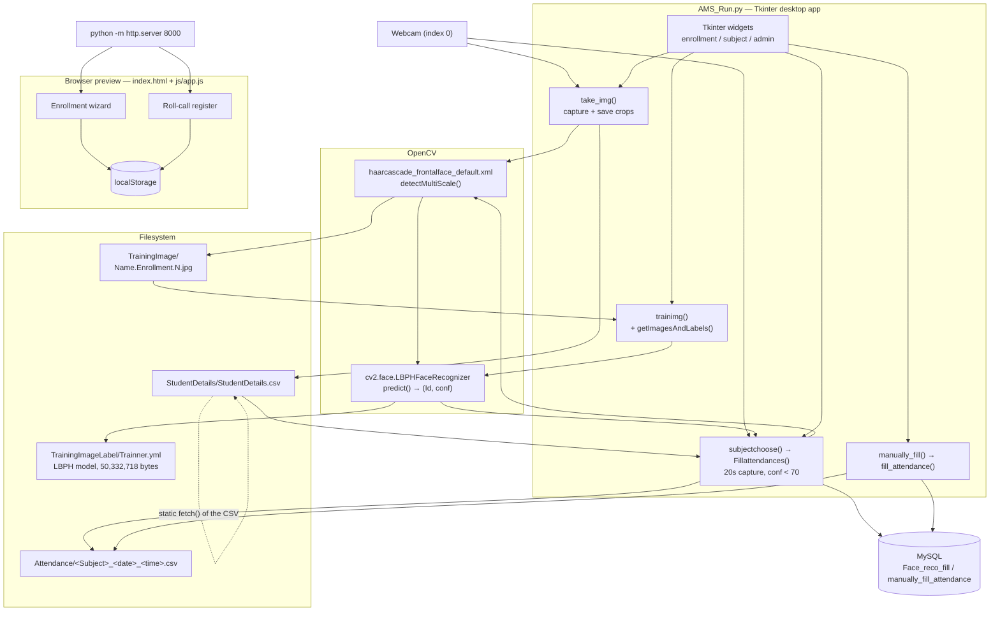

# FAMS: Face Recognition Attendance System

## Overview and purpose

FAMS Roll-Call Kiosk (desktop title: FAMS-Face Recognition Based Attendance Management System) face-recognition-attendance-system <https://github.com/Spidy20/Attendacemanagementsystem> Manual attendance registers are slow, easy to forge, and disconnected from the students who are actually present. Let an instructor register a student once, then mark attendance automatically from a webcam and produce a per-subject, per-timestamp CSV that can be archived or mirrored to a database. Classroom instructors / lab supervisors taking attendance; an administrator reviewing the enrolled-student register. Attendance/<Subject><YYYY-MM-DD><HH-MM-SS>.csv containing Enrollment,Name,Date,Time, optionally mir

## Real-world context and scope

The original workflow is a paper register. The instructor calls names, ticks a box, and later re-types the sheet into a spreadsheet. Three problems follow:

1. **Time** — the register consumes the first minutes of every session.
2. **Integrity** — a hand-ticked sheet is trivially altered and cannot be audited.
3. **Fragmentation** — the data ends up in a format that cannot be queried, joined, or archived automatically.

A machine-vision attendance kiosk replaces the ticking with a webcam pass: enrolled faces are recognised automatically, and each session produces a machine-generated, timestamped record.

The honest scope of this repository: it is a **desktop application**, not a web service. There is no HTTP API, no server, and no multi-camera or multi-user design.

The material describes the repository as supplied. **Implemented behavior** is summarized from the source overview and entry points; **proposed or missing functionality** is listed separately below. Do not infer production readiness from a polished interface or project title.

### Verified implementation notes

Read PROJECT_OVERVIEW.md in the source repository for the implementation inventory.

### Proposed, absent, or uncertain behavior

- The app uses Haar + LBPH rather than deep learning. Biometric data and attendance records need consent, access controls, retention rules, and correction paths.

## Technology stack

- `See source project dependency manifest and setup guide`

## System requirements and setup

Use a supported Python environment appropriate to the source dependency pins. Some projects also require data files, trained weights, external APIs, cameras, GPU resources, a database, or an LLM runtime. These are identified in `setup-guide.md`; they are not assumed to be included. Follow the source `WORKFLOW.md` carefully and do not paste real credentials into tracked files.

## Architecture and important components

Real components only — there is no web server in this project.

**Boundary note.** The dashed arrow is the *only* link between the browser layer and the rest of the system: a static `fetch()` of a CSV file. No detection, recognition, database or model access happens in the browser.

## Directory structure

Source paths central to the learning material:

- `AMS_Run.py`
- `PROJECT_OVERVIEW.md`
- `README.md`
- `TrainingImageLabel/Trainner.yml`
- `WORKFLOW.md`
- `index.html`
- `js/app.js`
- `project-metadata.json`
- `retrain.py`
- `testing.py`
- `training.py`

## Installation, environment, and database

See [`setup-guide.md`](setup-guide.md) for repository-specific commands, environment variables, optional services, and data/model requirements. Database setup is only applicable when the source workflow documents a database.

## Testing

Use only tests and checks present in the source repository. This learning package has not run the source application or trained a model. Expected test behavior and missing coverage are described in the source workflow and lessons.

## Security, privacy, and responsible use

Treat credentials, uploaded data, biometric data, student/financial records, and generated outputs as sensitive where relevant. Apply data minimization, consent and access controls, retention limits, secure secret handling, documented error handling, and human review. For consequential decisions, model outputs are educational signals only. Project-specific hazards appear in the final project guide and source review report.

## Troubleshooting

Start with missing assets and dependency versions, then validate input shape/schema, check configured API/database/model services, inspect logs, and compare observed behavior with the exact source path described in `architecture.md`. Many repositories contain a static UI or stub that is not wired to the model.

## Expected outcome

Complete the final project to explain and reproduce the repository's actual data-to-output path, demonstrate a tested source-aligned extension, and document its limitations.

## Further learning

See `references.json` for official framework references and the source repository's `PROJECT_OVERVIEW.md`, `WORKFLOW.md`, and README for implementation details.
