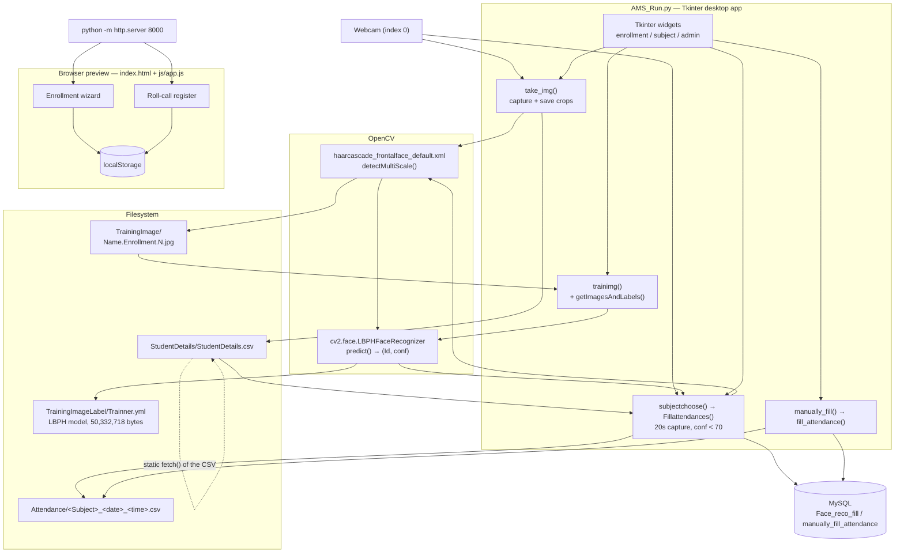
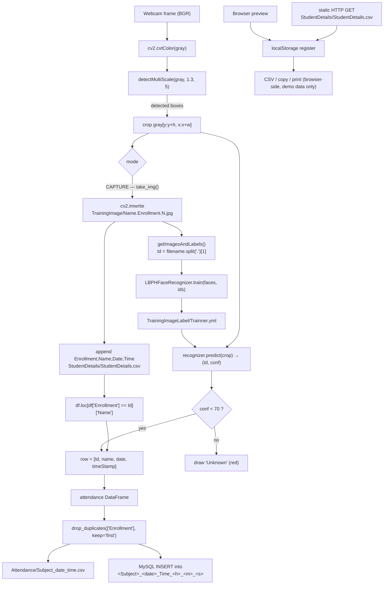

# Architecture — FAMS: Face Recognition Attendance System

## Component map

Real components only — there is no web server in this project.

**Boundary note.** The dashed arrow is the *only* link between the browser layer and the rest of the system: a static `fetch()` of a CSV file. No detection, recognition, database or model access happens in the browser.

## Data and control flow

## Algorithm/model details

This project is classical computer vision plus a classical biometric template — there is no neural network anywhere in the repository.

### 1. Face detection — Haar cascade

`cv2.CascadeClassifier("haarcascade_frontalface_default.xml")` is the Viola–Jones style cascade that ships with OpenCV. `detectMultiScale(gray, scaleFactor, minNeighbors)` returns the list of `(x, y, w, h)` boxes for frontal faces. The app uses `(1.3, 5)` while capturing and `(1.2, 5)` while marking attendance — a slightly more permissive setting during the live pass, which favours recall (finding faces) over precision (finding exactly one face per person).

### 2. Face representation and matching — LBPH

`cv2.face.LBPHFaceRecognizer_create()` implements **Local Binary Pattern Histogram**. For each pixel the LBP operator compares it with its 8 neighbours, producing an 8-bit code. The face crop is divided into a grid of cells (the recognizer's default is 8×8 cells × 16×16 pixels), and a 256-bin histogram of the LBP codes is built per cell. Concatenating the cell histograms gives a compact descriptor that is characteristic of local texture — which is exactly what distinguishes one face from another.

Matching is done with **chi-squared distance**: the recognizer returns the nearest template and a confidence value that is a distance, so **lower is better**. The app's rule `conf < 70` is therefore a *distance* threshold, not a probability. Above the threshold the face is treated as unknown and drawn in red.

Consequences worth understanding:
- The threshold is a single global constant; it is not calibrated per user and there is no ROC analysis in the repo.
- Because the descriptor is a texture signature, training images matter a lot: the upstream README notes that "noisy image can reduce your accuracy so quality of images matters".
- There is no liveness check, so a photograph of an enrolled face can be matched.

### 3. Why the registry CSV is part of the model

LBPH only returns an **integer label**. The label is the enrollment number parsed out of the file name (`getImagesAndLabels`: `os.path.split(imagePath)[-1].split(".")[1]`). The human-readable name is joined in at *inference* time from `StudentDetails/StudentDetails.csv` via `df.loc[df['Enrollment'] == Id]['Name'].values`. If a row is missing from that CSV, the recognised enrollment still appears but the name column is empty.

### 4. Fisher-face variant

`training.py` uses `cv2.face.createFisherFaceRecognizer_create()` instead — a **Linear Discriminant Analysis** projection that finds the linear directions maximising between-class separation, then compares projections by Euclidean distance. It is more accurate in principle, but it is *not* interchangeable with LBPH: the file it writes (`TrainingImageLabel/trainner.yml`) is the same file the app and `testing.py` read back with `LBPHFaceRecognizer`, which will fail to deserialize a Fisher model.

## Source inventory

| File | Key symbols | Role |
|---|---|---|
| `AMS_Run.py` | `take_img()`, `trainimg()`, `getImagesAndLabels(path)`, `subjectchoose()` → `Fillattendances()`, `manually_fill()` → `fill_attendance()` → `enter_data_DB()` / `create_csv()`, `admin_panel()` → `log_in()`, `testVal(inStr, acttyp)` | The whole desktop application: capture, training, automatic and manual attendance, register viewer |
| `testing.py` | module-level script: `LBPHFaceRecognizer_create()`, `recognizer.read('TrainingImageLabel/trainner.yml')` | Standalone webcam prediction; draws the predicted `Id`, no acceptance threshold, no CSV output |
| `training.py` | `getImagesAndLabels(path)`, `createFisherFaceRecognizer_create()` | Standalone **Fisher** trainer writing `TrainingImageLabel/trainner.yml` (overwrites the LBPH model) |
| `retrain.py` | `create_image_lists()`, `create_model_graph()`, `cache_bottleneck_file()`, `run_bottleneck_on_image()` | Vendored 2015 TensorFlow 1.x Inception-v3 transfer-learning example, Apache 2.0. **Unrelated to this pipeline**; requires TF1 and an ImageNet checkpoint |
| `index.html` | markup for the wizard, register, "How recognition works" cards, run panel | Browser companion page |
| `js/app.js` | `loadRoster()` (static `fetch` of `StudentDetails/StudentDetails.csv`), wizard step controller, register table renderer, CSV builder | Browser-side demo logic; `localStorage` persistence |
| `css/style.css` | stylesheet | Browser UI styling |
| `StudentDetails/StudentDetails.csv` | — | Registry: `Enrollment,Name,Date,Time` |
| `Attendance/Manually Attendance/OOP_2019_02_22_Time_11_32_41.csv` | — | Sample manual export: `ID,ENROLLMENT,NAME,DATE,TIME` |
| `TrainingImageLabel/Trainner.yml` | — | Serialised LBPH model (48 MiB), header `opencv_lbphfaces` |
| `haarcascade_frontalface_default.xml`, `haarcascade_frontalface_alt.xml` | — | OpenCV cascades; only the `_default` one is referenced by the code |
| `training code.txt` | — | Scratch note listing the training command |
| `project-metadata.json` | — | Catalog metadata; its `stack` and `goal` fields do not match the code |

## Implemented versus proposed

Implemented behavior is limited to the source entry points and code paths described above.

- The app uses Haar + LBPH rather than deep learning. Biometric data and attendance records need consent, access controls, retention rules, and correction paths.
