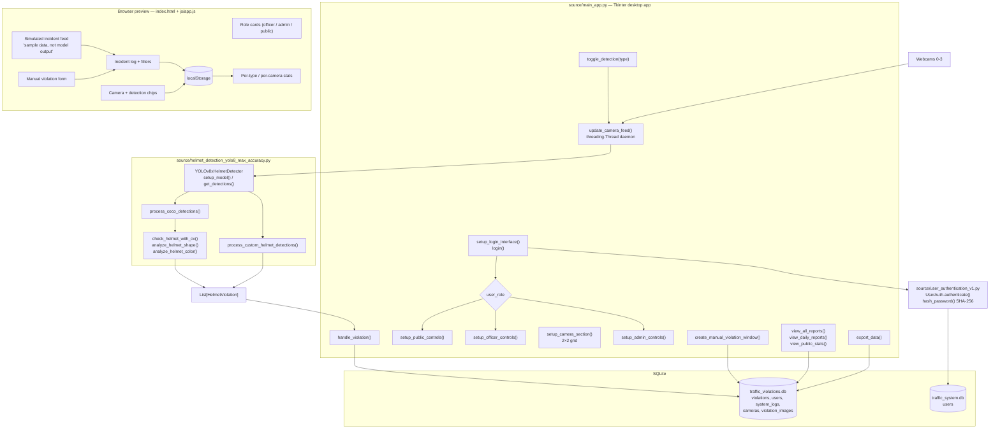

# Signal Control Room: Helmet and Seatbelt Detection

## Overview and purpose

Signal Control Room (desktop title: Traffic Violation Detection System) helmet-seatbelt-violation-detection <https://github.com/3TInfoTinker/trafficviolationdetection> Helmet violations are enforced manually, from roadside posts, with no durable machine-readable evidence and no way to review what a camera saw afterwards. Watch road cameras continuously, detect riders without a helmet, log every violation with camera id, timestamp, confidence and officer, and give operators role-scoped reports and exports. Traffic officers on duty, administrators managing cameras and reviewing the log, and the general public as a read-only viewer of statistics. Rows in the SQLite violations table (violationid

## Real-world context and scope

Traffic-police camera deployments produce a lot of video and very little structured evidence. Three gaps follow from that:

1. **No automatic screening.** An officer watching four feeds cannot scan every frame of every camera for a missing helmet; attention lapses within minutes.
2. **No usable record.** When something does look wrong, what exists is a clip or a memory, not a row with a camera id, a timestamp and a confidence.
3. **No access control around the evidence.** Anyone who can reach the monitoring station can currently browse everything, and there is no distinction between an administrator, an officer and the public.

The repository was designed to close these gaps with a YOLO detector, a violation decision layer, a SQLite evidence store and a role-aware operator console. As shipped, **only the helmet detector is implemented**, and the default model is a generic COCO checkpoint rather than a trained helmet model.

The material describes the repository as supplied. **Implemented behavior** is summarized from the source overview and entry points; **proposed or missing functionality** is listed separately below. Do not infer production readiness from a polished interface or project title.

### Verified implementation notes

Read PROJECT_OVERVIEW.md in the source repository for the implementation inventory.

### Proposed, absent, or uncertain behavior

- Generic COCO weights do not reliably supply dedicated helmet/seatbelt classes; custom model path and deployed behavior differ. No automated output should be treated as enforcement evidence.

## Technology stack

- `opencv-python`
- `numpy`
- `pillow`
- `torch`
- `torchvision`
- `ultralytics`
- `tk`
- `pytest`

## System requirements and setup

Use a supported Python environment appropriate to the source dependency pins. Some projects also require data files, trained weights, external APIs, cameras, GPU resources, a database, or an LLM runtime. These are identified in `setup-guide.md`; they are not assumed to be included. Follow the source `WORKFLOW.md` carefully and do not paste real credentials into tracked files.

## Architecture and important components

Real components only — there is no web server in this project.

**Boundary note.** The browser layer has no edge to the desktop application or the database. It is a self-contained local simulation that mirrors field names and record shapes so the console can be evaluated without cameras.

## Directory structure

Source paths central to the learning material:

- `PROJECT_OVERVIEW.md`
- `README.md`
- `WORKFLOW.md`
- `index.html`
- `js/app.js`
- `project-metadata.json`
- `requirements.txt`
- `source/database_manager.py`
- `source/helmet_detection_yolo8_max_accuracy.py`
- `source/main_app.py`
- `source/user_authentication_v1.py`

## Installation, environment, and database

See [`setup-guide.md`](setup-guide.md) for repository-specific commands, environment variables, optional services, and data/model requirements. Database setup is only applicable when the source workflow documents a database.

## Testing

Use only tests and checks present in the source repository. This learning package has not run the source application or trained a model. Expected test behavior and missing coverage are described in the source workflow and lessons.

## Security, privacy, and responsible use

Treat credentials, uploaded data, biometric data, student/financial records, and generated outputs as sensitive where relevant. Apply data minimization, consent and access controls, retention limits, secure secret handling, documented error handling, and human review. For consequential decisions, model outputs are educational signals only. Project-specific hazards appear in the final project guide and source review report.

## Troubleshooting

Start with missing assets and dependency versions, then validate input shape/schema, check configured API/database/model services, inspect logs, and compare observed behavior with the exact source path described in `architecture.md`. Many repositories contain a static UI or stub that is not wired to the model.

## Expected outcome

Complete the final project to explain and reproduce the repository's actual data-to-output path, demonstrate a tested source-aligned extension, and document its limitations.

## Further learning

See `references.json` for official framework references and the source repository's `PROJECT_OVERVIEW.md`, `WORKFLOW.md`, and README for implementation details.
