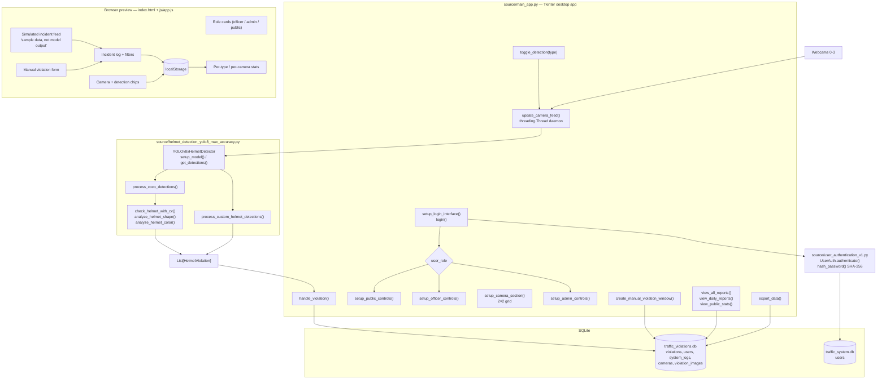
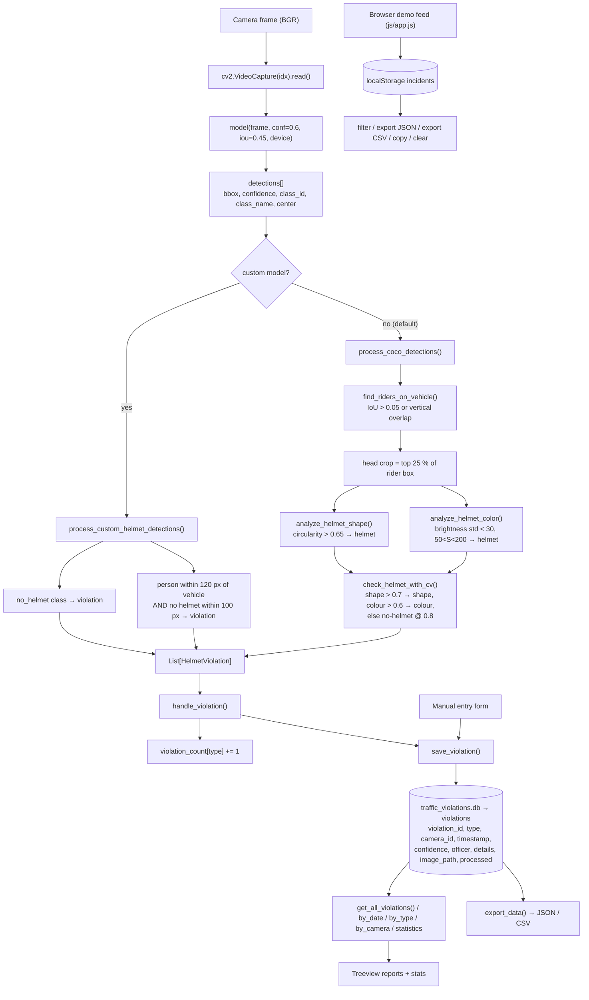

# Architecture — Signal Control Room: Helmet and Seatbelt Detection

## Component map

Real components only — there is no web server in this project.

**Boundary note.** The browser layer has no edge to the desktop application or the database. It is a self-contained local simulation that mirrors field names and record shapes so the console can be evaluated without cameras.

## Data and control flow

## Algorithm/model details

This project combines a modern learned detector with a classical rule layer. There is no trained model in the repository, so the shipped behaviour is "generic COCO detector + hand-written CV heuristics".

### 1. Object detection — YOLOv8x

`ultralytics.YOLO` runs a single-stage detector over the whole frame. The instance is configured with:

| Parameter | Value | Effect |
|---|---|---|
| `confidence_threshold` | `0.6` | Boxes below 0.6 are discarded — high precision, lower recall |
| `iou_threshold` | `0.45` | Non-maximum-suppression IoU cutoff |
| `device` | `auto` | `cuda` → `mps` → `cpu`, resolved once in `setup_model()` |
| `model_path` | `custom_model_path` if it exists, else `"yolov8x.pt"` | Custom checkpoint wins when supplied |

`setup_model()` also runs a warm-up inference on a 640×640 zero image so the first real frame is not slowed by lazy initialisation.

### 2. Violation inference — custom-model path

`process_custom_helmet_detections()` assumes the class set `person, helmet, no_helmet, motorcycle, bicycle` (exactly the contents of `helmet.names`):

- **Direct rule** — every `no_helmet` box becomes a `no_helmet_detected` violation.
- **Geometric rule** — for each `person`, `is_near_vehicle()` checks whether a motorcycle/bicycle centre is within **120 px**; if so, `has_nearby_helmet()` checks whether a `helmet` box centre is within **100 px** of the person's head point (`x + w/2`, `y + 0.15h`). No nearby helmet ⇒ `person_no_helmet` violation.

The 120 px / 100 px radii are fixed pixel constants, so the rule is **resolution-dependent** — at 1080p the same physical gap maps to more pixels than at 720p.

### 3. Violation inference — COCO path (what actually runs today)

`process_coco_detections()` runs because no custom checkpoint is present:

1. **Rider association** — `find_riders_on_vehicle()` pairs each person with a motorcycle/bicycle when the box IoU exceeds **0.05** (`calculate_overlap()`) *or* when the person's vertical span overlaps the vehicle's (`person_y + person_h >= vehicle_y and person_y <= vehicle_y + vehicle_h`).
2. **Head crop** — `check_helmet_with_cv()` takes the top **25 %** of the rider's box (minimum 10 px tall) as the head region.
3. **Shape test** — `analyze_helmet_shape()` blurs with a 5×5 Gaussian, applies Canny (30, 100), takes the largest external contour, computes circularity `4πA/P²` and treats `> 0.65` as helmet-shaped (helmets are convex and rounded; faces are not).
4. **Colour test** — `analyze_helmet_color()` works in HSV: a low brightness standard deviation (`< 30`) plus moderate saturation (`50 < S < 200`) indicates a smooth, solid-coloured shell.
5. **Combination** — if shape confidence `> 0.7` the shape result wins; else if colour confidence `> 0.6` the colour result wins; otherwise the region is declared **no helmet with confidence 0.8** by default.

Note the conservative default: when neither test fires, the code flags a violation. On a generic COCO model this produces a high false-positive rate, and the two thresholds are uncalibrated constants.

### 4. Why there is no learning here beyond YOLO

The repository contains **no training script, no annotations and no dataset**. The upstream metadata describes the intent ("custom-labelled dataset, detection + plate crop pipeline and evidence log"), but only the inference and storage halves exist here. The `.gitignore` even excludes `*.pt` and `*.weights`, so no checkpoint can be committed through the normal workflow.

## Source inventory

| File | Key symbols | Role |
|---|---|---|
| `source/main_app.py` | `TrafficViolationSystem`; `setup_login_interface()`, `login()`, `setup_main_interface()`, `setup_header()`, `setup_camera_section()`, `setup_admin_controls()`, `setup_officer_controls()`, `setup_public_controls()`, `setup_status_panel()`, `start_camera()`, `stop_camera()`, `update_camera_feed()`, `handle_violation()`, `update_violation_display()`, `toggle_detection()`, `update_system_status()`, `view_all_reports()`, `view_daily_reports()`, `view_public_stats()`, `show_reports_window()`, `show_stats_window()`, `record_violation()`, `create_manual_violation_window()`, `generate_ticket()`, `system_settings()`, `export_data()`, `user_management()`, `logout()`, `on_closing()` | The complete operator console: authentication gate, four-camera grid, detection toggles, role-scoped panels, violation counters, report windows, export |
| `source/helmet_detection_yolo8_max_accuracy.py` | `HelmetViolation` (dataclass), `YOLOv8xHelmetDetector`; `setup_model()`, `detect()`, `get_detections()`, `process_detections()`, `process_custom_helmet_detections()`, `process_coco_detections()`, `check_helmet_with_cv()`, `analyze_helmet_shape()`, `analyze_helmet_color()`, `is_near_vehicle()`, `has_nearby_helmet()`, `find_riders_on_vehicle()`, `calculate_overlap()`, `draw_detections()`, `add_frame_info()`, `save_violation_log()`, `violations_to_dict()`, `get_statistics()`, `reset_statistics()`, `set_confidence_threshold()`, `is_model_ready()`, `get_model_info()`; factory `create_helmet_detector()` | All detection and violation-inference logic |
| `source/database_manager.py` | `DatabaseManager`; `init_database()`, `setup_default_cameras()`, `save_violation()`, `generate_violation_id()`, `get_all_violations()`, `get_violations_by_date()`, `get_violations_by_type()`, `get_violations_by_camera()`, `get_violation_statistics()`, `update_violation_status()`, `delete_violation()`, `save_violation_image()`, `get_camera_info()`, `update_camera_settings()`, `log_system_event()`, `get_system_logs()`, `export_data()`, `backup_database()`, `cleanup_old_data()` | SQLite schema, evidence store, reporting queries, export and maintenance |
| `source/user_authentication_v1.py` | `UserAuth`; `init_database()`, `hash_password()`, `create_default_users()`, `authenticate()`, `add_user()`, `change_password()`, `get_all_users()`, `deactivate_user()`, `activate_user()` | Credential store and role verification (SHA-256) |
| `index.html` | markup for role cards, four camera cards, log table, stats, manual form | Browser companion page |
| `js/app.js` | `loadIncidents()` / `saveIncidents()` (localStorage), `nextId()`, `recomputeCounters()`, `addIncident()`, `renderFeed()`, `renderLogTable()`, `renderStats()`, `bars()`, `exportJson()`, `exportCsv()`, `copyLog()`, `clearLog()`, `demoStep()`, `demoToggle()`, `manualSubmit()`, `chipClick()`, `setRole()`, `switchTab()` | Browser-side demo console: role gating, simulated feed, manual entry, filters, exports |
| `css/style.css` | stylesheet | Browser UI styling |
| `models/*.xml`, `models/helmet.names`, `models/yolov4.cfg`, `helmet.names` | — | Unused assets; no source file references them |
| `docs/UserLogin_Trouble.txt` | — | A generic Flask login example that is **not** part of this application |
| `docs/UserAuth_V2.odt` | — | Author's design notes for the authentication module |
| `requirements.txt` | — | `opencv-python, numpy, pillow, torch, torchvision, ultralytics, tk, pytest` — the `tk` entry is not a valid PyPI package |
| `quasar/` | — | Linux virtualenv snapshot (Python 3.10.16); unusable on Windows |
| `LICENSE` | — | MIT, © 2025 Maqboor ur Rahman (@3T-InfoTinker) |

## Implemented versus proposed

Implemented behavior is limited to the source entry points and code paths described above.

- Generic COCO weights do not reliably supply dedicated helmet/seatbelt classes; custom model path and deployed behavior differ. No automated output should be treated as enforcement evidence.
