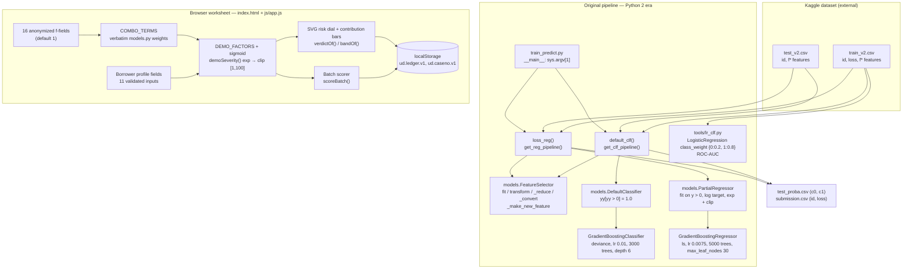

# Underwriting Desk: Loan Default Risk Modeling

## Overview and purpose

Underwriting Desk (browser title: Underwriting Desk — Loan Default Prediction (demo worksheet)) loan-default-prediction <https://github.com/songgc/loan-default-prediction> — stated in the upstream README to have won the Kaggle Loan Default Prediction competition Lending decisions need two answers at once — will this borrower default? and how much will we lose if they do? A single regressor on a heavily zero-inflated target answers neither well. Split the problem into a default probability and a loss severity, then apply severity only when the probability crosses a threshold, producing a submission-shaped id, loss file. The original competitor; today, a student or engineer studying the two-st

## Real-world context and scope

The competition target `loss` is a severity in `[1, 100]` and is **exactly zero for the large majority of rows**. Two things follow.

1. **The target is not a clean binary.** "Did they default?" and "how much?" are different questions, and a single model forced to answer both spends its capacity on a distribution that is mostly zeros.
2. **Naive regression is a bad fit.** A gradient-boosted regressor trained on the raw target spends most of its splits distinguishing "zero" from "non-zero" and then predicts a near-constant severity for everybody who did default — which is exactly the information a lender needs and does not get.

The original solution therefore **decomposes** the problem: estimate a probability of default, estimate a severity conditional on default, and gate the second with the first.

The repository is a 2015-era Kaggle artifact. It is valuable as a model of the decomposition and of hand-engineered feature design, but it does not run unmodified on a current interpreter, and it ships no data and no weights.

The material describes the repository as supplied. **Implemented behavior** is summarized from the source overview and entry points; **proposed or missing functionality** is listed separately below. Do not infer production readiness from a polished interface or project title.

### Verified implementation notes

Read PROJECT_OVERVIEW.md in the source repository for the implementation inventory.

### Proposed, absent, or uncertain behavior

- The web UI is a heuristic demo, not the trained pipeline. The legacy training path requires missing CSV inputs and porting; no model artifact is supplied. Credit decisions need rigorous fairness, calibration, and legal review.

## Technology stack

- `See source project dependency manifest and setup guide`

## System requirements and setup

Use a supported Python environment appropriate to the source dependency pins. Some projects also require data files, trained weights, external APIs, cameras, GPU resources, a database, or an LLM runtime. These are identified in `setup-guide.md`; they are not assumed to be included. Follow the source `WORKFLOW.md` carefully and do not paste real credentials into tracked files.

## Architecture and important components

Real components only — there is no web server in this project.

**Boundary note.** The dashed separation is real: the worksheet shares *coefficients* with the original model and nothing else. Its probability, its severity and its verdict are produced by a different, hand-authored formula that the page prints in full.

## Directory structure

Source paths central to the learning material:

- `PROJECT_OVERVIEW.md`
- `README.md`
- `WORKFLOW.md`
- `index.html`
- `js/app.js`
- `models.py`
- `project-metadata.json`
- `tools/lr_clf.py`
- `train_predict.py`

## Installation, environment, and database

See [`setup-guide.md`](setup-guide.md) for repository-specific commands, environment variables, optional services, and data/model requirements. Database setup is only applicable when the source workflow documents a database.

## Testing

Use only tests and checks present in the source repository. This learning package has not run the source application or trained a model. Expected test behavior and missing coverage are described in the source workflow and lessons.

## Security, privacy, and responsible use

Treat credentials, uploaded data, biometric data, student/financial records, and generated outputs as sensitive where relevant. Apply data minimization, consent and access controls, retention limits, secure secret handling, documented error handling, and human review. For consequential decisions, model outputs are educational signals only. Project-specific hazards appear in the final project guide and source review report.

## Troubleshooting

Start with missing assets and dependency versions, then validate input shape/schema, check configured API/database/model services, inspect logs, and compare observed behavior with the exact source path described in `architecture.md`. Many repositories contain a static UI or stub that is not wired to the model.

## Expected outcome

Complete the final project to explain and reproduce the repository's actual data-to-output path, demonstrate a tested source-aligned extension, and document its limitations.

## Further learning

See `references.json` for official framework references and the source repository's `PROJECT_OVERVIEW.md`, `WORKFLOW.md`, and README for implementation details.
