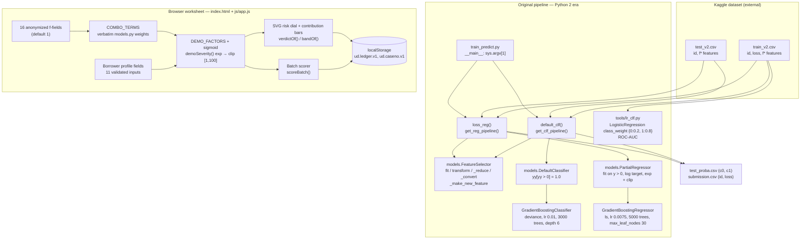
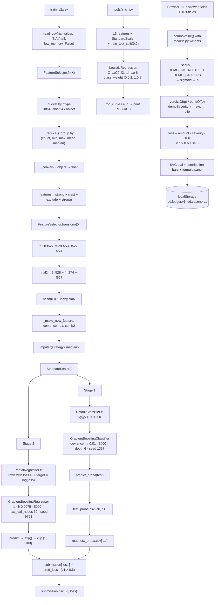

# Architecture — Underwriting Desk: Loan Default Risk Modeling

## Component map

Real components only — there is no web server in this project.

**Boundary note.** The dashed separation is real: the worksheet shares *coefficients* with the original model and nothing else. Its probability, its severity and its verdict are produced by a different, hand-authored formula that the page prints in full.

## Data and control flow

## Algorithm/model details

### 1. The two-stage decomposition

Let `Y` be the observed loss, `1{Y > 0}` the default indicator, and `S = Y · 1{Y > 0}` the severity paid on default.

The pipeline models:

- `P(default) ≈ f₁(X)` — a binary gradient-boosting classifier.
- `E[S | X] ≈ f₂(X)` — a severity regressor trained **only** on defaulted rows.

The final expectation used for scoring is `E[Y|X] ≈ f₂(X) · 1{f₁(X) > 0.6}`.

This is a hard-threshold approximation of `E[S|X] · P(default|X]`. It is not a probability-consistent product — severity is either fully applied or not applied at all — but it is exactly the quantity the competition wanted, and it is far more stable than regressing the zero-inflated target directly, because `f₂` never wastes capacity learning "this row is zero".

The `0.6` cut is a business decision encoded as a constant. Rows at or below the cut get `loss = 0` regardless of how large `f₂` says the severity would be.

### 2. Gradient boosting, and why these hyper-parameters

`GradientBoostingClassifier` and `GradientBoostingRegressor` build an additive ensemble `F_M(x) = F₀ + Σₘ γₘ·hₘ(x)`, fitting each new tree `hₘ` to the negative gradient of the loss.

- **Shallow trees** (`max_depth=6` for the classifier, `max_leaf_nodes=30` for the regressor) with **high `min_samples_leaf` (12 / 20)** — classic regularisation for a wide, low-signal tabular dataset with hundreds of anonymised columns.
- **Very low learning rates** (`0.01` and `0.0075`) with **very many trees** (3,000 and 5,000) — the "slow learning, many steps" recipe. It trades compute time for a smoother, lower-variance fit.
- **`subsample` 0.6 / 0.5** — row subsampling at every iteration for stochastic gradient boosting, which regularises further and makes each tree see a different sample.
- **`loss='deviance'`** on the classifier: the historical name for the logistic loss; sklearn ≥ 1.1 renamed it to `'log_loss'`, so a modern port needs that rename too.
- **`random_state` 1357 / 9753** — fixed seeds, so the run is reproducible.
- **The regressor is `loss='ls'`** (least squares) on `log(loss)`, which turns a skewed, right-heavy severity distribution into something closer to symmetric and makes the exponentiated predictions strictly positive.

### 3. Why log-space severity and clipping

`PartialRegressor.fit` sets `yy = np.log(yy)` for `yy = y[y > 0]`, and `predict` applies `np.exp` and then clips to `[1, 100]`. The log transform means the model fits *relative* errors multiplicatively — a severity of 10 is penalised proportionally more than a severity of 100 — which matches how loss magnitudes behave. The clip guarantees the output stays inside the target's declared range even where the boosted trees extrapolate.

### 4. Handling class imbalance — without SMOTE

There is **no SMOTE, no `imblearn`, no resampling of any kind** in the repository. Two different mechanisms do the work:

- In the **production pipeline**, imbalance is structural: stage 1 is a binary classification with `loss='deviance'` (log loss, which is already imbalance-aware through the log), and stage 2 simply never sees the majority class because it is fitted on `loss > 0` rows only.
- In the **baseline** (`tools/lr_clf.py`), imbalance is handled explicitly by `class_weight={0: 0.2, 1: 0.8}` — the minority (default) class receives 4× the weight of the majority. Note this is an unusual orientation (the *default* class is up-weighted), which matches the task: the point of the model is to catch defaults.

### 5. Feature design

`FeatureSelector` is doing two very different things:

- **Dimensional triage** — `_reduce` groups columns by the tuple `(non-null count, min, max, mean, median)` and keeps one representative per group. On a dataset with hundreds of derived `f*` columns this collapses statistically identical variables automatically.
- **Hand-crafted combination features** — the three `comb*` vectors are linear projections with weights that look like they were fitted or heavily hand-tuned offline. `comb2` reaches 17 terms. The `trial2` feature (`5·f528 − 4·f274 − f527`) is the same idea in a single hand-written expression.

`hasnull` deserves a note: the pipeline imputes missing values with the **median** (so the model still has a usable number) while separately giving the model a binary flag saying "this row had a gap". That is a deliberate separation of *value* from *presence*.

### 6. The browser heuristic (and why it is not the model)

`js/app.js` scores a case as `sigmoid(DEMO_INTERCEPT + Σ wᵢ·xᵢ)` with `DEMO_INTERCEPT = -1.6` and 15 `DEMO_FACTORS` covering DTI, delinquency counts, derogatory reports, credit lines, APR, term, amount, age, income, missingness, and the three `comb` projections (compressed by `tanh(x/40)` and scaled by the blend sliders). The weights are hand-authored for illustration; they were not fitted to any data. The severity formula mirrors `PartialRegressor`'s `exp` + clip, and the `0.6` gate mirrors `train_predict.py` — but the probability is a different function entirely.

## Source inventory

| File | Key symbols | Role |
|---|---|---|
| `train_predict.py` | `read_csv` (partial), `get_clf_pipeline()`, `get_reg_pipeline()`, `default_clf(train_file, test_file, path)`, `loss_reg(train_file, test_file, path)`, `__main__` block | The pipeline entry point: stage 1 → `test_proba.csv`, stage 2 → `submission.csv` |
| `models.py` | `FeatureSelector` (`strong`, `tail_feature_300`, `exclude`, `fit`, `transform`, `fit_transform`, `_reduce`, `_convert`, `_make_new_feature`); `DefaultClassifier` (`fit`, `predict`, `predict_proba`); `PartialRegressor` (`fit`, `predict`) | Feature engineering and the two estimator wrappers |
| `tools/lr_clf.py` | `LogisticRegression(C=1e20, penalty='l2', tol=1e-6, class_weight={0:0.2, 1:0.8})`, `train_test_split(test_size=0.2)`, `roc_curve`, `auc` | A 13-feature logistic baseline; prints the coefficient vector and the ROC-AUC |
| `index.html` | markup for the borrower form, 16 f-fields, dial, contributions, formula panel, batch tab, ledger, and the "Legacy Python 2 pipeline" panel | Browser worksheet |
| `js/app.js` | `LOSS_CUT`, `COMBO_TERMS`, `DEMO_INTERCEPT`, `DEMO_FACTORS`, `FIELDS`, `F_FIELD_IDS`, `STORE_KEYS`, `demoSeverity()`, `verdictOf()`, `bandOf()`, `comboValue()`, `termValue()`, `buildContext()`, `score()`, `buildDial()`, `polar()`, `arcPath()`, `recompute()`, `scoreBatch()`, `storeGet()`/`storeSet()` | The demo scorecard, the SVG dial, batch scoring and localStorage persistence |
| `css/style.css` | stylesheet | Browser UI styling |
| `README.md` | — | Upstream README: description, dependency pins, 4-step "how to run" |
| `LICENSE` | — | MIT, © 2014 Guocong Song |
| `project-metadata.json` | — | Catalog metadata; the `stack` field (`XGBoost`, `Streamlit`) and the `entry` field are both wrong |
| `.gitignore` | — | Python build artefacts; no data exclusion, because the data was never committed |

## Implemented versus proposed

Implemented behavior is limited to the source entry points and code paths described above.

- The web UI is a heuristic demo, not the trained pipeline. The legacy training path requires missing CSV inputs and porting; no model artifact is supplied. Credit decisions need rigorous fairness, calibration, and legal review.
