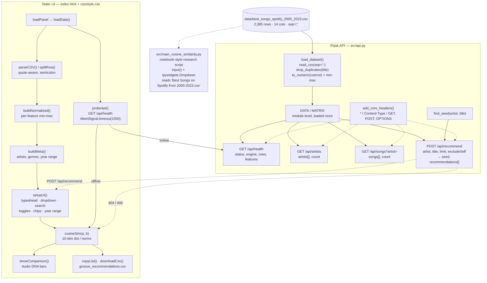

# Groove Observatory: Audio Feature Music Recommendation

## Overview and purpose

Groove Observatory — "Retro record-crate recommender · cosine similarity over audio DNA" music-recommender-from-audio-features <https://github.com/edenmhuang/Music-Recommender> — Eden Huang, Skyline College research project, 2023; peer-reviewed by Prof. Bryan Swartout; write-up on Medium Recommending music normally needs user behaviour (plays, skips, likes). This project asks whether acoustic similarity alone is enough: if two songs share tempo, energy and danceability, are they similar? Take one track, compute its similarity to the rest of a Spotify-feature catalogue, and return the closest matches — as a ranked, explainable, per-feature comparison. A listener browsing a "record crate" and

## Real-world context and scope

Collaborative filtering dominates music recommendation, but it needs a history: what you played, skipped, liked, and how often. Cold-start users have none of that, and a catalogue that has never been played has none either.

**Content-based filtering** inverts the problem: describe the *item* and compare items to each other. If a track's acoustic profile is a point in a 10-dimensional space, then "sounds like" is a geometric question — and geometry has a closed form.

The upstream research question was specifically: *can cosine similarity — a text technique — be reused for music audio features?* The intuition is that acoustic descriptors (tempo, energy, valence, …) behave like sparse text vectors: they are non-negative, bounded, and dominated by a few large components. Cosine similarity is well suited to that shape, because it normalises by vector magnitude and therefore compares *profiles* rather than *levels*.

The honest framing, which the code reflects, is that this is a **baseline**. It is explainable (every recommendation decomposes into ten feature comparisons), instant, and dependency-free — but it has no notion of taste, and "similar" in feature space is only loosely the same as "similar" to a human ear.

The material describes the repository as supplied. **Implemented behavior** is summarized from the source overview and entry points; **proposed or missing functionality** is listed separately below. Do not infer production readiness from a polished interface or project title.

### Verified implementation notes

Read PROJECT_OVERVIEW.md in the source repository for the implementation inventory.

### Proposed, absent, or uncertain behavior

- This is deterministic cosine-neighbor ranking over a local 2,261-row, ten-feature catalogue, not a learned recommender. Catalog coverage and popularity bias limit results.

## Technology stack

- `See source project dependency manifest and setup guide`

## System requirements and setup

Use a supported Python environment appropriate to the source dependency pins. Some projects also require data files, trained weights, external APIs, cameras, GPU resources, a database, or an LLM runtime. These are identified in `setup-guide.md`; they are not assumed to be included. Follow the source `WORKFLOW.md` carefully and do not paste real credentials into tracked files.

## Architecture and important components

Real components only. There is no database, no model server and no queue.

**The key boundary**: the browser and the API compute the *same* similarity from *almost* the same matrix. The API de-duplicates on `title` (2,261 rows); the browser does not (2,385 rows). Different min/max bounds, therefore marginally different percentages — the architecture is duplicated by necessity, because the browser app is designed to work with the backend completely absent.

## Directory structure

Source paths central to the learning material:

- `PROJECT_OVERVIEW.md`
- `README.md`
- `WORKFLOW.md`
- `index.html`
- `js/app.js`
- `project-metadata.json`
- `src/api.py`
- `src/main_cosine_similarity.py`
- `tests/test_artist_selection.py`
- `tests/test_clean_dataset.py`
- `tests/test_cosine_similarity.py`
- `tests/test_song_selection_dropdown.py`
- `tests/test_visualization.py`
- `trials/trial_1_spotify_recommendation.py`
- `trials/trial_2_acoustic_recommendation.py`

## Installation, environment, and database

See [`setup-guide.md`](setup-guide.md) for repository-specific commands, environment variables, optional services, and data/model requirements. Database setup is only applicable when the source workflow documents a database.

## Testing

Use only tests and checks present in the source repository. This learning package has not run the source application or trained a model. Expected test behavior and missing coverage are described in the source workflow and lessons.

## Security, privacy, and responsible use

Treat credentials, uploaded data, biometric data, student/financial records, and generated outputs as sensitive where relevant. Apply data minimization, consent and access controls, retention limits, secure secret handling, documented error handling, and human review. For consequential decisions, model outputs are educational signals only. Project-specific hazards appear in the final project guide and source review report.

## Troubleshooting

Start with missing assets and dependency versions, then validate input shape/schema, check configured API/database/model services, inspect logs, and compare observed behavior with the exact source path described in `architecture.md`. Many repositories contain a static UI or stub that is not wired to the model.

## Expected outcome

Complete the final project to explain and reproduce the repository's actual data-to-output path, demonstrate a tested source-aligned extension, and document its limitations.

## Further learning

See `references.json` for official framework references and the source repository's `PROJECT_OVERVIEW.md`, `WORKFLOW.md`, and README for implementation details.
