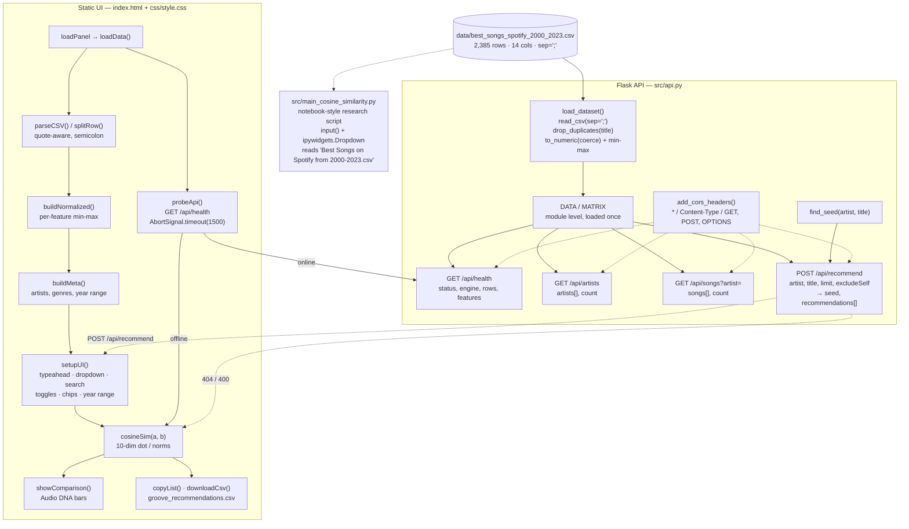
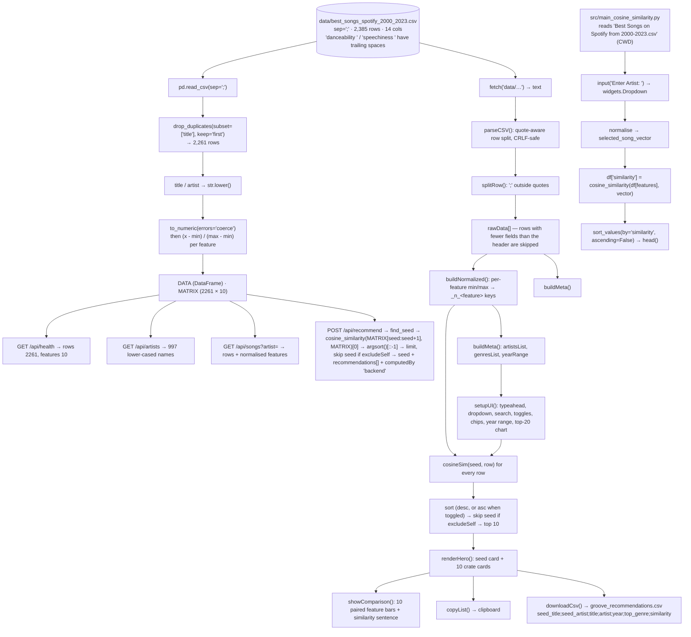

# Architecture — Groove Observatory: Audio Feature Music Recommendation

## Component map

Real components only. There is no database, no model server and no queue.



**The key boundary**: the browser and the API compute the *same* similarity from *almost* the same matrix. The API de-duplicates on `title` (2,261 rows); the browser does not (2,385 rows). Different min/max bounds, therefore marginally different percentages — the architecture is duplicated by necessity, because the browser app is designed to work with the backend completely absent.

## Data and control flow



## Algorithm/model details

### 1. Content-based filtering as geometry

Each track is a point `x ∈ ℝ¹⁰` — one coordinate per acoustic feature. "Sounds like" becomes "is close to". The catalogue of 2,261 points is a cloud; the seed is a query point; the answer is the neighbourhood.

The choice of distance function is the whole design decision, and cosine similarity is chosen for two specific reasons:

- **Magnitude invariance.** Cosine compares *direction*, not length. A track that is uniformly "louder" on every axis (higher bpm *and* higher energy *and* higher valence) keeps the same similarity to the seed regardless of the overall scale. For audio, where absolute levels vary wildly across genres and eras, that is exactly the right behaviour: we want "same shape of track", not "same numeric size".
- **Non-negative, bounded features.** After min-max scaling every coordinate lies in `[0, 1]`, so the vectors live in the non-negative orthant. The angle between two such vectors is bounded and interpretable, and the dot product is never negative.

The formula, as implemented in `js/app.js` and equivalent to `sklearn.metrics.pairwise.cosine_similarity`:

```
sim(a, b) = (a · b) / (‖a‖ · ‖b‖)
           = Σᵢ aᵢbᵢ / (√(Σᵢ aᵢ²) · √(Σᵢ bᵢ²))
```

where `aᵢ` and `bᵢ` are the min-max-scaled values of feature *i*. The dot product and the two norms are accumulated in one pass over the ten features; the function returns `0` if either norm is zero (a track with no measurable features).

### 2. Why min-max normalisation is mandatory here

Cosine similarity is *not* scale-invariant — only rotation-invariant. If `duration` (measured in milliseconds, range 0–400+) and `valence` (0–100) are used raw, the duration coordinate dominates the dot product by two orders of magnitude and the "similarity" becomes a duration ranking. Min-max scaling `(x - min) / (max - min)` maps every feature to `[0, 1]`, making the ten dimensions commensurable and letting each contribute comparably to the angle.

The trade-off is that min-max is **outlier-sensitive**: one extreme value compresses the rest of the column into a narrow band, so that feature effectively stops discriminating. The repository does not treat or winsorise outliers.

### 3. De-duplication and case folding

`drop_duplicates(subset=["title"], keep="first")` removes 124 rows (2,385 → 2,261). The key is the *title alone*, which is a simplification: two different songs sharing a title, or the same song appearing for two artists, collapse to the first occurrence. Lower-casing `title` and `artist` afterwards makes every subsequent comparison case-insensitive — which is why `find_seed()` can compare `artist.lower()` against the already-lowercased column.

### 4. Ranking and the neighbourhood

`sims.argsort()[::-1]` produces descending order; the seed is skipped when `excludeSelf` is set; the loop stops at `limit` rows. The browser implements the same ranking with an explicit `Array.sort` comparator, and adds the *ascending* option, which surfaces the **least** similar tracks in the catalogue — a useful diagnostic and a nice contrast with the "Top Recommendations" framing.

### 5. What this method is *not*

- **It is not trained.** There is no objective function, no optimiser, no parameters, no train/test split. The "model" is a closed form over the dataset's own min and max — which also means the results change if the dataset changes.
- **It is not evaluated.** No precision@k, no hit rate, no NDCG, no catalogue-level metrics exist in the repository. The only evidence offered is one anecdotal pair.
- **It is not collaborative.** Nothing in the system can express "users who liked X also liked Y" or a personal taste profile. Everything is item-to-item.
- **It is not perceptual.** Spotify's features are population-level summaries computed by a proprietary model; "high valence and high energy" is a genre-level statement, not a claim about timbre. Two tracks with identical descriptors can sound nothing alike.

### 6. The "Audio DNA" explanation

`showComparison()` does not call a separate explainability library — it simply re-uses the same normalised matrix to draw the seed's and the match's value for each of the ten features as paired bars. The explanation is therefore *exact* rather than approximate: it shows the numbers that produced the cosine, and lets the user see which dimensions are shared and which are not. The trade-off is that cosine itself does not decompose into per-feature contributions, so the panel shows the profile, not the per-feature contribution to the score.

## Source inventory

| File | Key symbols | Role |
|---|---|---|
| `src/api.py` | `BASE_DIR`, `CSV_PATH`, `FEATURES`, `app`, `add_cors_headers()`, `recommend_preflight()`, `load_dataset()`, `DATA`, `MATRIX`, `find_seed()`, `row_payload()`, `health()`, `artists()`, `songs()`, `recommend()` | The backend: loads and normalises the catalogue once, serves four routes, adds CORS to every response |
| `src/main_cosine_similarity.py` | `read_csv`, `drop_duplicates`, `popular_songs_count`, `sns.barplot`, `select_artist` (`input()`), `select_title` (`widgets.Dropdown`), `acoustic_features`, `selected_song_vector`, `df['similarity']` | The original research script: top-20 artist bar chart, artist/song selection, cosine ranking. Notebook-style and unchanged |
| `js/app.js` | `FEATURES`, `API_BASE`, `apiMode`, `parseCSV()`, `splitRow()`, `probeApi()`, `loadData()`, `buildNormalized()`, `buildMeta()`, `setupUI()`, `getSongsForArtist()`, `populateSongs()`, `populateSongSelect()`, `findSeed()`, `cosineSim()`, `computeRecommendations()`, `recompute()`, `renderHero()`, `showComparison()`, `getMaxRaw()`, `copyList()`, `downloadCsv()`, `resetAll()`, `applyFilters()`, `buildArtistBarChart()`, `escapeHtml()` | The whole front end: CSV parsing, the in-browser engine, the API client, and every interaction |
| `index.html` | `loadPanel`, `appRoot`, `artistInput`/`artistDropdown`, `songSelect`/`songSearch`, `excludeSelfToggle`, `sortToggle`, `featuredBtn`, `recsList`, `comparisonPanel`, `dnaChart`, `genreChips`, `yearStart`/`yearEnd`, `artistBarChart`, the *How it works* tab | Markup for the app, the "Method (from repo)" panel and the featured-match shortcut |
| `css/style.css` | — | The full visual system: masthead, typeahead, crate cards, similarity bars, DNA rows, chips, year range |
| `data/best_songs_spotify_2000_2023.csv` | 14 columns, `;`-separated | The only data dependency; 2,385 rows |
| `requirements-api.txt` | `flask>=2.3`, `pandas>=2.0`, `scikit-learn>=1.3` | Backend dependencies (the UI needs none) |
| `tests/test_clean_dataset.py` | `read_csv`, `drop_duplicates`, `str.lower()` | Scratch script: the cleaning step in isolation |
| `tests/test_artist_selection.py` | `input()`, `df['artist'].str.contains(...)` | Scratch script: the artist filter |
| `tests/test_song_selection_dropdown.py` | `widgets.Dropdown` | Scratch script: the song dropdown |
| `tests/test_cosine_similarity.py` | `selected_song` dict for *Flowers*, `cosine_similarity(...).flatten()` | Scratch script: the similarity computation for one seed |
| `tests/test_visualization.py` | `value_counts().head(20)`, `sns.barplot` | Scratch script: the top-20 artist chart |
| `trials/trial_1_spotify_recommendation.py` | `drop(df.iloc[:, 4:13], axis=1)`, `value_counts()`, the pop/rock/hip-hop/metal/EDM/R&B/rap grouping sets | Experiment: genre distribution and coarse genre grouping |
| `trials/trial_2_acoustic_recommendation.py` | interactive title/artist lookup, normalisation, `cosine_similarity(...).flatten()` | Experiment: interactive selection of a seed track; unfinished (references an undefined `feature`) |
| `project-metadata.json` | `stack`, `goal`, `entry`, `license` | Catalog metadata — `Librosa`, "cluster songs" and `license: Unknown` are inaccurate |
| `.gitignore` | `.ipynb`, `data/main_cosine_similarity_song_recommendation-2.ipynb` | Excludes the original notebook |

## Implemented versus proposed

Implemented behavior is limited to the source entry points and code paths described above.

- This is deterministic cosine-neighbor ranking over a local 2,261-row, ten-feature catalogue, not a learned recommender. Catalog coverage and popularity bias limit results.
