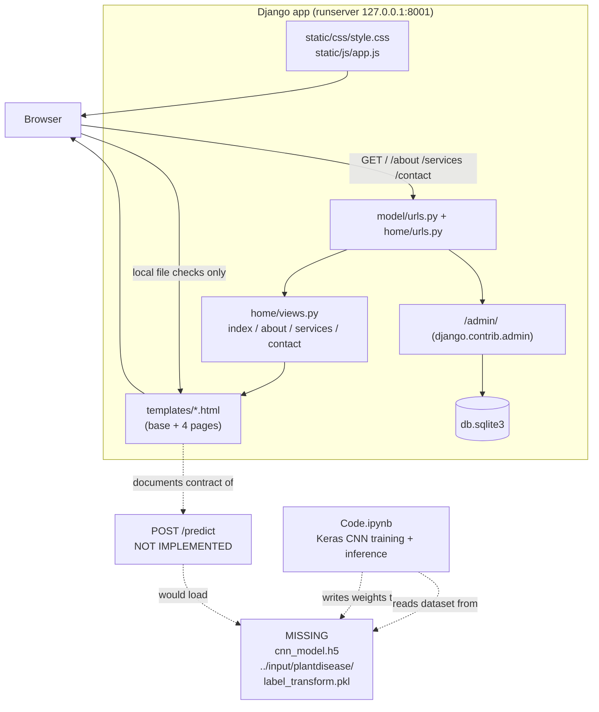

# LeafLens: Plant Leaf Disease Image Classification

## Overview and purpose

LeafLens — Plant Leaf Disease Detection (CNN) plant-leaf-disease-detection-cnn Artificial Intelligence & Machine Learning Monitoring disease symptoms across large fields of crops requires classifying leaf photographs consistently and quickly; manual inspection is slow and subjective. Build a CNN image classifier that maps a photograph of a single leaf to one of fifteen categories and reports healthy-vs-diseased status together with the category. Agricultural researchers, plant-pathology field teams, and anyone prototyping leaf-disease triage. A category label (one of 15) plus a healthy/diseased verdict for an uploaded leaf image. The Django web layer (4 pages + admin), the full Keras trainin

## Real-world context and scope

Automatic plant disease detection matters for agriculture research because monitoring large fields
of crops by eye does not scale. The upstream project states the goal directly: *"the automatic
classifier CNN had been used for classification based on learning with some training samples of that
fifteen category"*, and *"the input is given in the form of an image where after prediction it
reveals the output whether it is healthy or diseased and it also reveals the category it belongs
to."*

Concretely, the engineering problems are:

1. **Feature extraction.** Raw pixels are not a useful representation. A convolutional stack has to
   learn local edges, textures and lesions.
2. **Generalisation on a small, skewed dataset.** Fifteen classes with at most 200 images each is
   small; augmentation and dropout are required to avoid memorising background leaves.
3. **Serving the result.** A notebook is not an application. The output has to reach a user through
   a web interface, with an input image and a class/confidence response.
4. **Honest status.** If the model or the dataset is absent from a checkout, the interface must say
   so rather than invent a diagnosis.

This repository solves (1) and (2) in `Code.ipynb`, and (3)/(4) partially: it ships the web shell,
and it solves (4) completely by refusing to fabricate output.

---

The material describes the repository as supplied. **Implemented behavior** is summarized from the source overview and entry points; **proposed or missing functionality** is listed separately below. Do not infer production readiness from a polished interface or project title.

### Verified implementation notes

Read PROJECT_OVERVIEW.md in the source repository for the implementation inventory.

### Proposed, absent, or uncertain behavior

- `POST /predict` endpoint with a lazily-loaded Keras model.
- Serving the 15 class names (they are not stored in the repo).
- A committed dataset or trained-weight artifact.
- Prediction caching, batch upload, confidence calibration, Grad-CAM visualisation.
- Production deployment (static file collection, WSGI server, environment-driven settings).

---

## Technology stack

- `See source project dependency manifest and setup guide`

## System requirements and setup

Use a supported Python environment appropriate to the source dependency pins. Some projects also require data files, trained weights, external APIs, cameras, GPU resources, a database, or an LLM runtime. These are identified in `setup-guide.md`; they are not assumed to be included. Follow the source `WORKFLOW.md` carefully and do not paste real credentials into tracked files.

## Architecture and important components

### Components that actually exist

| Component | Technology | Files |
|---|---|---|
| Page server | Django 5.2.18 (WSGI/ASGI) | `manage.py`, `model/wsgi.py`, `model/asgi.py` |
| Router | Django URLconf | `model/urls.py`, `home/urls.py` |
| View layer | 4 function-based views, render-only | `home/views.py` |
| Template layer | Django templates | `templates/base.html`, `index.html`, `about.html`, `services.html`, `contact.html` |
| Style layer | Hand-written CSS + Google Fonts | `static/css/style.css` |
| Behaviour layer | Vanilla ES5 JS, browser-only | `static/js/app.js` |
| Database | SQLite (Django ORM) | `db.sqlite3`, `model/settings.py` |
| Training pipeline | Keras / TensorFlow / OpenCV / scikit-learn (notebook) | `Code.ipynb` |
| Model artefact | **Absent** — expected at `./cnn_model.h5` | — |
| Dataset | **Absent** — expected at `../input/plantdisease/` | — |

### Architecture diagram

---

## Directory structure

Source paths central to the learning material:

- `Code.ipynb`
- `PROJECT_OVERVIEW.md`
- `README.md`
- `WORKFLOW.md`
- `home/__init__.py`
- `home/admin.py`
- `home/apps.py`
- `home/migrations/__init__.py`
- `home/models.py`
- `home/predictor.py`
- `home/tests.py`
- `home/urls.py`
- `home/views.py`
- `manage.py`
- `model/__init__.py`
- `model/asgi.py`
- `model/settings.py`
- `model/urls.py`
- `model/wsgi.py`
- `prepare_dataset.py`
- `project-metadata.json`
- `static/js/app.js`
- `templates/about.html`
- `templates/base.html`
- `templates/contact.html`
- `templates/index.html`
- `templates/services.html`
- `train_cnn.py`

## Installation, environment, and database

See [`setup-guide.md`](setup-guide.md) for repository-specific commands, environment variables, optional services, and data/model requirements. Database setup is only applicable when the source workflow documents a database.

## Testing

Use only tests and checks present in the source repository. This learning package has not run the source application or trained a model. Expected test behavior and missing coverage are described in the source workflow and lessons.

## Security, privacy, and responsible use

Treat credentials, uploaded data, biometric data, student/financial records, and generated outputs as sensitive where relevant. Apply data minimization, consent and access controls, retention limits, secure secret handling, documented error handling, and human review. For consequential decisions, model outputs are educational signals only. Project-specific hazards appear in the final project guide and source review report.

## Troubleshooting

Start with missing assets and dependency versions, then validate input shape/schema, check configured API/database/model services, inspect logs, and compare observed behavior with the exact source path described in `architecture.md`. Many repositories contain a static UI or stub that is not wired to the model.

## Expected outcome

Complete the final project to explain and reproduce the repository's actual data-to-output path, demonstrate a tested source-aligned extension, and document its limitations.

## Further learning

See `references.json` for official framework references and the source repository's `PROJECT_OVERVIEW.md`, `WORKFLOW.md`, and README for implementation details.
