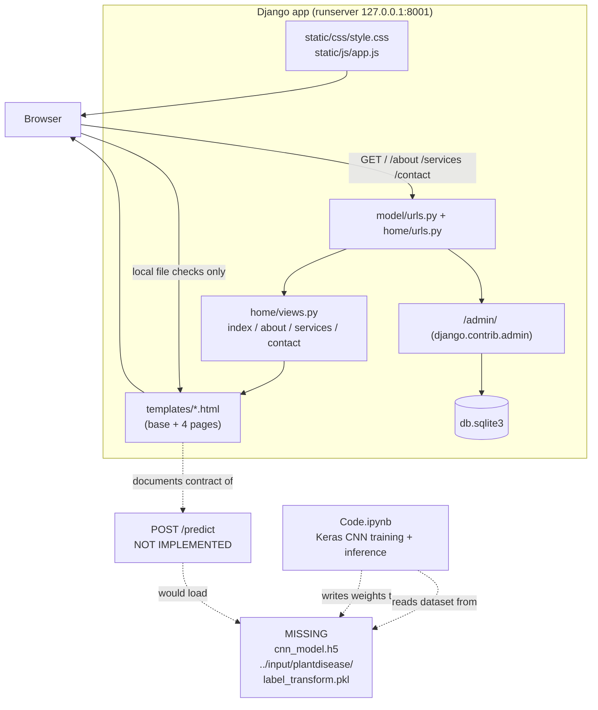

# Architecture — LeafLens: Plant Leaf Disease Image Classification

## Component map

### Components that actually exist

| Component | Technology | Files |
|---|---|---|
| Page server | Django 5.2.18 (WSGI/ASGI) | `manage.py`, `model/wsgi.py`, `model/asgi.py` |
| Router | Django URLconf | `model/urls.py`, `home/urls.py` |
| View layer | 4 function-based views, render-only | `home/views.py` |
| Template layer | Django templates | `templates/base.html`, `index.html`, `about.html`, `services.html`, `contact.html` |
| Style layer | Hand-written CSS + Google Fonts | `static/css/style.css` |
| Behaviour layer | Vanilla ES5 JS, browser-only | `static/js/app.js` |
| Database | SQLite (Django ORM) | `db.sqlite3`, `model/settings.py` |
| Training pipeline | Keras / TensorFlow / OpenCV / scikit-learn (notebook) | `Code.ipynb` |
| Model artefact | **Absent** — expected at `./cnn_model.h5` | — |
| Dataset | **Absent** — expected at `../input/plantdisease/` | — |

### Architecture diagram



---

## Data and control flow

```mermaid
flowchart TD
    subgraph User
        U1[User drags a leaf photo<br/>onto #leaf-drop]
        U2[User clicks "Analyze leaf"]
    end

    subgraph Browser["Browser (static/js/app.js)"]
        V1["acceptFile()<br/>type check + size check<br/>MAX_BYTES = 10 MB"]
        P1["showPreview()<br/>URL.createObjectURL(file)"]
        T1["applyTransform()<br/>rotate + scale"]
        A1["analyzeBtn handler<br/>local check only"]
        BP["#backend-panel<br/>facts about the missing backend"]
        MK["#mock-frame<br/>empty skeleton, no values"]
    end

    subgraph Server["Django (127.0.0.1:8001)"]
        R1["model/urls.py → home/urls.py"]
        R2["home.views.index()"]
        R3["render(index.html, context)"]
    end

    subgraph Repo["Repository artefacts"]
        NB["Code.ipynb"]
        W["cnn_model.h5 (MISSING)"]
        D["../input/plantdisease/ (MISSING)"]
        L["label_transform.pkl (MISSING)"]
    end

    U1 --> V1
    V1 -->|invalid| E1["#file-error message"]
    V1 -->|valid| P1
    P1 --> T1
    U2 --> A1
    A1 --> V1
    A1 --> BP
    A1 --> MK
    R1 --> R2 --> R3
    R3 -.-> U1
    NB --> D
    NB --> W
    NB --> L
    BP -.documents.-> NB
```

**Key observation:** the only data that crosses the network boundary in the running application is
the HTML page itself. The leaf image stays in the browser (object URL), and the classification data
path (`D → NB → W/L → predict`) is entirely inside the repository and currently broken at the first
arrow because the dataset is absent.

---

## Algorithm/model details

### The actual model (from `Code.ipynb`)

**Architecture — a sequential CNN on 256×256×3 RGB input.**

| # | Layer | Output shape (approx.) |
|---|---|---|
| 1 | `Conv2D(32, (3,3), padding="same")` + `Activation("relu")` | 256×256×32 |
| 2 | `BatchNormalization(axis=chanDim)` | 256×256×32 |
| 3 | `MaxPooling2D(pool_size=(3,3))` | 85×85×32 |
| 4 | `Dropout(0.25)` | — |
| 5 | `Conv2D(64, (3,3), padding="same")` + `relu` + `BatchNormalization` | 85×85×64 |
| 6 | `Conv2D(64, (3,3), padding="same")` + `relu` + `BatchNormalization` | 85×85×64 |
| 7 | `MaxPooling2D(pool_size=(2,2))` + `Dropout(0.25)` | 42×42×64 |
| 8 | `Conv2D(128, (3,3), padding="same")` + `relu` + `BatchNormalization` | 42×42×128 |
| 9 | `Conv2D(128, (3,3), padding="same")` + `relu` + `BatchNormalization` | 42×42×128 |
| 10 | `MaxPooling2D(pool_size=(2,2))` + `Dropout(0.25)` | 21×21×128 |
| 11 | `Flatten()` | 56 448 |
| 12 | `Dense(1024)` + `relu` + `BatchNormalization` + `Dropout(0.5)` | 1024 |
| 13 | `Dense(n_classes)` + `Activation("softmax")` | n_classes (= 15) |

**Why this shape works.** Three convolution blocks with 3×3 kernels and "same" padding preserve
spatial resolution while doubling the channel count (32 → 64 → 128); 3×3 then 2×2 max-pooling
halves the spatial size twice per block, so the receptive field grows while computation drops.
`BatchNormalization` stabilises the activations after each conv block, and `Dropout(0.25)` inside
the blocks plus `Dropout(0.5)` before the classifier head is the main regulariser — necessary given
at most ~200 images per class. The final `Dense(n_classes) + softmax` turns the logit vector into a
probability distribution over the fifteen categories.

**Data pipeline.**

- `convert_image_to_array(image_dir)` — `cv2.imread` → `cv2.resize(image, (256, 256))` →
  `img_to_array`. Returns `np.array([])` if the file cannot be read.
- Class discovery — the loader walks `../input/plantdisease/<plant_folder>/<disease_folder>/` and
  keeps files ending in `.jpg`/`.JPG`, capped at **200 images per class**.
- Labels — `LabelBinarizer().fit_transform(label_list)`; the fitted encoder is pickled to
  `label_transform.pkl` and its class count drives `n_classes`.
- Scaling — `np.array(image_list, dtype=np.float16) / 225.0`. (Note: 225 is the upstream constant;
  255 would be the conventional divisor. This is the notebook's behaviour as written and is
  reproduced here verbatim.)
- Split — `train_test_split(..., test_size=0.2, random_state=42)`.
- Augmentation — `ImageDataGenerator(rotation_range=25, width_shift_range=0.1, height_shift_range=0.1,
  shear_range=0.2, zoom_range=0.2, horizontal_flip=True, fill_mode="nearest")`, fed through
  `aug.flow(x_train, y_train, batch_size=BS)`.

**Optimisation.** `Adam(learning_rate=INIT_LR, decay=INIT_LR / EPOCHS)` with `INIT_LR = 1e-3`,
`EPOCHS = 25`, `BS = 32`, `steps_per_epoch = len(x_train) // BS`. The loss is `binary_crossentropy`
(multi-label style, consistent with the binarised labels) and the metric is `accuracy`.
`history.history['accuracy']` / `['val_accuracy']` / `['loss']` / `['val_loss']` are plotted, and
`model.evaluate(x_test, y_test)` prints the test accuracy.

**Inference.** `model.predict(npp_image)` → `np.where(result == np.max(result))` →
`label_binarizer.classes_[itemindex[1][0]]` with the max probability printed alongside.

### What is **not** claimed

No accuracy number, no training curve, no confusion matrix and no evaluation artefact exists in
this repository — the notebook has no saved outputs and no weights are committed. The upstream README
describes the result qualitatively ("minimum error during training and better accuracy in
classification"); this documentation does not turn that into a number.

### The algorithm in the *shipped* web app

There is none. The web app's only algorithms are DOM-level: file-type and size validation, CSS
transform composition, and the debounce/timer logic in `static/js/app.js`. The result skeleton is
deliberately empty.

---

## Source inventory

| File | Role | Key symbols |
|---|---|---|
| `manage.py` | Django CLI entry point | `main()` → `os.environ.setdefault('DJANGO_SETTINGS_MODULE', 'model.settings')` → `execute_from_command_line` |
| `model/settings.py` | Project configuration | `SECRET_KEY`, `DEBUG = True`, `ALLOWED_HOSTS = []`, `INSTALLED_APPS`, `TEMPLATES[0]['DIRS'] = [BASE_DIR/"templates"]`, `DATABASES` (sqlite3 → `BASE_DIR/'db.sqlite3'`), `STATIC_URL = 'static/'`, `STATICFILES_DIRS = [BASE_DIR/"static"]`, `WSGI_APPLICATION = 'model.wsgi.application'` |
| `model/urls.py` | Root URLconf | `admin.site.site_header/site_title/index_title` branding; `path('admin/', admin.site.urls)`, `path('', include('home.urls'))` |
| `model/wsgi.py`, `model/asgi.py` | Server adapters | `application = get_wsgi_application()` / `get_asgi_application()` |
| `home/urls.py` | App URLconf | `path("", views.index, name='home')`, `path("about", …, name='about')`, `path("services", …)`, `path("contact", …)` |
| `home/views.py` | Views (render only) | `index(request)` → `render(request, 'index.html', {"variable": "this is sent"})`; `about`, `services`, `contact` |
| `home/apps.py` | App config | `HomeConfig` (`name = 'home'`) |
| `home/models.py`, `home/admin.py`, `home/tests.py` | Unmodified Django stubs | no models registered, no tests |
| `home/migrations/__init__.py` | Migration package marker | — (no migrations needed; no models) |
| `templates/base.html` | UI shell | ``, nav built with `` … ``, footer with the "Frontend preview — CNN backend not wired" status chip, `<script src="">` |
| `templates/base.html.bak` | Original shell backup | — |
| `templates/index.html` | LeafLens home | Hero (`LeafLens`, 15 categories), `#workbench` scan bench, `#leaf-drop`/`#leaf-input`, `#preview-stage`, `#preview-img`, toolbar buttons `#rotate-left`/`#rotate-right`/`#zoom-in`/`#zoom-out`/`#zoom-reset`/`#remove-file`, `#analyze-btn`, `#backend-panel`, `#mock-frame` skeleton, `.steps` method list, `.plates` gallery, `.researchers` notes |
| `templates/index.html.bak` | Original home backup | — |
| `templates/about.html` | About page | extends `base.html`; body is the original upstream placeholder text |
| `templates/services.html` | Services page | extends `base.html`; original upstream placeholder text |
| `templates/contact.html` | Contact page | extends `base.html`; original upstream `<form action="/action_page.php">` file input |
| `static/css/style.css` | Full stylesheet (22 KB) | Layout, nav, bench, mock frame, plates, researchers, responsive rules |
| `static/js/app.js` | Bench behaviour (ES5, IIFE) | `$()`, `setStatus()`, `showError()`, `clearError()`, `describeSize()`, `extensionOf()`, `applyTransform()`, `resetView()`, `clearFile()`, `showPreview()`, `acceptFile()`, drag/drop handlers, `analyzeBtn` click handler, `init` |
| `static/1.jpg`, `2.jpg`, `3.jpg` (+ `img/` copies) | Original demo photographs | Referenced from `index.html` via `` |
| `static/test.txt` | Original Django placeholder | — |
| `Code.ipynb` | Training + inference | `convert_image_to_array()`, loader loop, `LabelBinarizer`, `ImageDataGenerator`, `model` (Sequential CNN), `model.fit`, `model.evaluate`, `model.save('./cnn_model.h5')`, `load_model`, `model.predict` |
| `db.sqlite3` | SQLite database | admin/auth/contenttypes/session tables |
| `LICENSE` | MIT | Copyright (c) 2022 Ghanshyam Prajapati |
| `project-metadata.json` | Catalogue metadata | upstream repo URL, `stack: Python; TensorFlow; TFLite`, `license: MIT`, `entry: home/apps.py` |

---

## Implemented versus proposed

Implemented behavior is limited to the source entry points and code paths described above.

- Training notebook/code and Django interface exist, but required trained model artifacts are missing; current tests are stubs and do not prove inference. Field photos differ from curated data; diagnosis requires expert confirmation.
