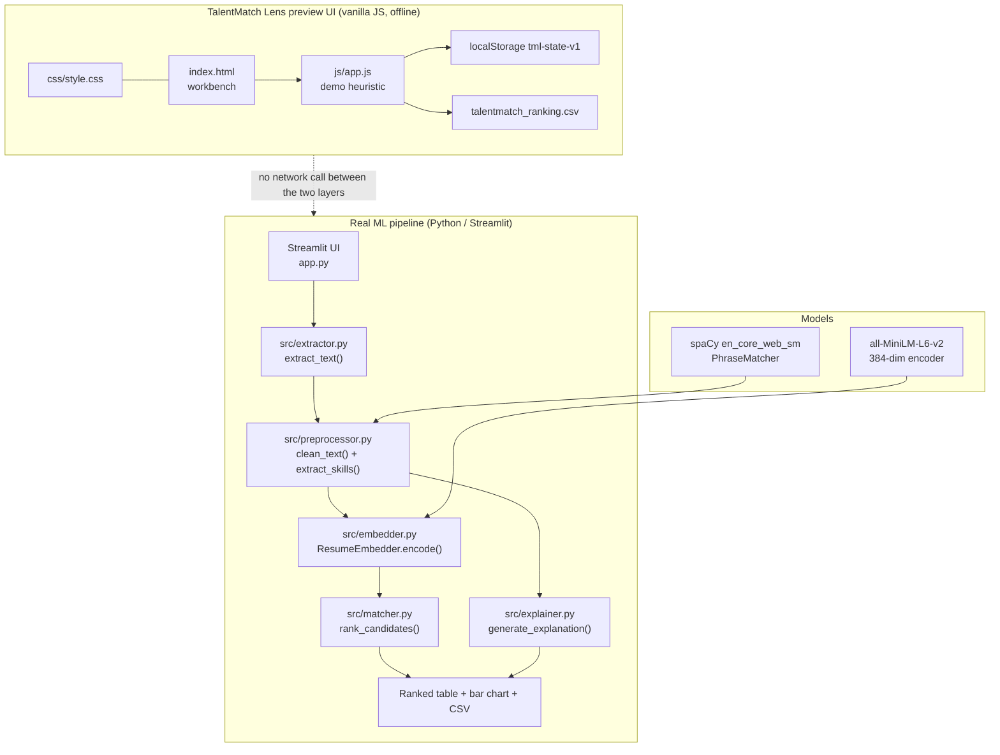

# TalentMatch Lens: Resume and Job Description Matching

## Overview and purpose

TalentMatch Lens is an AI-assisted resume screening system. It takes a job description and a batch of candidate resumes, converts every document into a 384-dimensional sentence embedding with the pretrained all-MiniLM-L6-v2 model, scores each candidate by cosine similarity against the job description, and then produces a plain-English explanation for every score: which skills matched, which required skills are missing, and which extra skills the candidate brings. Problem it addresses. Recruiters skim hundreds of resumes per role; keyword-matching ATS tools miss synonyms ("ML" vs "Machine Learning"); and a bare score is not a defensible hiring input. Objective. Rank candidates in seconds whil

## Real-world context and scope

Screening resumes manually is slow and inconsistent: two recruiters reading the same stack of
documents produce different shortlists, and every decision is hard to justify afterwards.

Three concrete gaps appear in existing tools:

1. **Lexical matching misses meaning.** A candidate who writes "scikit-learn" for a role asking for
   "ML" or "machine learning" is penalised by a keyword ATS, even though the skills are equivalent.
2. **A score alone is not a decision.** A recruiter needs to know *why* a candidate ranked where
   they did — which requirements are met, which are gaps, and what the candidate offers beyond the
   posting.
3. **Rankings are not portable.** A shortlist built in one tool cannot be reviewed, exported or
   defended later without the reasoning attached.

**Non-goals.** This project does not parse scanned resumes (no OCR), does not infer years of
experience or education level (no NER stage), and does not train or fine-tune anything — it uses a
pretrained general-purpose encoder zero-shot.

---

The material describes the repository as supplied. **Implemented behavior** is summarized from the source overview and entry points; **proposed or missing functionality** is listed separately below. Do not infer production readiness from a polished interface or project title.

### Verified implementation notes

**Real pipeline — `app.py` + `src/`**

- JD input by pasted text **or** uploaded PDF/DOCX/TXT, with the extracted text echoed back in a
  read-only box.
- Multi-file resume upload with a live count and a single **Run Screening** trigger.
- Validation gates: empty JD → *"Please provide a job description before running screening."*;
  no resumes → *"Please upload at least one resume before running screening."*; both call
  `st.stop()`.
- Format dispatch: `extract_text()` routes by extension to pdfplumber / python-docx / UTF-8 decode,
  and raises `ValueError` for anything else.
- Light cleaning: `clean_text()` removes emails, URLs and exotic characters, collapses
  whitespace, and deliberately preserves natural language and stopwords.
- Skill extraction against `SKILL_KEYWORDS` using spaCy's `PhraseMatcher` with `attr="LOWER"`, so
  multi-word skills such as "machine learning" match as one unit.
- Embedding with `ResumeEmbedder.encode()` → `(n, 384)` float array, `normalize_embeddings=True`.
- Ranking with `rank_candidates()` → `cosine_similarity(jd_embedding, resume_embeddings)[0]`,
  sorted descending.
- Explanation with `generate_explanation()` → matched / missing / extra skill lists, skill-match
  percentage, and a summary sentence bucketed at 0.75 and 0.55.
- Ranked `st.dataframe` + `st.bar_chart` + CSV download (`resume_screening_results.csv`).
- `@st.cache_resource` on `load_models()` so spaCy and the ~90 MB encoder load once per session.

**Preview UI — `index.html` / `js/app.js` (1168 lines)**

- Job description panel with *Paste text* / *Upload file* tabs and a **Load sample JD (repo)**
  button that fetches `data/sample_job_description.txt`.
- Automatic skill extraction into removable chips, with manual skills preserved and flagged
  (`chip-manual`).
- Up to **8** candidate cards (`MAX_CANDIDATES`), each with a name, a text body and a `.txt`
  loader; searchable by name or text.
- Transparent demo scoring:
  `score = round1((0.55 * tokenCosine + 0.45 * skillJaccard) * 100)`.
- Threshold slider (50–95, default 75) driving **Strong / Partial / Weak** bands.
- Results with an SVG score ring, the cosine and Jaccard components, matched/missing/extra chips
  and the shared terms.
- Side-by-side comparison of two candidates, result filtering, CSV export
  (`talentmatch_ranking.csv`), and clear-results / clear-all.
- State persistence in `localStorage` unde

[Excerpt shortened; consult the cited source guide for full detail.]

### Proposed, absent, or uncertain behavior

- The embedding model is used zero-shot and no evaluation/training data is supplied. Similarity can encode proxy bias and must not rank or reject applicants without meaningful human review.

## Technology stack

- `streamlit==1.38.0`
- `sentence-transformers==3.0.1`
- `torch==2.3.1`
- `scikit-learn==1.5.1`
- `spacy==3.7.5`
- `pdfplumber==0.11.4`
- `python-docx==1.1.2`
- `pandas==2.2.2`
- `numpy==1.26.4`

## System requirements and setup

Use a supported Python environment appropriate to the source dependency pins. Some projects also require data files, trained weights, external APIs, cameras, GPU resources, a database, or an LLM runtime. These are identified in `setup-guide.md`; they are not assumed to be included. Follow the source `WORKFLOW.md` carefully and do not paste real credentials into tracked files.

## Architecture and important components

**Real components (only what exists in the code)**

| Component | Files | Responsibility |
|---|---|---|
| Presentation (real) | `app.py` | Streamlit layout, validation, pipeline orchestration, results, CSV export |
| Document parsing | `src/extractor.py` | PDF/DOCX/TXT → plain text, isolated behind `extract_text()` |
| Text + skills | `src/preprocessor.py` | `clean_text()`, `SKILL_KEYWORDS`, `load_skill_matcher()`, `extract_skills()` |
| Embeddings | `src/embedder.py` | `ResumeEmbedder` wrapping `SentenceTransformer` |
| Scoring | `src/matcher.py` | `rank_candidates()` — cosine similarity + descending sort |
| Explanation | `src/explainer.py` | `generate_explanation()` — set differences + summary |
| Presentation (preview) | `index.html`, `css/style.css`, `js/app.js` | Static recruiter workbench with an in-browser heuristic scorer |
| Assets | `data/sample_job_description.txt` | The only data file in the repository |
| Packaging | `requirements.txt`, `resume_screening_ai.zip`, `project-metadata.json` | 10 pinned dependencies; upstream snapshot; catalogue metadata |

**Runtime dependencies that must be present for the real pipeline:** `streamlit`, `spacy` +
`en_core_web_sm`, `sentence-transformers` + `torch`, `scikit-learn`, `pdfplumber`, `python-docx`,
`pandas`, `numpy`. On this machine, `streamlit`, `sentence-transformers`, `spacy`, `pdfplumber` and
`python-docx` are **not installed** and the bundled `venv/` is unusable (it holds only a bash
`activate` script pointing at `C:\Users\thrin\AI_Internship\resume_screening_ai\venv`).

---

## Directory structure

Source paths central to the learning material:

- `PROJECT_OVERVIEW.md`
- `README.md`
- `WORKFLOW.md`
- `app.py`
- `index.html`
- `js/app.js`
- `project-metadata.json`
- `requirements.txt`
- `src/__init__.py`
- `src/embedder.py`
- `src/explainer.py`
- `src/extractor.py`
- `src/matcher.py`
- `src/preprocessor.py`

## Installation, environment, and database

See [`setup-guide.md`](setup-guide.md) for repository-specific commands, environment variables, optional services, and data/model requirements. Database setup is only applicable when the source workflow documents a database.

## Testing

Use only tests and checks present in the source repository. This learning package has not run the source application or trained a model. Expected test behavior and missing coverage are described in the source workflow and lessons.

## Security, privacy, and responsible use

Treat credentials, uploaded data, biometric data, student/financial records, and generated outputs as sensitive where relevant. Apply data minimization, consent and access controls, retention limits, secure secret handling, documented error handling, and human review. For consequential decisions, model outputs are educational signals only. Project-specific hazards appear in the final project guide and source review report.

## Troubleshooting

Start with missing assets and dependency versions, then validate input shape/schema, check configured API/database/model services, inspect logs, and compare observed behavior with the exact source path described in `architecture.md`. Many repositories contain a static UI or stub that is not wired to the model.

## Expected outcome

Complete the final project to explain and reproduce the repository's actual data-to-output path, demonstrate a tested source-aligned extension, and document its limitations.

## Further learning

See `references.json` for official framework references and the source repository's `PROJECT_OVERVIEW.md`, `WORKFLOW.md`, and README for implementation details.
