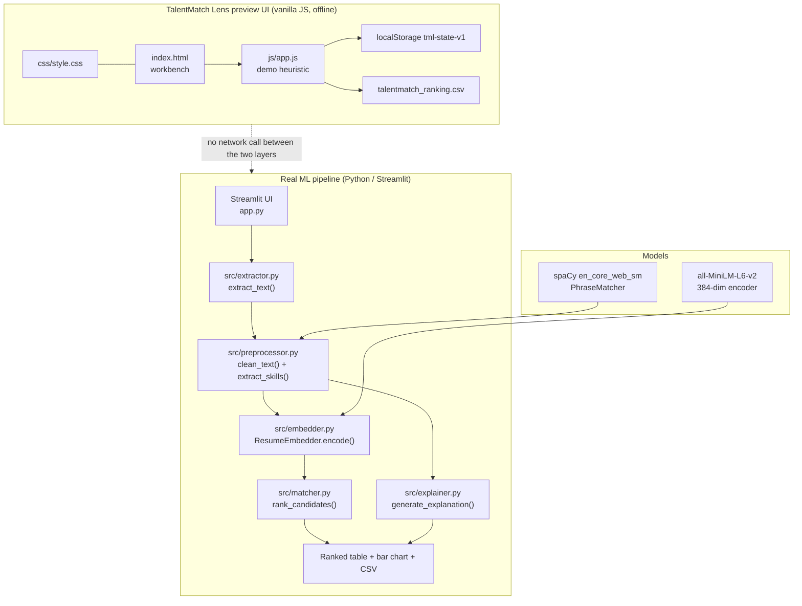
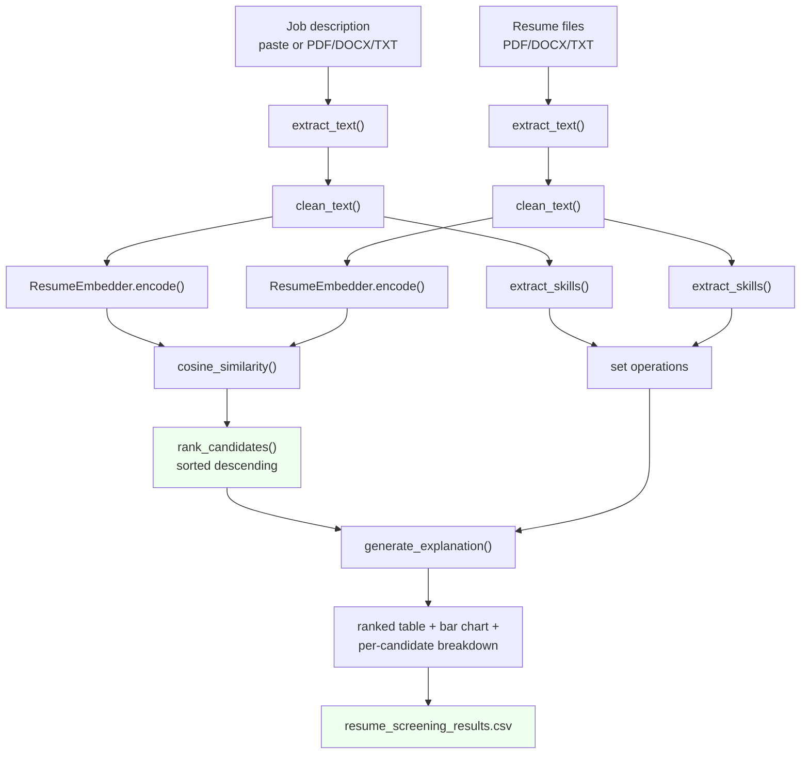

# Architecture — TalentMatch Lens: Resume and Job Description Matching

## Component map



**Real components (only what exists in the code)**

| Component | Files | Responsibility |
|---|---|---|
| Presentation (real) | `app.py` | Streamlit layout, validation, pipeline orchestration, results, CSV export |
| Document parsing | `src/extractor.py` | PDF/DOCX/TXT → plain text, isolated behind `extract_text()` |
| Text + skills | `src/preprocessor.py` | `clean_text()`, `SKILL_KEYWORDS`, `load_skill_matcher()`, `extract_skills()` |
| Embeddings | `src/embedder.py` | `ResumeEmbedder` wrapping `SentenceTransformer` |
| Scoring | `src/matcher.py` | `rank_candidates()` — cosine similarity + descending sort |
| Explanation | `src/explainer.py` | `generate_explanation()` — set differences + summary |
| Presentation (preview) | `index.html`, `css/style.css`, `js/app.js` | Static recruiter workbench with an in-browser heuristic scorer |
| Assets | `data/sample_job_description.txt` | The only data file in the repository |
| Packaging | `requirements.txt`, `resume_screening_ai.zip`, `project-metadata.json` | 10 pinned dependencies; upstream snapshot; catalogue metadata |

**Runtime dependencies that must be present for the real pipeline:** `streamlit`, `spacy` +
`en_core_web_sm`, `sentence-transformers` + `torch`, `scikit-learn`, `pdfplumber`, `python-docx`,
`pandas`, `numpy`. On this machine, `streamlit`, `sentence-transformers`, `spacy`, `pdfplumber` and
`python-docx` are **not installed** and the bundled `venv/` is unusable (it holds only a bash
`activate` script pointing at `C:\Users\thrin\AI_Internship\resume_screening_ai\venv`).

---

## Data and control flow



**Data shapes at each stage**

| Stage | Type | Shape / content |
|---|---|---|
| Raw input | `bytes` / `str` | Uploaded file bytes, or the pasted JD |
| `extract_text()` | `str` | Plain text; `""` for an image-only PDF |
| `clean_text()` | `str` | Emails/URLs/special characters removed, whitespace collapsed |
| `extract_skills()` | `set[str]` | Lowercase skill names, deduplicated |
| `ResumeEmbedder.encode()` | `np.ndarray` | `(1, 384)` for the JD, `(n, 384)` for the resumes; L2-normalised |
| `rank_candidates()` | `list[dict]` | `[{"name": str, "score": float}, ...]`, descending |
| `generate_explanation()` | `dict` | `matched_skills`, `missing_skills`, `extra_skills`, `skill_match_percentage`, `summary` |
| Display | `DataFrame` | Rank, Candidate, Match Score, Skills Matched (%) |
| Export | `bytes` | `resume_screening_results.csv` (UTF-8) |

**Preview-UI data flow**

```
JD text ──▶ findSkills() ──▶ state.skills (auto + manual chips)
                 │
resume text ────┴──▶ tokenSet() ──▶ tokenCosine()  ─┐
                     skillSetsOverlap() ──▶ jaccard ─┴──▶ scoreCandidate() ──▶ state.results
state.threshold ────────────────────────────────────▶ bandFor()  (strong / partial / weak)
                                                              │
                                       persist() ◀──────────┘
                                   localStorage "tml-state-v1"
```

---

## Algorithm/model details

**The model.** `all-MiniLM-L6-v2` — a pretrained sentence-transformer (MiniLM architecture, 6 layers,
384-dim output, ~80–90 MB). It is used **zero-shot**: the repository contains no training script,
no dataset, no fine-tuning code and no evaluation metrics. Sentence-Transformers (rather than raw
BERT) is the right tool because BERT produces one vector *per token*; averaging those yields poor
sentence-level similarity, whereas a sentence-transformer is trained so the whole-text embedding is
directly comparable by cosine similarity.

**Normalisation.** `ResumeEmbedder.encode()` sets `normalize_embeddings=True`, so every vector has
unit length and cosine similarity equals the dot product.

**Scoring.** `cosine_similarity(jd_embedding, resume_embeddings)[0]` in `src/matcher.py` gives one
score in `[-1, 1]` per candidate. Cosine is chosen over Euclidean distance because it measures the
*angle* between vectors, not their magnitude — important because resume lengths vary widely and a
3-page resume should not out-score a 1-page one purely by containing more text.

**The explainability layer (rule-based, not learned).**

```
matched  = jd_skills ∩ resume_skills
missing  = jd_skills − resume_skills
extra    = resume_skills − jd_skills
skill_match_percentage = round(len(matched) / len(jd_skills) × 100, 1)   # 0.0 if the JD has no known skills
```

The summary is a fixed template with three bands: `similarity_score >= 0.75` → *"a strong overall
match"*; `>= 0.55` → *"a moderate match"*; otherwise *"a weak match"*.

**Skill detection.** `load_skill_matcher()` builds a spaCy `PhraseMatcher` over the 90-entry
`SKILL_KEYWORDS` list with `attr="LOWER"`, so matching is case-insensitive and multi-word phrases
match as a unit. `extract_skills()` lowercases the text, runs the matcher and returns a set of
matched spans. This is a **fixed dictionary**, so a skill outside the 90 entries is invisible to the
explanation even when the embedding score reflects it.

**Text cleaning.** `clean_text()` removes emails (`\S+@\S+`), URLs (`http\S+|www\.\S+`), characters
outside `[a-zA-Z0-9.,;:()/#+\-\s]`, and collapses whitespace. It intentionally does **not** strip
stopwords or lemmatise — the module docstring notes that over-cleaning hurts embedding quality
because transformer models expect natural, fluent text.

**Preview-UI heuristic (demo only, not the model).**

```
cos      = |sharedTokens| / sqrt(|jdTokens| × |resumeTokens|)      # over stopword-filtered tokens
jaccard  = |jdSkills ∩ resumeSkills| / |jdSkills ∪ resumeSkills|
score     = round1((0.55 × cos + 0.45 × jaccard) × 100)
```

Token extraction uses the regex `[a-z0-9+#][a-z0-9+#.]*`, drops tokens shorter than 2 characters and
removes ~70 stopwords (including resume/recruitment boilerplate such as "experience", "skills",
"role", "team"). Skill detection in the browser is a regex boundary scan
(`(^|[^a-z0-9])keyword([^a-z0-9]|$)`) over the same 90 keywords — without spaCy's phrase matcher, so
a multi-word skill can match partially.

---

## Source inventory

| File | Key functions / symbols | Notes |
|---|---|---|
| `app.py` | `load_models()` (`@st.cache_resource`), `st.set_page_config`, `st.file_uploader`, `st.download_button`, `st.dataframe`, `st.bar_chart` | 212 lines. The real entry point. Calls `spacy.load("en_core_web_sm")` and `ResumeEmbedder(model_name="all-MiniLM-L6-v2")` at import time |
| `src/__init__.py` | — | 128-byte package marker |
| `src/extractor.py` | `extract_text(filename, file_bytes)`, `extract_text_from_pdf(file_bytes)`, `extract_text_from_docx(file_bytes)`, `extract_text_from_txt(file_bytes)` | 96 lines. pdfplumber page-by-page; docx non-empty paragraphs; UTF-8 with `errors="ignore"`. Raises `ValueError` for unsupported extensions |
| `src/preprocessor.py` | `SKILL_KEYWORDS` (90 entries), `clean_text(text)`, `load_skill_matcher(nlp)`, `extract_skills(text, nlp, matcher)` | 112 lines. The skill dictionary is the single source of truth for the explainability layer |
| `src/embedder.py` | `class ResumeEmbedder` → `__init__(model_name="all-MiniLM-L6-v2")`, `encode(texts) -> np.ndarray` | 58 lines. `convert_to_numpy=True`, `show_progress_bar=False`, `normalize_embeddings=True`; returns `(n, 384)` |
| `src/matcher.py` | `rank_candidates(jd_embedding, resume_embeddings, resume_names) -> list[dict]` | 46 lines. `cosine_similarity(...)[0]`, dicts `{"name", "score"}`, sorted descending |
| `src/explainer.py` | `generate_explanation(jd_skills, resume_skills, similarity_score) -> dict` | 65 lines. Returns `matched_skills`, `missing_skills`, `extra_skills`, `skill_match_percentage`, `summary`; percentage falls back to 0.0 when the JD has no recognised skills |
| `index.html` | Tabs `#tabPaste` / `#tabUpload`, `#jdText`, `#jdFile`, `#loadSample`, `#extractSkills`, `#skillInput`, `#candList`, `#addCand`, `#threshold`, `#runScreening`, `#exportCsv`, `#compareSection`, `#about` | 10.8 KB. Semantic markup, `aria-*` attributes, Google Fonts (Plus Jakarta Sans, JetBrains Mono) |
| `css/style.css` | — | 22.8 KB. CSS custom properties, ring/bar/panel styling, responsive layout, reduced-motion rules |
| `js/app.js` | `SKILL_KEYWORDS`, `STOPWORDS`, `STORAGE_KEY = "tml-state-v1"`, `MAX_CANDIDATES = 8`, `tokenSet()`, `tokenCosine()`, `skillSetsOverlap()`, `scoreCandidate()`, `bandFor()`, `bandLabel()`, `ringMarkup()`, `runScreening()`, `renderResults()`, `renderCompare()`, `exportCsv()`, `persist()`, `restore()`, `loadSampleJd()`, `handleResumeFile()`, `handleJdFile()`, `bindGlobalKeys()` | 1168 lines, ES5-style vanilla JS in an IIFE. `exportCsv()` writes `talentmatch_ranking.csv` with a Blob; the only `fetch()` is `data/sample_job_description.txt` |
| `data/sample_job_description.txt` | — | 683 bytes. "Machine Learning Engineer" posting: Python, PyTorch, scikit-learn, NLP/transformers, FastAPI/Flask, SQL, AWS/GCP, Docker, CI/CD, Agile/Scrum |
| `requirements.txt` | — | 10 pins: `streamlit==1.38.0`, `sentence-transformers==3.0.1`, `torch==2.3.1`, `scikit-learn==1.5.1`, `spacy==3.7.5`, `pdfplumber==0.11.4`, `python-docx==1.1.2`, `pandas==2.2.2`, `numpy==1.26.4` |
| `venv/Scripts/activate` | — | The only file in `venv/`. A **bash** script; sets `VIRTUAL_ENV="C:\Users\thrin\AI_Internship\resume_screening_ai\venv"`. No `python.exe`, no `site-packages` → unusable |
| `resume_screening_ai.zip` | — | Upstream snapshot: `src/*.py`, `app.py`, `requirements.txt`, `README.md`, `.gitignore`, `data/sample_job_description.txt`. No models, no datasets |
| `project-metadata.json` | — | `id`, `repository`, `stack: "Python; spaCy; FastAPI"`, `license: "MIT"`, `entry: "app.py"`, `expectedFileCount: 7`, `downloadedFileCount: 13`. The FastAPI mention is **not** backed by code |
| `LICENSE` | — | MIT, Copyright (c) 2026 Thrinath Polanki |

---

## Implemented versus proposed

Implemented behavior is limited to the source entry points and code paths described above.

- The embedding model is used zero-shot and no evaluation/training data is supplied. Similarity can encode proxy bias and must not rank or reject applicants without meaningful human review.
