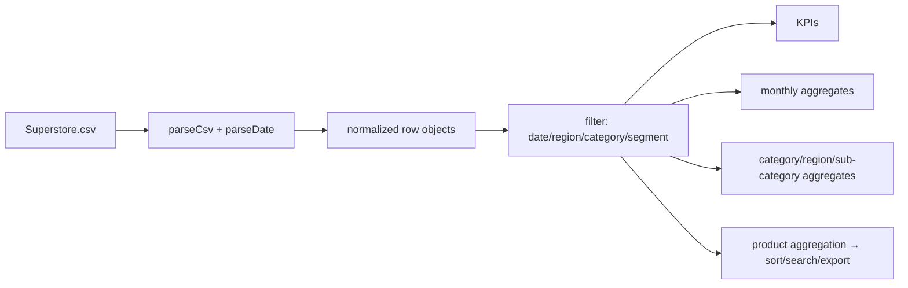

# Architecture — DemandSight: Retail Sales Analytics

## Component map

```mermaid
flowchart TD
    U[User + Browser] --> HTML[index.html + css/style.css]
    HTML --> JS[js/app.js analytics engine]
    JS -->|fetch same-origin| CSV[(dataset/Superstore.csv)]
    JS --> KPI[KPI strip + sparklines]
    JS --> CH[Chart.js charts via CDN]
    JS --> TB[Top products table / export]
    subgraph optional upstream (not used by UI)
        APP[app.py cleaning] --> MYSQL[(MySQL)] --> RUN[run_all_queries.py + sql/retail_analysis.sql]
    end
```

## Data and control flow



## Algorithm/model details

No ML model exists in this project. The core processing is deterministic aggregation:
groupBy + sum/mean over filtered rows, monthly bucketing by calendar month, and a sales-weighted
discount mean (`Σ(discount·sales)/Σ(sales)`). Margin % is `profit/sales`. Sub-category profitability
is a signed sum of profit used for diverging bars.

## Source inventory

| File | Responsibility |
|---|---|
| `index.html` | Layout: filter ribbon, KPI strip, chart panels, products table, forecast/data-notes panels |
| `js/app.js` | `parseCsv`, `parseDate`, `loadData`, `buildFilters`/`makeChip`, `applyFilters`, `renderKpis`, `renderSparkline`, `renderSalesChart`, `renderBarChart`, `renderSubcatChart`, `productAgg`/`currentProducts`/`renderProductsTable`, export & insight handlers |
| `dataset/Superstore.csv` | 9,994 rows × 21 columns, 2014–2017 |
| `css/style.css` | Dark dashboard styling |
| `app.py`, `sql/`, `run_all_queries.py` | Upstream MySQL analytics kit (independent of the UI) |

## Implemented versus proposed

Implemented behavior is limited to the source entry points and code paths described above.

- No forecasting model exists: the implementation aggregates transaction data. The ETL requires MySQL and pymysql is omitted from requirements. Seasonal prediction is an extension, not shipped behavior.
