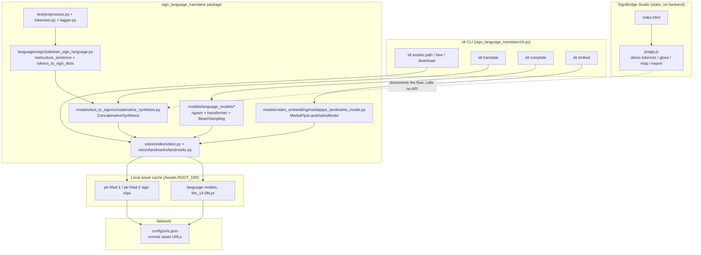

# SignBridge: Rule-Based Sign Language Text Translation

## Overview and purpose

sign-language-to-text-translation signlanguagetranslator v0.8.1 (Poetry, Apache-2.0) SignBridge Studio (index.html, css/style.css, js/app.js) Hearing and hearing-impaired people cannot communicate directly; most deaf people in the developing world use a regional sign language that has almost no digital text corpus, so mainstream speech/OCR translation tools are useless to them. Provide a reusable, extensible Python framework that (a) converts written text into a sequence of sign-language video clips using a dictionary of recorded signs, and (b) converts sign videos into machine-learning-friendly landmark/embedding vectors so that sign-to-text models can be trained. Deaf and hearing-impaired

## Real-world context and scope

Automatic Sign Language Translation (ASLT) is hard for three compounding reasons:

1. **No written corpus.** Sign languages have no standard orthography, so there is no text to align with, and no large parallel text corpus to train a sequence-to-sequence model on.
2. **Spatial and temporal structure.** A sign is a 3-D trajectory of hand, arm and body configurations. It is not a sequence of discrete symbols, so it must be reduced to a numeric representation (landmarks) before any learning can happen.
3. **Regional variation and resource scarcity.** Each country has its own sign language and its own dictionary of recorded clips. Pakistan Sign Language (PSL) has a curated `pk-hfad` clip collection, but the tooling to use it did not exist.

The upstream project answers this with a **rule-based** first step: given a dictionary of word-level sign videos plus a JSON mapping from text tokens to those videos, you can assemble a sentence into a video by concatenating clips. The same framework then offers a landmark extractor to produce training data for the *neural* sign-to-text models that would come later.

The material describes the repository as supplied. **Implemented behavior** is summarized from the source overview and entry points; **proposed or missing functionality** is listed separately below. Do not infer production readiness from a polished interface or project title.

### Verified implementation notes

Read PROJECT_OVERVIEW.md in the source repository for the implementation inventory.

### Proposed, absent, or uncertain behavior

- The core is rule-based gloss restructuring and token-to-clip mapping, not video recognition or general language translation. Clip coverage and dialect/culture constraints need signer review.

## Technology stack

- `opencv_contrib_python==4.8.0.74`
- `tqdm==4.65.0`
- `matplotlib==3.7.2`
- `numpy==1.25.1`
- `torch==2.1.2`
- `click==8.1.6`
- `requests==2.31.0`
- `mediapipe==0.10.11`
- `deep_translator==1.11.4`

## System requirements and setup

Use a supported Python environment appropriate to the source dependency pins. Some projects also require data files, trained weights, external APIs, cameras, GPU resources, a database, or an LLM runtime. These are identified in `setup-guide.md`; they are not assumed to be included. Follow the source `WORKFLOW.md` carefully and do not paste real credentials into tracked files.

## Architecture and important components

Three cooperating layers, none of which is a web service:

1. **Library core** (`sign_language_translator/`) — pure Python, imported as `sign_language_translator as slt`.
2. **CLI shell** (`sign_language_translator/cli.py`) — a Click group exposing the same core over a terminal.
3. **Static UI** (`index.html`, `css/style.css`, `js/app.js`) — an independent, zero-dependency browser demo that documents the flow.

Supporting infrastructure: the `Assets` manager plus `config/urls.json` (downloads), `config/enums.py` (short codes / factory lookup), and `config/settings.py` (asset root).

## Directory structure

Source paths central to the learning material:

- `.github/FUNDING.yml`
- `.github/workflows/check_releasable.yml`
- `.github/workflows/coverage.yaml`
- `.github/workflows/release.yml`
- `.readthedocs.yaml`
- `PROJECT_OVERVIEW.md`
- `README.md`
- `WORKFLOW.md`
- `docs/conf.py`
- `docs/requirements.txt`
- `index.html`
- `js/app.js`
- `project-metadata.json`
- `pyproject.toml`
- `requirements.txt`
- `sign_language_translator/__init__.py`
- `sign_language_translator/cli.py`
- `sign_language_translator/config/__init__.py`
- `sign_language_translator/config/assets.py`
- `sign_language_translator/config/colors.py`
- `sign_language_translator/config/enums.py`
- `sign_language_translator/config/settings.py`
- `sign_language_translator/config/urls.json`
- `sign_language_translator/config/utils.py`
- `sign_language_translator/languages/__init__.py`
- `sign_language_translator/languages/sign/__init__.py`
- `sign_language_translator/languages/sign/mapping_rules.py`
- `sign_language_translator/languages/sign/pakistan_sign_language.py`
- `sign_language_translator/languages/sign/sign_language.py`
- `sign_language_translator/languages/text/__init__.py`
- `sign_language_translator/languages/text/english.py`
- `sign_language_translator/languages/text/hindi.py`
- `sign_language_translator/languages/text/text_language.py`
- `sign_language_translator/languages/text/urdu.py`
- `sign_language_translator/languages/utils.py`
- `sign_language_translator/languages/vocab.py`
- `sign_language_translator/text/__init__.py`
- `sign_language_translator/text/metrics.py`
- `sign_language_translator/text/preprocess.py`
- `sign_language_translator/text/subtitles.py`
- `sign_language_translator/text/synonyms.py`
- `sign_language_translator/text/tagger.py`
- `sign_language_translator/text/tokenizer.py`
- `sign_language_translator/text/utils.py`
- `sign_language_translator/utils/__init__.py`
- `sign_language_translator/utils/archive.py`
- `sign_language_translator/utils/arrays.py`
- `sign_language_translator/utils/download.py`
- `sign_language_translator/utils/parallel.py`
- `sign_language_translator/utils/tree.py`
- `sign_language_translator/utils/utils.py`
- `sign_language_translator/vision/__init__.py`
- `sign_language_translator/vision/_utils.py`
- `sign_language_translator/vision/landmarks/__init__.py`
- `sign_language_translator/vision/landmarks/connections.py`
- `sign_language_translator/vision/landmarks/display.py`
- `sign_language_translator/vision/landmarks/landmarks.py`
- `sign_language_translator/vision/sign/__init__.py`
- `sign_language_translator/vision/sign/sign.py`
- `sign_language_translator/vision/sign/transformations.py`

## Installation, environment, and database

See [`setup-guide.md`](setup-guide.md) for repository-specific commands, environment variables, optional services, and data/model requirements. Database setup is only applicable when the source workflow documents a database.

## Testing

Use only tests and checks present in the source repository. This learning package has not run the source application or trained a model. Expected test behavior and missing coverage are described in the source workflow and lessons.

## Security, privacy, and responsible use

Treat credentials, uploaded data, biometric data, student/financial records, and generated outputs as sensitive where relevant. Apply data minimization, consent and access controls, retention limits, secure secret handling, documented error handling, and human review. For consequential decisions, model outputs are educational signals only. Project-specific hazards appear in the final project guide and source review report.

## Troubleshooting

Start with missing assets and dependency versions, then validate input shape/schema, check configured API/database/model services, inspect logs, and compare observed behavior with the exact source path described in `architecture.md`. Many repositories contain a static UI or stub that is not wired to the model.

## Expected outcome

Complete the final project to explain and reproduce the repository's actual data-to-output path, demonstrate a tested source-aligned extension, and document its limitations.

## Further learning

See `references.json` for official framework references and the source repository's `PROJECT_OVERVIEW.md`, `WORKFLOW.md`, and README for implementation details.
