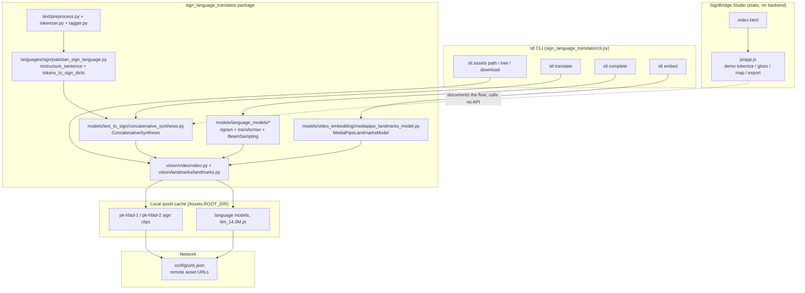
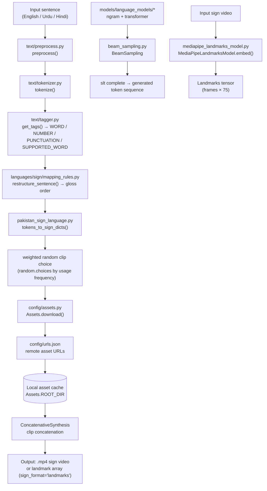

# Architecture — SignBridge: Rule-Based Sign Language Text Translation

## Component map

Three cooperating layers, none of which is a web service:

1. **Library core** (`sign_language_translator/`) — pure Python, imported as `sign_language_translator as slt`.
2. **CLI shell** (`sign_language_translator/cli.py`) — a Click group exposing the same core over a terminal.
3. **Static UI** (`index.html`, `css/style.css`, `js/app.js`) — an independent, zero-dependency browser demo that documents the flow.

Supporting infrastructure: the `Assets` manager plus `config/urls.json` (downloads), `config/enums.py` (short codes / factory lookup), and `config/settings.py` (asset root).

## Data and control flow

**Asset flow:** every clip referenced by the lexicon is checked against the local cache; a miss triggers an HTTP GET against the URL recorded in `config/urls.json`, the payload is written into `Assets.ROOT_DIR`, and the pipeline continues.

## Algorithm/model details

**The rule-based translator is not a machine-learning model.** It is a deterministic transformation chain, and the README describes it as "rule-based". Its components:

- **Tokenisation** — `text/tokenizer.py` splits on language-specific boundaries; `text/tagger.py` assigns one of the `Tags` enum values.
- **Gloss restructuring** — `mapping_rules.py` holds per-rule regular-expression substitutions that move question words, drop stopwords and remove punctuation, approximating the target sign language's word order.
- **Clip mapping** — `PakistanSignLanguage.tokens_to_sign_dicts()` tries a direct token→clip lookup, then a digit expansion (each digit is a separate clip), then a spelling fallback (one clip per character).
- **Clip selection** — weighted random choice using per-clip usage frequency; this is the only stochastic element.

**The ML parts of the repository**

| Component | Type | What it does |
| --- | --- | --- |
| `MediaPipeLandmarksModel` | Neural model (MediaPipe pose + hand landmark networks) | Maps a video frame to a fixed-length vector: 33 pose landmarks + 2 × 21 hand landmarks, 5 channels (x, y, z, visibility, presence) → 75 values per frame. |
| `NgramLanguageModel` | Statistical n-gram LM | Character/word-level next-token probabilities, used by `slt complete`. |
| `TransformerLanguageModel` (`models/language_models/transformer_language_model/`) | Neural sequence model | Token embedding + transformer layers, trained by `train.py`; the released checkpoint is `tlm_14.0M.pt` (~14 M parameters) for `ur-supported-gpt`. |
| `BeamSampling` (`beam_sampling.py`) | Search algorithm | Beam search over one or more language models with per-model selection weights (`--model-weight`) and a `choose`/`merge` selection strategy. |
| `VectorLookupModel` (`models/text_embedding/vector_lookup_model.py`) | Lookup table | Maps text tokens to precomputed FastText-style vectors (`lookup-ur-fasttext-cc`). |

**What the repo does *not* contain:** a trained sign-to-text classifier. `sign_language_translator/__init__.py` shows the intended usage and comments it out with `# sign-to-text model (pytorch) (COMING SOON!)`. The library's role is to *generate the synthetic training data* such a model would need.

## Source inventory

| File | Key symbols | Role |
| --- | --- | --- |
| `sign_language_translator/__init__.py` | `Assets`, `Video`, `Landmarks`, `get_model`, `get_text_language`, `get_sign_language`, `get_sign_wrapper_class`, `__version__` | Public API surface and the usage docstring. |
| `sign_language_translator/cli.py` | `slt`, `assets` (group), `path`, `tree`, `download`, `translate`, `complete`, `embed` | Click console script; every user-facing flag lives here. |
| `sign_language_translator/config/assets.py` | `Assets` (`ROOT_DIR`, `FILE_TO_URL`, `set_root_dir`, `download`, `list_all`, `delete`) | Owns the local asset cache and the download lifecycle. |
| `sign_language_translator/config/urls.json` | URL manifest | The single source of truth for downloadable datasets and models. |
| `sign_language_translator/config/enums.py` | `ModelCodes`, `TextLanguages`, `SignLanguages`, `SignFormats`, `ModelCodeGroups` | Short codes used on the CLI and in the UI's "Model zoo" panel. |
| `sign_language_translator/config/settings.py` | `Settings` | Default asset root and other defaults. |
| `sign_language_translator/text/preprocess.py` | `preprocess()` | Normalisation before tokenisation. |
| `sign_language_translator/text/tokenizer.py` | `tokenize()` | Language-aware token splitting. |
| `sign_language_translator/text/tagger.py` | `get_tags()`, `Tags` | Token classification (`WORD`, `NUMBER`, `PUNCTUATION`, `SUPPORTED_WORD`). |
| `sign_language_translator/text/synonyms.py` | synonym expansion helpers | Optional `deep-translator` back-off for unknown words. |
| `sign_language_translator/languages/sign/pakistan_sign_language.py` | `PakistanSignLanguage`, `tokens_to_sign_dicts()`, `restructure_sentence()` | The only sign-language implementation shipped. |
| `sign_language_translator/languages/sign/mapping_rules.py` | rule table | Regular-expression gloss transformations. |
| `sign_language_translator/languages/text/{english,urdu,hindi}.py` | `English`, `Urdu`, `Hindi` text languages | Lexicon sizes and preprocessing per language. |
| `sign_language_translator/models/text_to_sign/concatenative_synthesis.py` | `ConcatenativeSynthesis`, `translate()` | Orchestrates the whole text → sign chain. |
| `sign_language_translator/models/video_embedding/mediapipe_landmarks_model.py` | `MediaPipeLandmarksModel`, `embed()` | Pose + hand landmark extraction. |
| `sign_language_translator/models/video_embedding/video_embedding_model.py` | `VideoEmbeddingModel` (abstract) | Base class for embedders. |
| `sign_language_translator/models/language_models/ngram_language_model.py` | `NgramLanguageModel` | n-gram statistics + probability lookup. |
| `sign_language_translator/models/language_models/beam_sampling.py` | `BeamSampling` | Beam search across one or more LMs. |
| `sign_language_translator/models/language_models/transformer_language_model/model.py` | `TransformerLanguageModel` | Neural LM used by `ur-supported-gpt`. |
| `sign_language_translator/models/utils.py` | `get_model()` | Factory that maps short codes → concrete classes. |
| `sign_language_translator/vision/video/video.py` | `Video` | Video container: `load_asset()`, `iter_frames()`, `save()`, `show()`. |
| `sign_language_translator/vision/landmarks/landmarks.py` | `Landmarks` | Landmark array wrapper with `show()` and connections. |
| `sign_language_translator/utils/download.py` | download helpers | HTTP fetch used by `Assets`. |
| `index.html` | — | SignBridge Studio markup: five-stage rail, "Model zoo", "CLI quickstart", "Build your own translator". |
| `js/app.js` | demo tokenizer / gloss rules / lexicon / export handlers | The browser demo. No `fetch()` calls, no network. |
| `css/style.css` | — | UI styling. |
| `pyproject.toml` | `[tool.poetry.scripts] slt = "sign_language_translator.cli:slt"` | Packaging and the console-script entry point. |
| `tests/` | `test_cli.py`, `tests/models/test_text_to_sign/test_concatenative_synthesis.py`, … | pytest suite (declared under the `dev` extra). |

## Implemented versus proposed

Implemented behavior is limited to the source entry points and code paths described above.

- The core is rule-based gloss restructuring and token-to-clip mapping, not video recognition or general language translation. Clip coverage and dialect/culture constraints need signer review.
