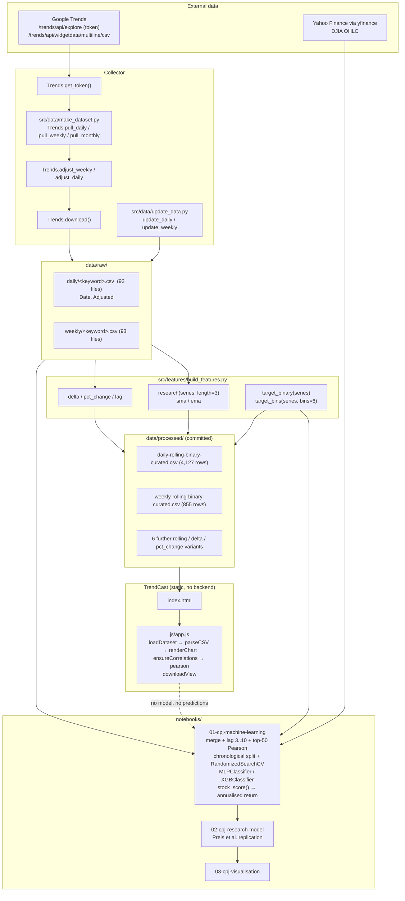

# TrendCast: Stock Price Trend Research

## Overview and purpose

stock-price-trend-predictor "Njord" by Cristian Perez Jensen (MIT) — PROJECTNAME = Stock-Market-Prediction-via-Google-Trends in the Makefile TrendCast — Alternative-Data Terminal (index.html, css/style.css, js/app.js) Traditional market indicators (price, volume, fundamentals) arrive after the information is priced in. Can a public, freely available and high-frequency behavioural signal — the volume of Google searches for terms such as "debt", "crisis" or "unemployment" — add predictive information about where the DJIA goes next? Build a reproducible pipeline that (1) collects daily/weekly/monthly Google Trends search volumes for 93 keywords, (2) puts them on a single relative scale so they

## Real-world context and scope

**Preis, Moat & Stanley (2014)** reported that changes in Google search volume for terms related to financial stress preceded movements of the S&P 500, and that a simple trading rule built on that signal beat buy-and-hold. The result was widely discussed and widely questioned — partly because Google Trends does not serve long, high-resolution histories directly, and partly because reproducing a decade-long result requires care about scale consistency and about evaluation methodology.

This repository is a **replication attempt and an engineering exercise** built around three concrete obstacles:

1. **Windows in the data source.** Google Trends only serves a limited time window at high resolution. Collecting 2004→2020 daily data for one keyword therefore requires stitching many requests together.
2. **Comparability across the whole span.** Each Trends response is normalised within its own window, so a raw value in 2005 and a raw value in 2019 are not on the same scale. Without a correction, a "research" feature computed across the series is meaningless.
3. **Honest evaluation.** A direction classifier that scores well on a random split tells you nothing about a trading strategy. The evaluation must be chronological, and the metric of interest is the return of a long/short rule, not accuracy.

The repository also faces a fourth, meta-problem, which this documentation effort addresses: the upstream code is a notebook-and-script research project. A newcomer needs to know **which 

[Excerpt shortened; consult the cited source guide for full detail.]

The material describes the repository as supplied. **Implemented behavior** is summarized from the source overview and entry points; **proposed or missing functionality** is listed separately below. Do not infer production readiness from a polished interface or project title.

### Verified implementation notes

Read PROJECT_OVERVIEW.md in the source repository for the implementation inventory.

### Proposed, absent, or uncertain behavior

- The source is research-oriented and the UI is static; historical signals do not establish future returns. Avoid look-ahead leakage and never present outputs as investment advice.

## Technology stack

- `DateTime==4.3`
- `pandas==1.0.4`
- `python-dateutil==2.8.1`
- `requests==2.23.0`
- `urllib3==1.26.5`
- `yfinance==0.1.54`
- `jupyter==1.0.0`
- `xgboost==1.1.0`
- `scikit-learn==0.23.1`
- `numpy==1.18.5`

## System requirements and setup

Use a supported Python environment appropriate to the source dependency pins. Some projects also require data files, trained weights, external APIs, cameras, GPU resources, a database, or an LLM runtime. These are identified in `setup-guide.md`; they are not assumed to be included. Follow the source `WORKFLOW.md` carefully and do not paste real credentials into tracked files.

## Architecture and important components

Four cooperating layers. Only the last one is interactive.

1. **Collector** (`src/data/make_dataset.py`) — talks to Google Trends; produces `data/raw/`.
2. **Feature/label library** (`src/features/build_features.py`) — pure functions over pandas Series; produces the engineered matrix.
3. **Notebooks** (`notebooks/`) — merge with `yfinance` DJIA data, train, evaluate, plot. In-memory only; nothing is persisted as a model.
4. **TrendCast** (`index.html`, `css/style.css`, `js/app.js`) — a static browser client over `data/processed/`.

## Directory structure

Source paths central to the learning material:

- `.github/workflows/main.yml`
- `PROJECT_OVERVIEW.md`
- `README.md`
- `WORKFLOW.md`
- `index.html`
- `js/app.js`
- `notebooks/01-cpj-machine-learning.ipynb`
- `notebooks/02-cpj-research-model.ipynb`
- `notebooks/03-cpj-visualisation.ipynb`
- `project-metadata.json`
- `requirements.txt`
- `setup.py`
- `src/README.md`
- `src/__init__.py`
- `src/features/__init__.py`
- `src/features/build_features.py`
- `test_environment.py`

## Installation, environment, and database

See [`setup-guide.md`](setup-guide.md) for repository-specific commands, environment variables, optional services, and data/model requirements. Database setup is only applicable when the source workflow documents a database.

## Testing

Use only tests and checks present in the source repository. This learning package has not run the source application or trained a model. Expected test behavior and missing coverage are described in the source workflow and lessons.

## Security, privacy, and responsible use

Treat credentials, uploaded data, biometric data, student/financial records, and generated outputs as sensitive where relevant. Apply data minimization, consent and access controls, retention limits, secure secret handling, documented error handling, and human review. For consequential decisions, model outputs are educational signals only. Project-specific hazards appear in the final project guide and source review report.

## Troubleshooting

Start with missing assets and dependency versions, then validate input shape/schema, check configured API/database/model services, inspect logs, and compare observed behavior with the exact source path described in `architecture.md`. Many repositories contain a static UI or stub that is not wired to the model.

## Expected outcome

Complete the final project to explain and reproduce the repository's actual data-to-output path, demonstrate a tested source-aligned extension, and document its limitations.

## Further learning

See `references.json` for official framework references and the source repository's `PROJECT_OVERVIEW.md`, `WORKFLOW.md`, and README for implementation details.
