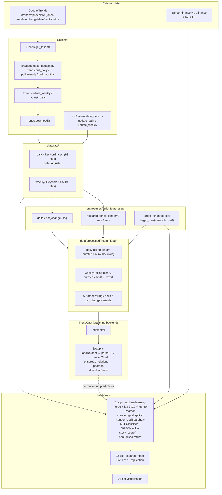
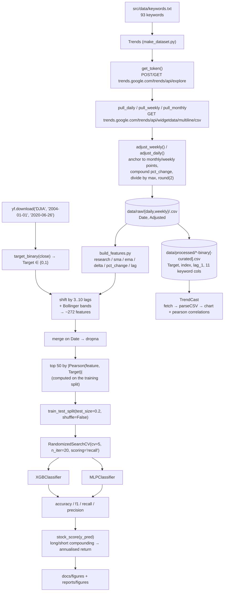

# Architecture — TrendCast: Stock Price Trend Research

## Component map

Four cooperating layers. Only the last one is interactive.

1. **Collector** (`src/data/make_dataset.py`) — talks to Google Trends; produces `data/raw/`.
2. **Feature/label library** (`src/features/build_features.py`) — pure functions over pandas Series; produces the engineered matrix.
3. **Notebooks** (`notebooks/`) — merge with `yfinance` DJIA data, train, evaluate, plot. In-memory only; nothing is persisted as a model.
4. **TrendCast** (`index.html`, `css/style.css`, `js/app.js`) — a static browser client over `data/processed/`.



## Data and control flow



**The adjustment step, precisely.** `make_dataset.py` expresses the reconstruction rule as:

```python
new_value = prev_value * (1 + unadjusted.pct_change())
```

Anchoring is what makes a value comparable across windows; the compounding rule is what fills the gaps between anchors; dividing by the series maximum is what puts the result on a 0–1 relative scale. `update_data.py` applies the same compounding rule when extending an existing series.

## Algorithm/model details

**The core signal — `research()` (Preis et al. 2014)**

```
research(series, length=3) = series - series.rolling(length).mean().shift(1)
```

i.e. today's keyword interest minus the moving average of the previous *n* periods. The `.shift(1)` is what makes it usable: it is the deviation from trend known *before* today's observation, so the feature never leaks the current value. A positive value means search interest for the keyword is running above its own recent norm.

**The label — `target_binary(series)`**

The DJIA close series is converted to a percentage change and binarised: `1` when the index rose, `0` when it fell. This is a *direction* target — no magnitude information is modelled.

**The other engineered features**

| Function | Definition | Role |
| --- | --- | --- |
| `sma(series, length=6)` | rolling mean | Trend baseline |
| `ema(series, length=6)` | exponential moving average, `span=length`, `adjust=False` | Faster-reacting trend baseline |
| `delta(series, length=3)` | `series.diff(length)` | Absolute change over *n* periods |
| `pct_change(series, length=3)` | percentage change over *n* periods | Scale-free momentum |
| `lag(series, length=1)` | `series.shift(i)` → `lag_1 … lag_{n-1}` | Lagged copies; the curated CSVs persist `lag_1` |
| `target_bins(series, bins=6)` | quantile bucketing of `pct_change` | Multi-class experiments |

The notebook additionally builds **Bollinger bands** (`rolling(20).mean() ± 2·rolling(20).std()`, plus 1σ and 10/20-day variants) and shifts every base feature by lags **3–10** to compensate for the roughly 3-day publication lag of Google Trends. This yields the ~272 features the upstream README refers to.

**Feature selection**

```python
correlations = np.abs(X_train.corrwith(y_train))
features = list(correlations.sort_values(ascending=False)[0:50].index)
```

The 50 columns with the largest absolute Pearson correlation with the target — computed on the **training split only**, which is the right thing to do.

**Models**

| Model | Search space (notebook) | Optimisation |
| --- | --- | --- |
| `XGBClassifier` | `learning_rate` ∈ {0.1, 0.01, 0.001}, `gamma` ∈ {0.01…2}, `max_depth` ∈ {2, 4, 7, 10}, `colsample_bytree`, `subsample`, `reg_alpha`, `reg_lambda`, `min_child_weight`, `n_estimators` ∈ {100, 250, 500, 1000} | `RandomizedSearchCV(cv=5, n_iter=20, scoring='recall')` |
| `MLPClassifier` | `solver='sgd'`, `max_iter=1000`, `alpha` ∈ `10**-arange(1,10)`, `hidden_layer_sizes` ∈ `arange(10,15)`, `learning_rate_init=0.15`, `momentum` ∈ U(0.8, 1) | `RandomizedSearchCV(cv=5, n_iter=20, scoring='recall')`; a fixed `MLPClassifier(learning_rate_init=0.1, momentum=0.9, max_iter=1000, shuffle=False, random_state=0)` is also evaluated |
| Reference (`02-cpj-research-model.ipynb`) | The original Preis et al. signal | — |

**The trading metric — `stock_score(y_pred)`**

```python
position = 100
for i, p in enumerate(y_pred):
    position *= stock['pct_change'][i] if p == 1 else 1 / stock['pct_change'][i]
ann_return = ((1 + (position - 100) / 100) ** (1 / (len(y_pred) / 365)) - 1) * 100
```

A long/short rule: `1` compounds the index's daily return, `0` compounds its inverse. The annualisation exponent assumes 365 calendar days per year of prediction periods. It ignores transaction costs, slippage and capacity — a limitation, not a modelling choice.

**Validation methodology (and its limit)**

`train_test_split(X, y, test_size=0.2, shuffle=False)` — a single chronological hold-out. There is no walk-forward / rolling re-fit, so the reported metrics come from one period and one split.

## Source inventory

| File | Key symbols | Role |
| --- | --- | --- |
| `src/data/make_dataset.py` | `Trends` (`__init__`, `pull_daily`, `pull_weekly`, `pull_monthly`, `get_token`, `adjust_weekly`, `adjust_daily`, `download`) | The collector. Resets the relative scale across windows and writes the raw CSVs. |
| `src/data/update_data.py` | `main`, `update_daily`, `update_weekly`, `get_token` | Incremental refresh; writes to `data/interim/`. `get_token()` is adapted from Pytrends (Apache-2.0, credited in the docstring). |
| `src/data/keywords.txt` | 93 lines | The keyword universe: `debt`, `color`, `stocks`, … `environment`, `ring`. |
| `src/features/build_features.py` | `research`, `sma`, `ema`, `delta`, `pct_change`, `lag`, `target_binary`, `target_bins` | The feature/label library — the scientific core. |
| `notebooks/01-cpj-machine-learning.ipynb` | `stock_score(y_pred)`; cells building features, lagging, `train_test_split`, `RandomizedSearchCV`, `MLPClassifier`, `XGBClassifier`, metric prints, commented `joblib.dump` | The ML notebook. |
| `notebooks/02-cpj-research-model.ipynb` | Preis et al. replication cells | The strategy notebook. |
| `notebooks/03-cpj-visualisation.ipynb` | plotting cells | Figure generation. |
| `Makefile` | `requirements`, `data`, `clean`, `lint`, `sync_data_to_s3`, `sync_data_from_s3`, `create_environment`, `test_environment` | Orchestration. `BUCKET`/`PROFILE` are the only knobs. No `train` target. |
| `test_environment.py` | `REQUIRED_PYTHON = "python3"`, `main()` | Interpreter sanity check. |
| `setup.py` | `name='src'`, `version='0.1.0'`, `license='MIT'` | Minimal setuptools stub. |
| `data/processed/daily-rolling-binary-curated.csv` | 4,127 rows × 14 cols | The daily dataset the UI loads. |
| `data/processed/weekly-rolling-binary-curated.csv` | 855 rows × 14 cols | The weekly dataset the UI loads. |
| `data/raw/daily/*.csv`, `data/raw/weekly/*.csv` | `Date, Adjusted` | 186 raw keyword series. |
| `index.html` | Trends / Features / Pipeline / Raw keywords tabs, `runCmd` block | The TrendCast markup. |
| `js/app.js` | `DATASETS`, `KEYWORDS`, `FEATURE_FAMILIES`, `parseCSV`, `loadDataset`, `buildDefaultSelection`, `renderChips`, `renderChart`, `renderStats`, `renderPreview`, `pearson`, `ensureCorrelations`, `downloadView` | All client-side behaviour. `pearson()` is a hand-rolled implementation. |
| `.github/workflows/main.yml` | cron `0 8 * * 2-6`, branch `webpage`, `python scripts/script.py` | Scheduled refresh — **references a file that does not exist**. |
| `docs/figures/`, `reports/figures/` | PNGs | Published research figures. |
| `references/*.pdf` | Preis et al.; Can We Predict… | The source papers. |

## Implemented versus proposed

Implemented behavior is limited to the source entry points and code paths described above.

- The source is research-oriented and the UI is static; historical signals do not establish future returns. Avoid look-ahead leakage and never present outputs as investment advice.
