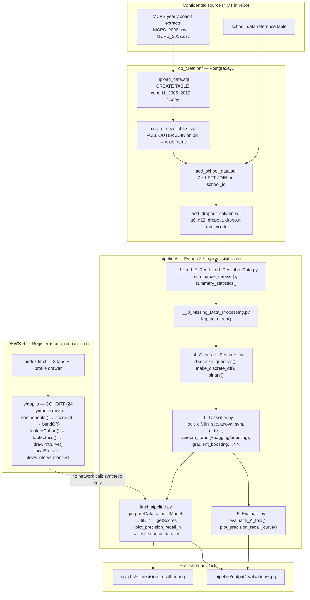

# DEWS: Student Dropout Risk Prediction

## Overview and purpose

student-dropout-risk-prediction "Predicting High School Dropouts" — UChicago Machine Learning in Public Policy course, in partnership with the Center for Data Science in Public Policy Bridgit Donnelly, Christine Cook, Joshua Mausolf (per the module docstrings) DEWS Risk Register (index.html, css/style.css, js/app.js) The U.S. Department of Education estimates that over 1.2 million American students drop out of high school every year, with long-run consequences for employment, health and family stability. School districts have finite advisory capacity and need to know which students to reach first, not merely whether someone is at risk. "Develop a scalable ranking system that will allow a sch

## Real-world context and scope

Predicting high-school drop-out is a classic imbalanced-binary problem embedded in a *resource-allocation* problem. Four aspects make it hard:

1. **The data cannot be published.** The upstream project used Chicago Public Schools (MCPS) student-level records, kept on a secure server. `pipeline/data/Data_Readme.md` states plainly: *"Data for this project was stored in this directory on a secure server. To maintain confidentiality, it is not uploaded here."* Only a school-level reference extract ships.
2. **The outcome is defined by administrative codes, not by a clean event.** A student leaves for many reasons. `db_creation/add_dropout_column.sql` encodes the label as a membership test on withdrawal codes: `g*_wcode IN (30,31,32,33,34,35,36,37,38,39,40,44,46,50,71,85)`, and the overall `dropout` flag is the OR across grades 6–12.
3. **The data is longitudinal and ragged.** Each student appears once per grade in separate yearly tables (`cohort1_2006` … `cohort1_2012`), so the pipeline must join grade 6 to grade 12 on `pid` with a `FULL OUTER JOIN`, then attach school-level context with seven `LEFT JOIN`s — producing rows where later-year fields are missing.
4. **The evaluation question is operational, not statistical.** A model with 95 % accuracy that never fires is useless; a model that fires on everyone is useless too. The meaningful artefact is a **precision@k curve against the share of the population flagged**, because k is set by how many students a school can actually ser

[Excerpt shortened; consult the cited source guide for full detail.]

The material describes the repository as supplied. **Implemented behavior** is summarized from the source overview and entry points; **proposed or missing functionality** is listed separately below. Do not infer production readiness from a polished interface or project title.

### Verified implementation notes

Read PROJECT_OVERVIEW.md in the source repository for the implementation inventory.

### Proposed, absent, or uncertain behavior

- The UI is a demo; the historical pipeline scripts are documented as mostly broken/legacy. Labels are an administrative rule. Risk scores must support voluntary services, not punitive decisions.

## Technology stack

- `See source project dependency manifest and setup guide`

## System requirements and setup

Use a supported Python environment appropriate to the source dependency pins. Some projects also require data files, trained weights, external APIs, cameras, GPU resources, a database, or an LLM runtime. These are identified in `setup-guide.md`; they are not assumed to be included. Follow the source `WORKFLOW.md` carefully and do not paste real credentials into tracked files.

## Architecture and important components

Three layers, only the last of which is interactive. Critically, **there is no arrow from the UI to the pipeline** — the browser layer is a self-contained, explicitly synthetic preview.

## Directory structure

Source paths central to the learning material:

- `PROJECT_OVERVIEW.md`
- `README.md`
- `WORKFLOW.md`
- `db_creation/add_dropout_column.sql`
- `db_creation/add_school_data.sql`
- `db_creation/create_new_tables.sql`
- `db_creation/upload_data.sql`
- `index.html`
- `js/app.js`
- `pipeline/__1_and_2_Read_and_Describe_Data.py`
- `pipeline/__3_Missing_Data_Processing.py`
- `pipeline/__4_Generate_Features.py`
- `pipeline/__5_Classifier.py`
- `pipeline/__5_MCPS_Classifier.py`
- `pipeline/__6_Evaluate.py`
- `pipeline/__6_MCPS__Evaluate.py`
- `pipeline/cook-pipeline-2.py`
- `pipeline/cook-pipeline-3.py`
- `pipeline/cook-pipeline.py`
- `pipeline/final_pipeline.py`
- `pipeline/mcps_pipeline.py`
- `pipeline/pipeline.py`
- `pipeline/precision_recall_population graph.py`
- `project-metadata.json`

## Installation, environment, and database

See [`setup-guide.md`](setup-guide.md) for repository-specific commands, environment variables, optional services, and data/model requirements. Database setup is only applicable when the source workflow documents a database.

## Testing

Use only tests and checks present in the source repository. This learning package has not run the source application or trained a model. Expected test behavior and missing coverage are described in the source workflow and lessons.

## Security, privacy, and responsible use

Treat credentials, uploaded data, biometric data, student/financial records, and generated outputs as sensitive where relevant. Apply data minimization, consent and access controls, retention limits, secure secret handling, documented error handling, and human review. For consequential decisions, model outputs are educational signals only. Project-specific hazards appear in the final project guide and source review report.

## Troubleshooting

Start with missing assets and dependency versions, then validate input shape/schema, check configured API/database/model services, inspect logs, and compare observed behavior with the exact source path described in `architecture.md`. Many repositories contain a static UI or stub that is not wired to the model.

## Expected outcome

Complete the final project to explain and reproduce the repository's actual data-to-output path, demonstrate a tested source-aligned extension, and document its limitations.

## Further learning

See `references.json` for official framework references and the source repository's `PROJECT_OVERVIEW.md`, `WORKFLOW.md`, and README for implementation details.
