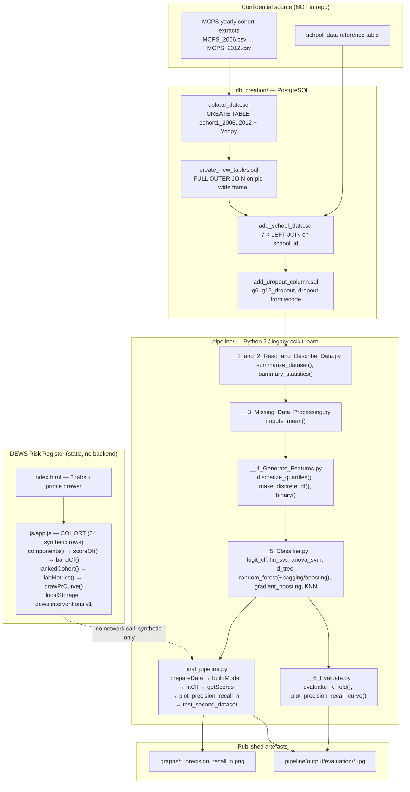
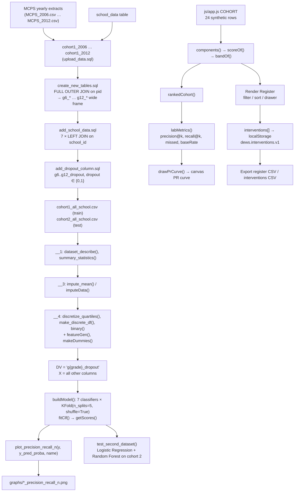

# Architecture — DEWS: Student Dropout Risk Prediction

## Component map

Three layers, only the last of which is interactive. Critically, **there is no arrow from the UI to the pipeline** — the browser layer is a self-contained, explicitly synthetic preview.



## Data and control flow



**The label/data boundary.** Everything above the dashed line is upstream and depends on the withheld MCPS data. Everything below it is the browser preview, which never leaves the page and never touches the pipeline.

## Algorithm/model details

**Label construction (not ML, but the foundation)**

`db_creation/add_dropout_column.sql` defines a student as having dropped out in grade *g* if their withdrawal code for that grade is in a fixed 16-value set; the overall `dropout` flag is the OR across grades 6–12, and any student not matching is set to `0`. This is a **rule-based label**, not an outcome inferred from data — an important point, because it means the "ground truth" is an administrative definition, and the evaluation measures how well features predict that definition.

**Preprocessing**

- `camel_to_snake()` — a two-step regex (`(.)([A-Z][a-z]+)` then `([a-z0-9])([A-Z])`) that turns the raw MCPS headers into snake_case, and the reverse in `__1_and_2_Read_and_Describe_Data.py` for readability. It is re-implemented in five separate modules.
- `impute_mean()` / `imputeData()` — mean imputation. In `buildModel()` the imputation is recomputed **inside each fold** from the training rows only, which is the correct procedure and a genuinely good detail in otherwise legacy code.
- `discretize_quartiles()` — `pd.qcut(..., 4, labels=['1','2','3','4'])`; `binary()` — reverse-coded dummies for a categorical variable.

**Model suite (`buildModel()` in `final_pipeline.py`)**

| Classifier | Configuration | Class-imbalance handling |
| --- | --- | --- |
| Nearest Neighbors | `KNeighborsClassifier(3)` | none |
| Decision Tree | `DecisionTreeClassifier(max_depth=5)` | none |
| Random Forest | `RandomForestClassifier(max_depth=5, n_estimators=10, max_features=1, class_weight={0:1, 1:10})` | class weights 1 : 10 |
| AdaBoost | `AdaBoostClassifier()` | none |
| Bagging | `BaggingClassifier()` | none |
| Logistic Regression | `linear_model.LogisticRegression()` | none |
| SGD | `SGDClassifier(loss="modified_huber", penalty="l2", class_weight={0:1, 1:10})` | class weights 1 : 10 |
| *(also in `__5_Classifier.py`)* | `lin_svc()`, `anova_svm()`, `random_forest_bagging()`, `random_forest_boosting()`, `gradient_boosting()` | — |

The 1:10 class weight is the project’s answer to a roughly 10 % drop-out rate: it buys recall on the positive class at the cost of precision, which is the right trade for a *ranking* system that will be cut off at capacity anyway.

**Validation**

`KFold(len(y), n_folds=5, shuffle=True)` — five **random** folds. `getScores()` then reports accuracy, precision, recall and F1 on the out-of-fold predictions, plus a `Baseline = 1-Mean of DV` reference line so the reader can see whether a model beats "always predict the majority class". `__6_Evaluate.py:evalualte_K_fold()` adds `average_precision` and `roc_auc` to the metric list.

**The evaluation artefact that matters: precision–recall vs. population share**

`plot_precision_recall_n(y_actual, y_prob, model_name)` (and its MCPS twin) plots precision and recall as a function of the fraction of the population flagged. This is the correct framing for the operational question: *given a budget of k outreach slots, how many true cases do I capture and how many false alarms do I generate?* The published PNGs in `graphs/` are exactly these curves for the seven classifiers, and the upstream README names `graphs/` as "the final precision-recall v. population graphs".

**The browser's demo heuristic (not the upstream model)**

```js
var WEIGHTS = { absence: 0.30, gpa: 0.25, credits: 0.25, behavior: 0.20 };
var SCALE  = { absMax: 35, gpaDrop: 1.2, creditGap: 38, behaviorMax: 4 };

components(row) = {
  absence:  clamp(row.absences / 35, 0, 1),
  gpa:      clamp(-row.gpa / 1.2, 0, 1),
  credits:  clamp((100 - row.credits) / 38, 0, 1),
  behavior: clamp(row.behavior / 4, 0, 1)
};
scoreOf(row) = round(100 * Σ weight_i · component_i)
bandOf(score) = score >= 65 ? 'HIGH' : score >= 40 ? 'MED' : 'LOW'
```

Each component is a **min-max normalisation against a fixed demo scale**, then a weighted sum. It is deterministic, transparent, and entirely synthetic — it is a teaching device, not a model.

**The browser's policy-lab metrics**

```js
ranked = COHORT sorted by score desc, absences desc, id asc
k      = max(1, round(n · pct / 100))          // pct from the capacity slider
tp     = Σ outcome over the top k rows
precision = tp / k
recall    = tp / positives
missed    = positives - tp
baseRate  = positives / n
```

The PR series is then the running precision/recall at every cutoff, which `drawPrCurve()` renders on a canvas together with a dashed **baseline** at `baseRate` (the precision of random targeting) and a marker at the current operating point.

## Source inventory

| File | Key symbols | Role |
| --- | --- | --- |
| `db_creation/upload_data.sql` | `CREATE TABLE cohort1_2006` … `cohort1_2012`, `\copy mcps.cohort1_2006 from 'MCPS_2006.csv'` | Schema + bulk load of the raw yearly extracts. |
| `db_creation/create_new_tables.sql` | `CREATE TABLE temp6_7 AS SELECT … FROM cohort1_2006 AS g6 FULL OUTER JOIN cohort1_2007 AS g7 ON g6.pid = g7.pid` | Pivots grade tables into one wide row per student. |
| `db_creation/add_school_data.sql` | 7 × `LEFT JOIN school_data AS g6 ON cohort.g6_school_id = g6.school` | Attaches school-level context per grade. |
| `db_creation/add_dropout_column.sql` | `ADD COLUMN dropout int, g6_dropout … g12_dropout`; `UPDATE … WHERE g*_wcode IN (30,…,85)` | Derives the outcome labels. |
| `db_creation/school_data_small.csv` | `school_data` DDL + one row (`SENECA VALLY HS`, school 104) | Schema reference for the school table. |
| `pipeline/__1_and_2_Read_and_Describe_Data.py` | `camel_to_snake()`, `bar()`, `histogram1()`, `histogram2()`, `line_count()`, `dataset_describe()`, `summarize_dataset()`, `summary_statistics()` | Ingest + exploratory description. |
| `pipeline/__3_Missing_Data_Processing.py` | `camel_to_snake()`, `impute_mean()` | Mean imputation. |
| `pipeline/__4_Generate_Features.py` | `camel_to_snake()`, `discretize_quartiles()`, `make_discrete_df()`, `discretize()`, `binary()` | Quantile binning and dummy encoding. |
| `pipeline/__5_Classifier.py` | `logistic_regression_classifier()`, `logistic_regression_table()`, `logit_clf()`, `Build_Data_Set()`, `lin_svc()`, `anova_svm()`, `d_tree()`, `random_forest()`, `random_forest_bagging()`, `random_forest_boosting()`, `gradient_boosting()`, `KNN()` | The classifier factory (non-final variant). |
| `pipeline/__5_MCPS_Classifier.py` | same family, MCPS cohort | MCPS-specific classifier variants. |
| `pipeline/__6_Evaluate.py` | `plot_precision_recall_curve()`, `evalualte_base_split()`, `evalualte_K_fold()`, `EVAL()`, `classifiers = [...]` | Metric computation, K-fold CV, PR curves. |
| `pipeline/__6_MCPS__Evaluate.py` | `plot_precision_recall_curve()`, `evalualte_base_split()`, `evalualte_K_fold()`, `EVAL()` | MCPS evaluation variant. |
| `pipeline/final_pipeline.py` | `getSumStats()`, `cleanData()`, `makeDummies()`, `limitRows()`, `chooseCols()`, `imputeData()`, `imputeConditionalMean()`, `featureGen()`, `prepareData()`, `buildModel()`, `fitClf()`, `getScores()`, `findMisClf()`, `plot_precision_recall_n()`, `test_second_dataset()` | **The consolidated entry point.** `buildModel()` is the 7-classifier × 5-fold loop; `findMisClf()` builds a mis-classified-student tree. |
| `pipeline/mcps_pipeline.py` | `summarize_data()`, `clean_data()`, `KFold` loop | Earlier MCPS pipeline (Bridgit Donnelly). |
| `pipeline/cook-pipeline.py`, `-2`, `-3` | `getSumStats()`, `cleanData()` | Earlier pipeline versions (Christine Cook). |
| `pipeline/pipeline.py` | shared ML helpers | Earliest pipeline version. |
| `pipeline/precision_recall_population graph.py` | `plot_precision_recall_n(y_true, y_prob, model_name)` | Standalone PR-vs-population plotting. |
| `pipeline/data/Data_Readme.md` | — | States the real data is withheld. |
| `graphs/*.png` | 7 files | Published precision–recall vs. population figures. |
| `index.html` | `panel-register`, `panel-lab`, `panel-pipeline`; `#capSlider`; `#exportRegisterCsv`, `#exportInterventionsCsv`; drawer `#drawer`, `#intervForm` | The DEWS markup. |
| `js/app.js` | `COHORT`, `WEIGHTS`, `SCALE`, `components()`, `scoreOf()`, `bandOf()`, `SUGGESTIONS`, `STORE_KEY`, `renderKpis()`, `visibleRows()`, `renderRegister()`, `initFilters()`, `initExports()`, `openDrawer()`, `renderDrawer()`, `renderHistory()`, `persistInterventions()`, `initInterventionForm()`, `rankedCohort()`, `labMetrics()`, `renderLab()`, `drawPrCurve()`, `initLab()`, `initTabs()`, `initCopy()` | All client behaviour. |
| `css/style.css` | — | UI styling. |

## Implemented versus proposed

Implemented behavior is limited to the source entry points and code paths described above.

- The UI is a demo; the historical pipeline scripts are documented as mostly broken/legacy. Labels are an administrative rule. Risk scores must support voluntary services, not punitive decisions.
