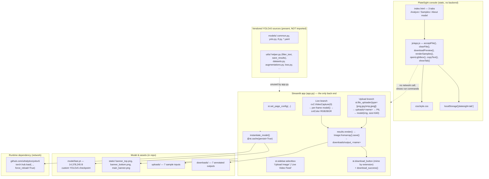

# PlateSight: Vehicle Number Plate Recognition

## Overview and purpose

vehicle-number-plate-recognition "Vehicle Number Plate Recognition" (project-metadata.json → name) PlateSight — ANPR Operator Console Prateek Ralhan (MIT, 2022) An "extended implementation" of mftnakrsu/AutomaticNumberPlateRecognitionYOLOOCR project-metadata.json — "stack": "Python; OpenCV; Tesseract", "goal": "Plate localisation, OCR cleanup with regex and CSV log.", "entry": "app.py", "license": "MIT" Manual plate transcription is slow, error-prone and rarely auditable. Enforcement, parking and access-control operators need plate regions located automatically in a camera or phone image, with an annotated image they can hand on. Detect number-plate regions in vehicle photographs (uploaded f

## Real-world context and scope

Automatic Number Plate Recognition splits into two very different sub-problems, and this repository implements only the first:

1. **Localisation** — "where is the plate in this image?" A detector answers this with bounding boxes. It is a well-posed object-detection problem, and YOLOv5 is a good fit: single-stage, fast enough for CPU-only laptops and low-end servers, and easy to fine-tune on a small custom dataset.
2. **Recognition** — "what characters are on the plate?" That needs OCR: perspective correction, character segmentation and a recogniser, plus the usual cleanup (regex validation of the plate format, country-specific patterns).

The repository's own metadata describes both steps, and it ships an OCR helper module (`utils/helper.py`) with functions whose signatures only make sense for OCR output — `filter_text(rectangle_size, ocr_result, region_threshold)` takes a list of OCR results and keeps the ones whose area exceeds a fraction of the plate rectangle, and `save_results(text, csv_filename, folder_path)` appends recognised text to a CSV log. **Neither function is called by `app.py`.** There is no Tesseract import, no `pytesseract`, no character output. So the honest description of the system is: *a plate-region detector with an annotated-image output, plus the scaffolding of an OCR stage that was never wired up.*

Three further engineering problems are real and visible in the code:

- **Model distribution.** The checkpoint is committed (`model/last.pt`, 14,378,245

[Excerpt shortened; consult the cited source guide for full detail.]

The material describes the repository as supplied. **Implemented behavior** is summarized from the source overview and entry points; **proposed or missing functionality** is listed separately below. Do not infer production readiness from a polished interface or project title.

### Verified implementation notes

Read PROJECT_OVERVIEW.md in the source repository for the implementation inventory.

### Proposed, absent, or uncertain behavior

- The repository includes YOLOv5 code and Streamlit app but model/checkpoint availability and OCR behavior need verification. Plate data is personal information; protect, minimize, and expire it.

## Technology stack

- `altair==4.2.0`
- `argon2-cffi==21.3.0`
- `argon2-cffi-bindings==21.2.0`
- `attrs==21.4.0`
- `backcall==0.2.0`
- `backports.zoneinfo==0.2.1`
- `beautifulsoup4==4.11.1`
- `bleach==5.0.0`
- `blinker==1.4`
- `cachetools==5.0.0`
- `certifi==2021.10.8`
- `cffi==1.15.0`
- `charset-normalizer==2.0.12`
- `click==8.0.4`

## System requirements and setup

Use a supported Python environment appropriate to the source dependency pins. Some projects also require data files, trained weights, external APIs, cameras, GPU resources, a database, or an LLM runtime. These are identified in `setup-guide.md`; they are not assumed to be included. Follow the source `WORKFLOW.md` carefully and do not paste real credentials into tracked files.

## Architecture and important components

The dashed edges are the honest part of the diagram: **the console never calls the app, and the app never imports the vendored YOLOv5 sources.**

## Directory structure

Source paths central to the learning material:

- `.github/FUNDING.yml`
- `.streamlit/config.toml`
- `.streamlit/credentials.toml`
- `PROJECT_OVERVIEW.md`
- `README.md`
- `WORKFLOW.md`
- `app.py`
- `index.html`
- `js/app.js`
- `project-metadata.json`
- `requirements.txt`
- `utils/__init__.py`
- `utils/activations.py`
- `utils/augmentations.py`
- `utils/autoanchor.py`
- `utils/autobatch.py`
- `utils/aws/resume.py`
- `utils/benchmarks.py`
- `utils/callbacks.py`
- `utils/datasets.py`
- `utils/downloads.py`
- `utils/flask_rest_api/README.md`
- `utils/flask_rest_api/example_request.py`
- `utils/flask_rest_api/restapi.py`
- `utils/general.py`
- `utils/google_app_engine/app.yaml`
- `utils/helper.py`
- `utils/loggers/__init__.py`
- `utils/loggers/wandb/README.md`
- `utils/loggers/wandb/log_dataset.py`
- `utils/loggers/wandb/sweep.py`
- `utils/loggers/wandb/sweep.yaml`
- `utils/loggers/wandb/wandb_utils.py`
- `utils/loss.py`
- `utils/metrics.py`
- `utils/params.py`
- `utils/plots.py`
- `utils/torch_utils.py`
- `utils/visual_utils.py`

## Installation, environment, and database

See [`setup-guide.md`](setup-guide.md) for repository-specific commands, environment variables, optional services, and data/model requirements. Database setup is only applicable when the source workflow documents a database.

## Testing

Use only tests and checks present in the source repository. This learning package has not run the source application or trained a model. Expected test behavior and missing coverage are described in the source workflow and lessons.

## Security, privacy, and responsible use

Treat credentials, uploaded data, biometric data, student/financial records, and generated outputs as sensitive where relevant. Apply data minimization, consent and access controls, retention limits, secure secret handling, documented error handling, and human review. For consequential decisions, model outputs are educational signals only. Project-specific hazards appear in the final project guide and source review report.

## Troubleshooting

Start with missing assets and dependency versions, then validate input shape/schema, check configured API/database/model services, inspect logs, and compare observed behavior with the exact source path described in `architecture.md`. Many repositories contain a static UI or stub that is not wired to the model.

## Expected outcome

Complete the final project to explain and reproduce the repository's actual data-to-output path, demonstrate a tested source-aligned extension, and document its limitations.

## Further learning

See `references.json` for official framework references and the source repository's `PROJECT_OVERVIEW.md`, `WORKFLOW.md`, and README for implementation details.
