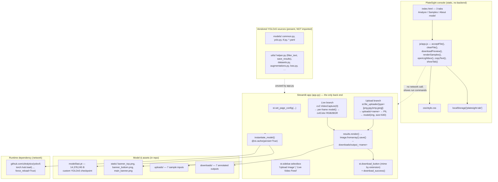
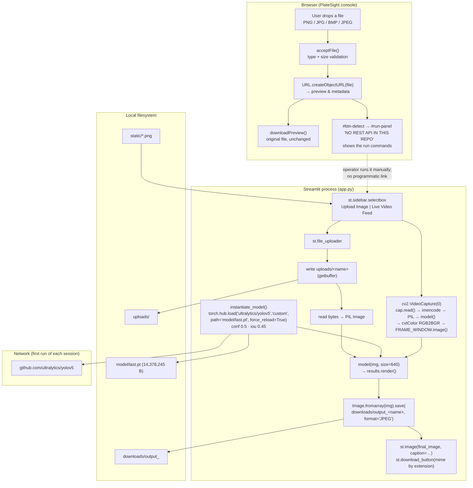

# Architecture — PlateSight: Vehicle Number Plate Recognition

## Component map



The dashed edges are the honest part of the diagram: **the console never calls the app, and the app never imports the vendored YOLOv5 sources.**

## Data and control flow



**Data shapes.** Input: a file of type PNG/JPG/BMP/JPEG, written to `uploads/` and decoded to a PIL RGB image. Intermediate: `results` — a YOLOv5 `Detections` object holding boxes (`xyxy`), confidences, classes and rendered frames (`imgs`). Output: a single annotated image on disk, the same bytes displayed in the app and offered for download. There is no structured output stream anywhere in the pipeline.

## Algorithm/model details

**The model: YOLOv5, single-stage object detection.**

YOLOv5 predicts, in one forward pass, a grid of candidate boxes with class probabilities and objectness scores; non-maximum suppression then removes duplicate boxes. The repository uses the `custom` entry point of the hub repo, which loads a checkpoint whose architecture and class map come from the checkpoint itself:

```python
model = torch.hub.load("ultralytics/yolov5", "custom", path="model/last.pt", force_reload=True)
model.eval()
model.conf = 0.5   # minimum confidence to report a detection
model.iou = 0.45   # NMS IoU threshold
results = model(img, size=640)
```

- **`model.eval()`** switches the network to inference mode (no dropout, frozen batch-norm statistics). It is the correct call for a serving path.
- **`conf = 0.5`** is the score threshold: candidates below 0.5 are discarded before NMS. It is a precision-leaning choice — for plate localisation, a missed plate is worse than a spurious box, so 0.5 is on the conservative side for an operator tool.
- **`iou = 0.45`** is the NMS overlap threshold: two boxes overlapping more than 45 % are treated as the same object. Lower values suppress more aggressively.
- **`size = 640`** is the inference edge length. YOLOv5 letterboxes the input to a multiple of 32, so 640 keeps a native 640×640 training geometry and bounds memory use.
- **`results.render()`** composites the boxes and labels onto the image as a NumPy array; `results.imgs` holds the rendered frames, `results.xyxy` the raw boxes (the console's own "how to script it" snippet in [Usage → D](../vehicle-number-plate-recognition/README.md) shows the `x1, y1, x2, y2, conf, cls` unpacking).

**What is *not* an algorithm here.** There is no training code, no loss function, no augmentation configuration, no data loader pointing at a real dataset, and no evaluation report in this repository — `models/datasets.py` and `models/augmentations.py` are YOLOv5's generic, unconfigured loaders. Consequently, the model's accuracy is **unknown from the repo's evidence**; the seven `downloads/` images are qualitative examples, not a benchmark.

**The OCR stage that was planned but not built.** `utils/helper.py` shows the intended shape of the missing half:

```python
def filter_text(rectangle_size, ocr_result, region_threshold):
    plate = []
    for result in ocr_result:
        length = np.sum(np.subtract(result[0][1], result[0][0]))
        height = np.sum(np.subtract(result[0][2], result[0][1]))
        if length * height / rectangle_size > region_threshold:
            plate.append(result[1])
    return plate

def save_results(text, csv_filename, folder_path):
    with open(csv_filename, mode='a', newline='') as f:
        csv_writer = csv.writer(f, delimiter=',', quotechar='"', quoting=csv.QUOTE_MINIMAL)
        csv_writer.writerow([text])
```

`filter_text()` expects OCR results shaped like `(quadrilateral, text)` — Tesseract's `image_to_data`/`image_to_string` output — and keeps only the text blocks that fill more than `region_threshold` of the plate rectangle, which is the classic fix for stray characters picked up from bolts and badges. `save_results()` appends one recognised string per row to a CSV, which is the "CSV log" the metadata goal describes. Note that `folder_path` is accepted and never used, and the CSV has no header — these are scaffolding, not finished code.

**The console's logic.** `js/app.js` contains no ML at all: it is type validation, blob-URL previewing, a static sample list, and a lightbox. Its "detection" surface is explicitly a set of instructions, which is the correct behaviour for a UI that has no model behind it.

## Source inventory

| File | Key symbols / elements | Role |
| --- | --- | --- |
| `app.py:13-18` | `st.set_page_config(page_title="Auto NPR", page_icon="✨", layout="centered", initial_sidebar_state="expanded")` | Page configuration. |
| `app.py:20-26` | `instantiate_model()` — `@st.cache(persist=True, allow_output_mutation=True, show_spinner=False, suppress_st_warning=True)`; `torch.hub.load(..., force_reload=True)`; `model.eval()`; `model.conf = 0.5`; `model.iou = 0.45` | Cached model construction. **The single most important 7 lines in the project.** |
| `app.py:28-31` | `download_success()` — `st.balloons()`, `st.success('✅ Download Successful !!')` | Post-download feedback (cached, so it fires once per session). |
| `app.py:33-35` | `Image.open('static/banner_top.png' / 'banner_bottom.png' / 'main_banner.png')` | Banner assets, loaded at import time (relative paths ⇒ must run from the project root). |
| `app.py:37-39` | `upload_path = "uploads/"`, `download_path = "downloads/"`, `model = instantiate_model()` | Path constants and model bootstrap. |
| `app.py:44-46` | `st.sidebar.header('Input 🛠')`, `st.sidebar.selectbox(...)` | Mode selection. |
| `app.py:48-50` | `st.info(...)`, `st.file_uploader(..., type=["png","jpg","bmp","jpeg"])` | Upload intake. |
| `app.py:53-57` | `uploaded_file.getbuffer()` write; `os.path.abspath(os.path.join(...))` | Input persistence and path construction. |
| `app.py:62-64` | `Image.open(io.BytesIO(img_bytes))`, `model(img, size=640)`, `results.render()` | Inference and annotation. |
| `app.py:65-72` | `Image.fromarray(img).save(downloaded_image, format="JPEG")`, `print("Opening ", final_image)`, `st.image(final_image, caption=...)` | Output persistence and display. |
| `app.py:73-106` | four `st.download_button` blocks (`.jpg`, `.jpeg`, `.png`, `.bmp`) with matching `mime` values | Download UX; note the extension-conditioned rendering. |
| `app.py:108-109` | `st.warning('⚠ Please upload your Image 😯')` | Empty-state handling. |
| `app.py:112-137` | `cv2.VideoCapture(0)`, `cap.read()`, `cv2.imencode('.jpg', frame)`, `model(img, size=640)`, `results.print()`, `np.squeeze(results.render())`, `cv2.cvtColor(..., cv2.COLOR_RGB2BGR)`, `FRAME_WINDOW.image(frame)`, `cap.release()`, `cv2.destroyAllWindows()` | Live-feed branch. |
| `app.py:139` | `st.markdown("… Made with ❤️ by Prateek Ralhan …", unsafe_allow_html=True)` | Attribution footer. |
| `index.html` | `#tab-analyze` / `#tab-samples` / `#tab-about`; `#dropzone`, `#file-input`, `#meta-name/#meta-size/#meta-type`; `#btn-detect`, `#btn-download-preview`, `#btn-clear`; `#run-panel`, `#result-skeleton`; `#sample-grid`; `#lightbox`, `#lb-prev/#lb-next/#lb-close`; `#toast` | PlateSight markup; the status strip states the real weights size, conf, IoU and infer size. |
| `js/app.js` | `SAMPLES[]` (7), `ACCEPTED`, `ACCEPTED_EXT`, `state`, `toast()`, `copyText()`, `formatBytes()`, `showTab()`, `initTabs()`, `showError()`, `extensionOf()`, `acceptFile()`, `clearFile()`, `downloadPreview()`, `initIntake()`, `renderSamples()`, `openLightbox()`, `updateLightbox()`, `closeLightbox()`, `stepLightbox()`, `initLightbox()`, `init()` | All console behaviour; ES5-style, no framework, no build step. |
| `css/style.css` | — | Console styling. |
| `utils/helper.py` | `filter_text(rectangle_size, ocr_result, region_threshold)`, `save_results(text, csv_filename, folder_path)` | OCR-stage helpers — **not imported by `app.py`**. |
| `models/` | `common.py`, `yolo.py`, `experimental.py`, `tf.py`, `yolov5{n,s,m,l,x}.yaml` | Vendored YOLOv5 sources — **not imported by `app.py`**. |
| `model/last.pt` | — | Custom YOLOv5 checkpoint (14,378,245 bytes). |
| `requirements.txt` | — | Full pinned freeze: `torch==1.8.1`, `torchvision==0.9.1`, `streamlit==1.9.0`, `opencv-python==4.5.5.64`, `Pillow==9.1.0`, `numpy==1.21.6`, `pandas==1.3.5`, `matplotlib==3.5.2`, `scipy==1.7.3`, `Flask==2.1.2`, `pywin32==304`, `pywinpty==2.0.5` + Jupyter stack. |
| `Dockerfile` | `FROM python:3.7`, `virtualenv`, `WORKDIR /app`, `ADD . /app`, `pip install -r requirements.txt`, `ENV PORT 8501`, `CMD ["streamlit","run","app.py"]` | Container image. |
| `Procfile` | `web: sh setup.sh && streamlit run app.py` | Heroku-styl

[Excerpt shortened; consult the cited source guide for full detail.]

## Implemented versus proposed

Implemented behavior is limited to the source entry points and code paths described above.

- The repository includes YOLOv5 code and Streamlit app but model/checkpoint availability and OCR behavior need verification. Plate data is personal information; protect, minimize, and expire it.
